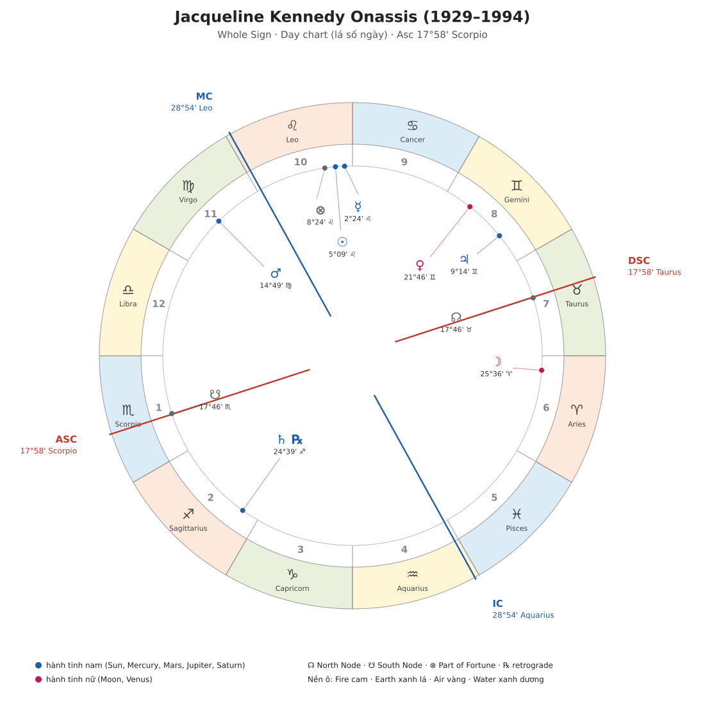
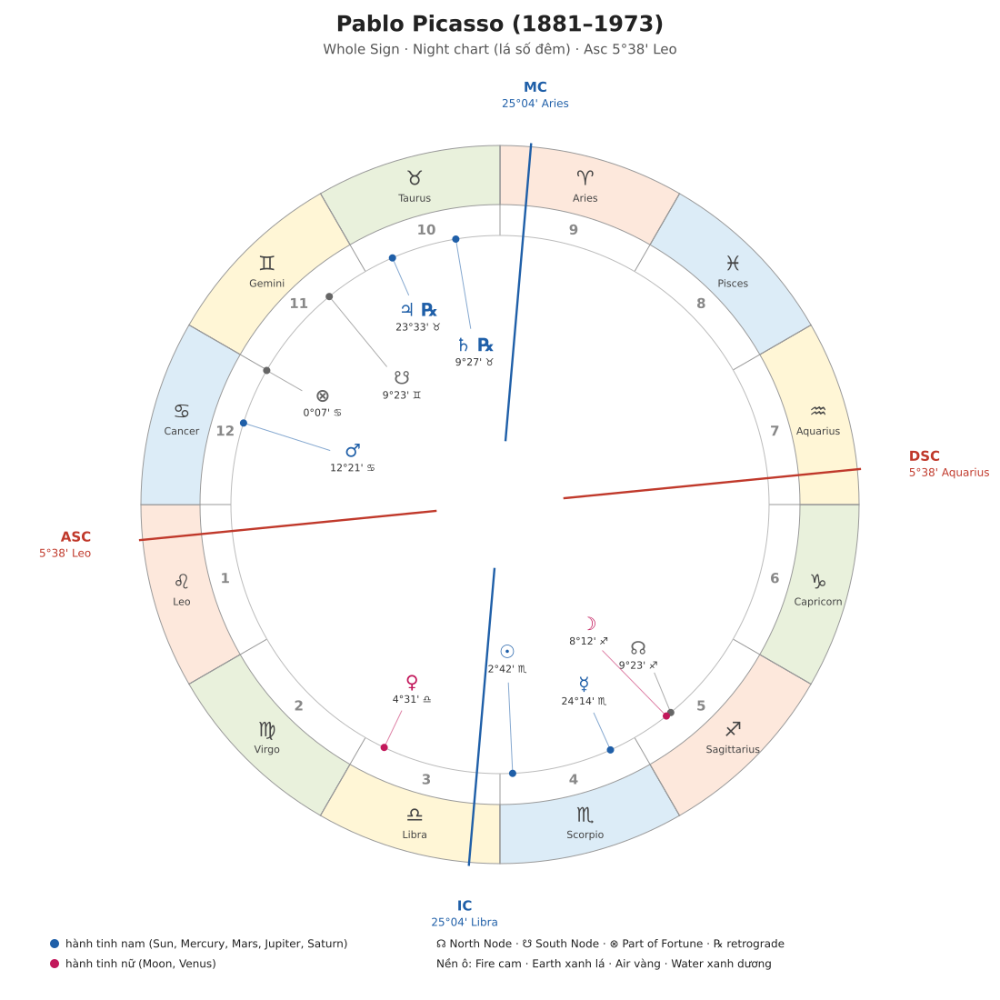
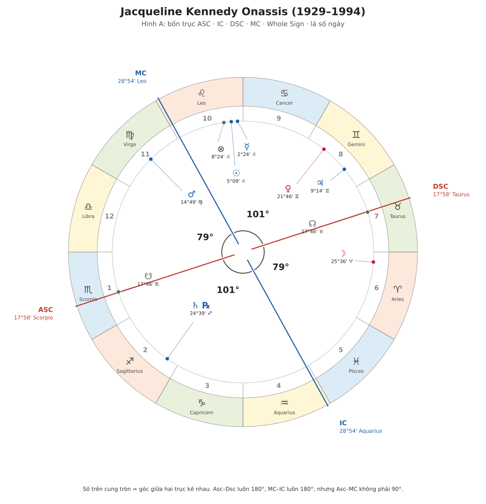
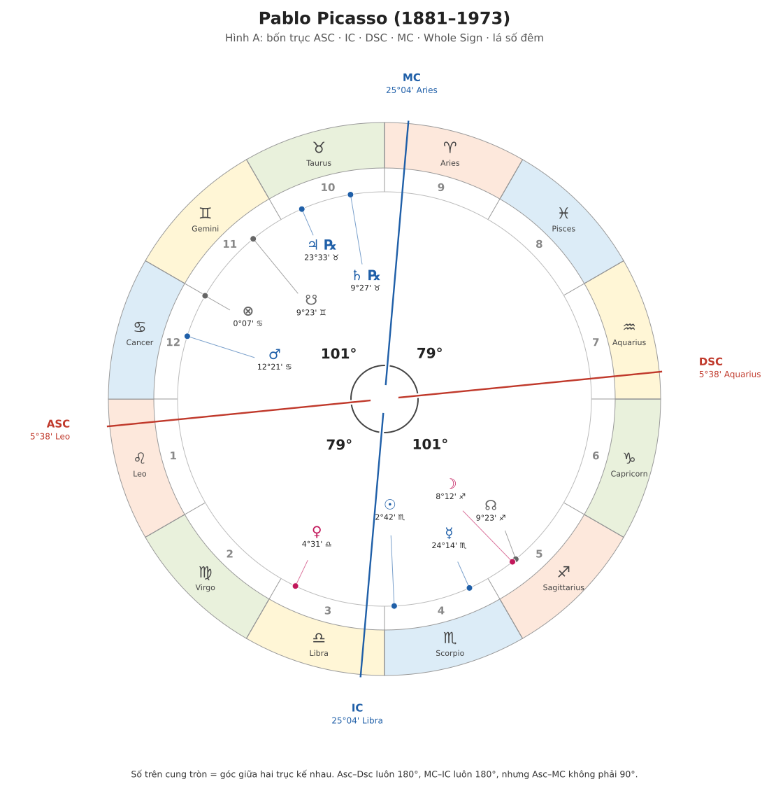
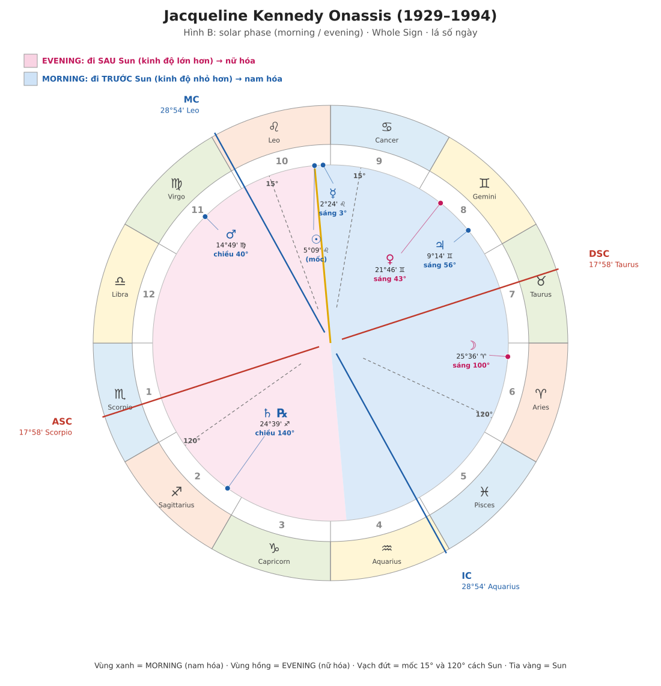
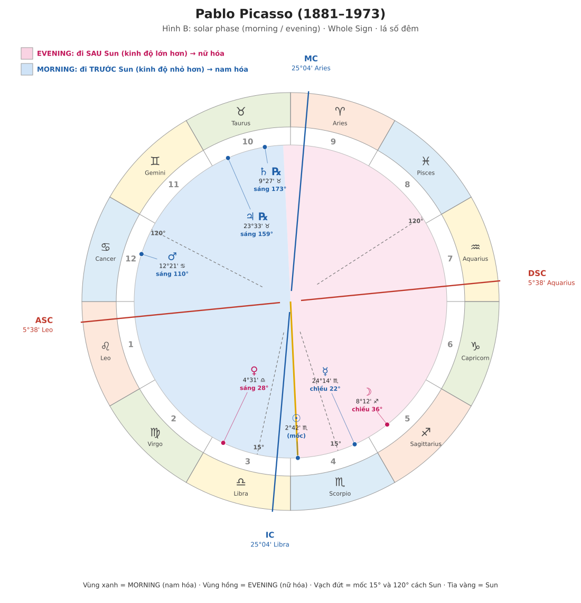
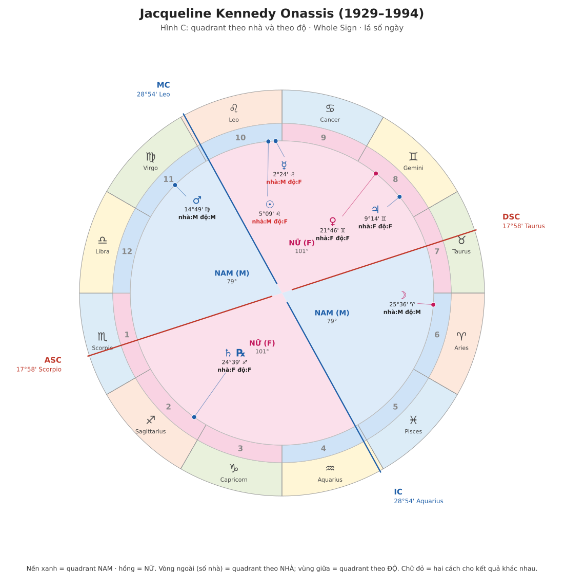
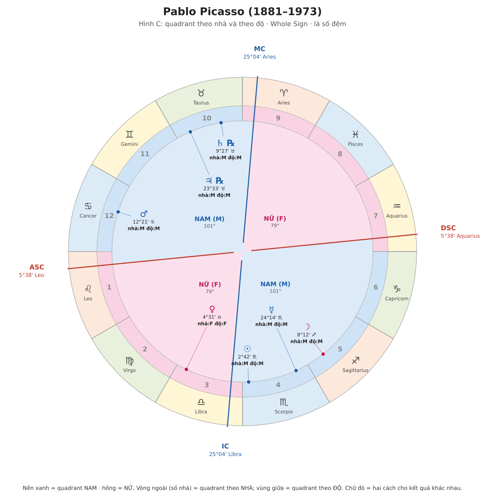

# Example Charts: Jacqueline Kennedy Onassis và Pablo Picasso
*(Demetra George, Ancient Astrology in Theory and Practice Vol. I, trang 67, Figure 7 và 8. Ngay sau Chương 5 "Gender of the Planets")*

Quy ước: **[Sách]** = nội dung có trong trang sách. **[Bổ sung]** = mình tự tính, diễn giải hoặc lấy từ các note trước. Phần [Bổ sung] không phải lời tác giả, hãy đối chiếu lại với sách.

---

## 0. Tóm tắt nhanh

- Trang này là **ví dụ áp dụng Chương 5**. Trong trang này sách chỉ bình luận về **giới tính của cung (sign)**. [Bổ sung] Mình đoán lý do là cung được coi là điều kiện quan trọng nhất trong 4 điều kiện của Chương 5.
- **Jackie** có 3 trong 7 hành tinh "ngược giới tính với cung". Đó là Moon, Venus (nữ trong cung nam) và Mars (nam trong cung nữ).
- **Picasso** có **cả 7 hành tinh** nằm trong cung ngược giới tính tự nhiên. Đây là điểm sách nhấn mạnh.
- Sách nói hai lá số này sẽ được dùng xuyên suốt phần còn lại của cuốn sách.
- Mình dùng **whole sign** như đã thống nhất, và sách cũng ghi rõ "Geocentric, Tropical, Whole Sign, True Node" ở caption.

---

## 1. Dịch đoạn sách (trang 67)

**[Sách] Jackie Kennedy Onassis**
- Sun (nam) ở Leo (cung nam). Moon (nữ) ở Aries (cung nam).
- Mercury ở **morning phase** trong Leo.
- Venus (nữ) ở Gemini (cung nam). Mars (nam) ở Virgo (cung nữ). Jupiter (nam) ở Gemini (cung nam). Saturn (nam) ở Sagittarius (cung nam).
- Hai hành tinh nữ đều ở cung nam. Điều này đẩy họ về phía **hoạt động nhiều hơn**, có thể đến mức căng thẳng vì làm quá sức, hoặc khó bộc lộ sự mong manh và khó nhận giúp đỡ.
- Mars ở Virgo (cung nữ) thì xung lực bốc đồng của Mars bị **làm chậm lại bằng sự phân biệt, phân tích**.

**[Sách] Picasso**
- Mọi hành tinh đều nằm trong cung **đối lập với giới tính tự nhiên** của nó.
- Gợi ý một sự **khó chịu về năng lượng ngay trong chính cơ thể mình**: được bảo "đi chậm" khi xung lực là nhanh, và ngược lại.
- Cũng có thể chỉ một cách biểu đạt giới tính **không phân cực thành khuôn mẫu nam/nữ**.

> Lưu ý: đây là bản dịch ý của mình, không phải bản dịch từng chữ.

---

## 2. Hai lá số vẽ lại (whole sign)

### Figure 7. Jacqueline Kennedy Onassis

Dữ liệu đọc từ hình: Asc 17°58' Scorpio, MC 28°54' Leo. **Lá số ngày** (Sun ở nhà 10, trên đường chân trời).

### Figure 8. Pablo Picasso

Dữ liệu đọc từ hình: Asc 5°38' Leo, MC 25°04' Aries. **Lá số đêm** (Sun ở nhà 4, dưới đường chân trời).

### Cách đọc hình
- Nhà 1 bắt đầu ở bên trái, các nhà (1 → 12) đi **ngược chiều kim đồng hồ**. Mỗi nhà là cả một cung (whole sign). Đường **Asc nằm bên trong nhà 1** (không nằm ở ranh giới), đúng theo vị trí độ thật.
- Chấm màu là **vị trí thật** trên vòng tròn. Chữ là nhãn, được đẩy ra một chút cho khỏi chồng nhau, nối bằng đường mảnh.
- ℞ = retrograde. ☊/☋ = nút Bắc/Nam. ⊗ = Part of Fortune.
- **[Bổ sung] Lưu ý whole sign:** MC không nằm ở "đầu nhà 10". Ở Picasso, **MC 25° Aries nằm trong nhà 9**, còn nhà 10 là cả cung Taurus. Ở Jackie, MC rơi vào nhà 10 (Leo). Đây chính là điều mình đã giải thích ở note về cusp: trục Asc/MC nằm *bên trong* nhà chứ không phải ranh giới nhà.

Kiểm tra số liệu: Part of Fortune mình tính ra khớp với sách (Jackie 8°25' Leo vs sách 8°24'; Picasso 0°08' Cancer vs sách 0°07'). Chênh 1' là do làm tròn. Điều này cho thấy dữ liệu mình đọc từ hình khá chắc.

---

## 2b. Ba khái niệm đọc hình: trục, morning/evening, quadrant

### (1) Vì sao ASC–DSC và MC–IC không vuông góc?
- ASC–DSC luôn thẳng hàng (180°). MC–IC cũng vậy.
- **ASC–MC không bắt buộc là 90°.** Đường chân trời và đường kinh tuyến vuông góc nhau trên bầu trời, nhưng vòng hoàng đạo nghiêng khoảng 23° nên khi trải thành vòng tròn 360°, khoảng cách ASC–MC thay đổi theo giờ và nơi sinh. Đây là bình thường, không phải lỗi vẽ.
- Kennedy: 4 khoảng giữa các trục là 101° / 79° / 101° / 79°. Picasso: 79° / 101° / 79° / 101°.

**Kennedy: Hình A**

**Picasso: Hình A**

### (2) Morning / evening
So từng hành tinh với **Sun** trên vòng hoàng đạo:
- **Morning** = kinh độ **nhỏ hơn** Sun (tối đa 180°). Hành tinh mọc **trước** Sun, thấy trước bình minh. Vùng **xanh** trong hình, **nam hóa**.
- **Evening** = kinh độ **lớn hơn** Sun. Hành tinh mọc **sau** Sun, thấy lúc chiều tối. Vùng **hồng**, **nữ hóa**.
- Vạch đứt = mốc **15°** và **120°** cách Sun (phần tinh chỉnh nâng cao của sách). Quy tắc cơ bản chỉ cần xem hành tinh ở bên xanh hay bên hồng.

| Kennedy | Phase | Picasso | Phase |
|---|---|---|---|
| Mercury | morning 3° | Venus | morning 28° |
| Venus | morning 43° | Mars | morning 110° |
| Jupiter | morning 56° | Jupiter ℞ | morning 159° (ngoài 120°) |
| Moon | morning 100° | Saturn ℞ | morning 173° (ngoài 120°) |
| Mars | evening 40° | Mercury | evening 22° |
| Saturn ℞ | evening 140° (ngoài 120°) | Moon | evening 36° |

Mercury của Kennedy cách Sun chỉ 3° nhưng vẫn ở bên xanh, nên sách gọi là "morning-phase Mercury". Với Picasso, Saturn cách Sun 173°, chỉ cách ranh giới xanh/hồng khoảng 7° nhưng vẫn thuộc morning. Jupiter và Saturn của Picasso đều retrograde, điều bình thường khi hành tinh ở gần đối diện Sun.

**Kennedy: Hình B**

**Picasso: Hình B**

### (3) Quadrant "theo nhà" và "theo độ"
Hai trục chia lá số thành 4 góc phần tư. Theo sách (Bảng 7): ASC→MC và DSC→IC là **nam**, MC→DSC và IC→ASC là **nữ**. Có hai cách xác định hành tinh nằm ở quadrant nào:
- **Theo nhà (vòng số nhà ngoài cùng):** nhà 10–12 và 4–6 là nam, nhà 1–3 và 7–9 là nữ. Mỗi quadrant đúng 90°.
- **Theo độ (vùng tô bên trong):** dùng chính đường ASC/MC/DSC/IC thật làm ranh giới nên quadrant rộng 79° hoặc 101°. Paulus dùng cách này. Sách nói chưa rõ nên chọn cách nào.

Hai cách chỉ khác nhau với hành tinh nằm gần trục:
- **Kennedy:** Sun ở nhà 10 (nam theo nhà) nhưng đã vượt MC khoảng 24° nên theo độ thuộc quadrant nữ. Mercury cũng vậy. Hai hành tinh này có chữ đỏ trong Hình C.
- **Picasso:** hai cách cho kết quả giống nhau ở cả 7 hành tinh. Venus ở quadrant nữ (nhà 3), sáu hành tinh còn lại ở quadrant nam. Sun cách IC khoảng 7.6° nhưng vẫn cùng quadrant với nhà 4.

**Kennedy: Hình C**

**Picasso: Hình C**

---

## 3. Bảng dữ kiện (đã tính)

Cách đọc cột:
- **Cung gender**: cung lửa/khí là nam (M), đất/nước là nữ (F).
- **Phase**: *morning* = đi trước Sun (kinh độ nhỏ hơn Sun), *evening* = đi sau Sun. Số trong ngoặc là số độ cách Sun.
- **Quadrant nhà / độ**: quadrant theo nhà whole sign, và quadrant theo độ chính xác (sách nói chưa rõ nên dùng cách nào, Paulus dùng độ).
- Cột latitude **bỏ trống**: hình không cho vĩ độ thiên cầu (celestial latitude), nên điều kiện thứ 4 không đánh giá được.

### Jackie (lá số ngày)

| Hành tinh | Vị trí | Nhà | Giới tính tự nhiên | Cung | Phase | Quadrant nhà / độ |
|---|---|---|---|---|---|---|
| Sun ☉ | 5°09' Leo | 10 | M | M | (mốc) | M / **F** |
| Moon ☽ | 25°36' Aries | 6 | **F** | M | morning (99.6°) | M / M |
| Mercury ☿ | 2°24' Leo | 10 | M (common) | M | morning (2.8°) | M / **F** |
| Venus ♀ | 21°46' Gemini | 8 | **F** | M | morning (43.4°) | F / F |
| Mars ♂ | 14°49' Virgo | 11 | M | **F** | evening (39.7°) | M / M |
| Jupiter ♃ | 9°14' Gemini | 8 | M | M | morning (55.9°) | F / F |
| Saturn ♄ ℞ | 24°39' Sagittarius | 2 | M | M | evening (139.5°) | F / F |

### Picasso (lá số đêm)

| Hành tinh | Vị trí | Nhà | Giới tính tự nhiên | Cung | Phase | Quadrant nhà / độ |
|---|---|---|---|---|---|---|
| Sun ☉ | 2°42' Scorpio | 4 | M | **F** | (mốc) | M / M |
| Moon ☽ | 8°12' Sagittarius | 5 | **F** | M | evening (35.5°) | M / M |
| Mercury ☿ | 24°14' Scorpio | 4 | M (common) | **F** | evening (21.5°) | M / M |
| Venus ♀ | 4°31' Libra | 3 | **F** | M | morning (28.2°) | F / F |
| Mars ♂ | 12°21' Cancer | 12 | M | **F** | morning (110.3°) | M / M |
| Jupiter ♃ ℞ | 23°33' Taurus | 10 | M | **F** | morning (159.1°) | M / M |
| Saturn ♄ ℞ | 9°27' Taurus | 10 | M | **F** | morning (173.2°) | M / M |

In đậm ở cột "Cung" nghĩa là **cung ngược giới tính tự nhiên**. Đếm nhanh: Jackie 3/7, Picasso 7/7.

---

## 4. Vì sao có chỗ M/F khác nhau giữa "nhà" và "độ"?

Ví dụ **Sun của Jackie**: ở cung Leo, cả cung này là nhà 10. Whole sign xếp nó vào quadrant nam (Asc → MC). Nhưng MC ở 28°54' Leo còn Sun ở 5°09' Leo, tức Sun **đã qua đỉnh trời ~24°**, nên theo độ chính xác nó đã sang quadrant nữ (MC → Dsc).

→ Đây chính là chỗ sách nói "chưa rõ dùng whole sign hay độ". Hai cách cho kết quả khác nhau ở những hành tinh nằm gần trục. Với hai lá số này, Sun và Mercury của Jackie là hai trường hợp như vậy. Mình giữ cả hai cột để bạn thấy.

---

## 5. Đọc giới tính từng hành tinh (áp dụng Bảng 7 và 8)

**[Bổ sung] Cách làm của mình, không phải công thức của sách.** Sách không cho công thức cộng điểm. Mình chỉ đếm xem mỗi điều kiện đẩy về nam (+) hay nữ (−), rồi nhớ rằng **cung là điều kiện quan trọng nhất**. Kết quả là gợi ý, không phải đáp án chuẩn.

### Jackie

| Hành tinh | Cung | Phase | Quadrant (nhà/độ) | Đọc ra |
|---|---|---|---|---|
| Sun (M) | + | – | + / − | **Nam**, quadrant ở rìa |
| Moon (F) | + (nam hóa) | + (morning) | + / + | **Nữ bị nam hóa** (đầu "masculinized feminine") |
| Mercury (M) | + | + | + / − | **Nam** đến rất nam |
| Venus (F) | + (nam hóa) | + (morning) | − / − | **Nữ bị nam hóa**, nhưng quadrant kéo lại |
| Mars (M) | − (nữ hóa) | − (evening) | + / + | **Nam bị nữ hóa**, quadrant giữ lại một phần |
| Jupiter (M) | + | + | − / − | **Nam** |
| Saturn (M) ℞ | + | ? (139.5°, ngoài vùng 15–120°) | − / − | **Nam**, có kéo về phía nữ |

**Điểm đáng chú ý:**
- **Moon và Venus** đều nam hóa. Khớp với câu sách: hai hành tinh nữ cùng bị đẩy về phía hoạt động, nên có xu hướng "làm quá, khó cho mình yếu mềm".
- **Mars** bị cung Virgo nữ hóa và cả phase evening nữ hóa. Khớp với sách: xung lực bị phân tích làm chậm lại.
- Mars còn là **chủ tinh của Asc** (Asc Scorpio, ruler cổ điển là Mars). Một hành tinh quan trọng như vậy đang ở trạng thái "nam bị làm chậm" nên cách diễn đạt bản thân (Asc) mang sắc thái này.

### Picasso

| Hành tinh | Cung | Phase | Quadrant (nhà/độ) | Đọc ra |
|---|---|---|---|---|
| Sun (M) | − (nữ hóa) | – | + / + | **Nam bị nữ hóa** nhẹ (quadrant giữ lại) |
| Moon (F) | + (nam hóa) | − (evening) | + / + | **Nữ bị nam hóa** |
| Mercury (M) | − | − (evening) | + / + | **Nam bị nữ hóa** |
| Venus (F) | + (nam hóa) | + (morning) | − / − | **Nữ bị nam hóa**, quadrant kéo lại |
| Mars (M) | − | + (morning, 110°) | + / + | Nam bị nữ hóa → nam (cung nặng nhất, quadrant + phase kéo ngược) |
| Jupiter (M) ℞ | − | ? (159°, ngoài vùng) | + / + | Nam bị nữ hóa → nam |
| Saturn (M) ℞ | − | ? (173°, ngoài vùng) | + / + | Nam bị nữ hóa → nam |

**Ý nghĩa của "cả 7 đều ngược":**
- Lá số này là một trường hợp **cực đoan về mặt cung**. Mọi hành tinh nam đều ở cung nữ (bị làm chậm/mềm), mọi hành tinh nữ đều ở cung nam (bị đẩy nhanh/cứng).
- Nhưng ở các điều kiện khác (quadrant, phase) vẫn có hành tinh bị kéo ngược lại. Vì vậy, "ngược 100% ở cung" không có nghĩa "ngược 100% ở mọi điều kiện". **[Bổ sung]** Cũng đừng đọc quá lố: tổng thể phụ thuộc cách bạn cân trọng số.
- Sách đề xuất hai cách đọc cùng lúc: một là **cảm giác không thoải mái trong cơ thể/năng lượng** (nhịp nhanh chậm bị ngược), hai là **cách biểu đạt không theo khuôn mẫu nam/nữ**. Hai cách này không loại trừ nhau.

### Hai lá số, hai kiểu "lệch"

| | Jackie | Picasso |
|---|---|---|
| Số hành tinh ngược cung | 3/7 | 7/7 |
| Dạng lệch | Chọn lọc: nữ → nam hóa, một Mars bị làm chậm | Toàn diện, ở cấp cung |
| Sách đọc | Hoạt động quá mức; khó nhận giúp; Mars được phân tích điều tiết | Khó chịu về nhịp năng lượng; không phân cực khuôn mẫu |

---

## 6. Đọc thêm bằng "5 lớp" (celestial condition)

**[Bổ sung] Phần này mình ghép từ các note trước, sách chưa bàn trong trang 67.** Mình chỉ kiểm tra dignity ở mức *domicile, exaltation, detriment, fall*. **Chưa kiểm tra triplicity, bound, decan**, nên "peregrine" ở đây nghĩa là "không có 4 dignity chính", chưa phải kết luận tuyệt đối.

### Jackie (lá số ngày → Sun, Jupiter, Saturn đúng sect; Moon, Venus, Mars nghịch sect)

- **Sun**: ở **domicile (Leo)**, nhà 10 (angular; cách MC khoảng 24° theo độ), đúng sect. Hành tinh mạnh nhất lá số. Sun còn là chủ nhà 10.
- **Mercury**: cách Sun chỉ **2.8°**, theo quy tắc cổ điển là **combust/under the beams** (khoảng dưới 8° là thường dùng). Nhưng sách vẫn gọi là "morning phase". Đây là chỗ gender (phase) và dignity (combust) cho hai kiểu thông tin khác nhau.
- **Jupiter** ở Gemini: **detriment**, nhà 8. Jupiter conjunct Venus (cùng cung, orb 12.5°).
- **Mars** (chủ Asc): Virgo, nhà 11, peregrine, **nghịch sect** (Mars là hành tinh của đêm). Bị **square** bởi Venus (orb 7.0°), Jupiter (5.6°) và Saturn (9.8°) theo cung.
- **Saturn ℞** ở Sagittarius, nhà 2. **Opposition Venus** (orb 2.9°, rất sát), opposition Jupiter (orb 15.4°). **Trine Moon** orb chỉ **1.0°** (rất chặt).
- **Moon** ở Aries, nhà 6 (cadent), sextile Venus (3.8°), trine Saturn (1.0°).

### Picasso (lá số đêm → Moon, Venus, Mars đúng sect; Sun, Jupiter, Saturn nghịch sect)

- **Venus**: **domicile (Libra)**, đúng sect (đêm). Dignity + sect đều tốt, nhưng ở **nhà 3 (cadent)** nên cách thể hiện kín hơn. Sextile Moon rất chặt (orb 3.7°). Square Mars (7.8°).
- **Mars**: Cancer = **fall**, nhà 12 (cadent), đúng sect. Sextile Saturn (2.9°), sextile Jupiter, trine Sun và Mercury.
- **Sun** ở Scorpio, nhà 4, cách IC khoảng 7.6° (gần như angular theo độ), **nghịch sect**. **Opposition Saturn** (6.8°) và Jupiter (20.9°).
- **Mercury** conjunct Sun theo cung (cùng cung Scorpio, nhưng cách nhau 21.5° nên **không** combust). **Opposition Jupiter orb chỉ 0.7°**, gần như chính xác.
- **Jupiter và Saturn**: cùng ở Taurus, đều **retrograde**, nhà 10 (whole sign), nghịch sect. Chúng nằm gần như đối diện Sun (159° và 173°), nên retrograde là điều bình thường ở khoảng cách này.

> **Thận trọng:** đừng dùng các nhận xét này để "giải thích tiểu sử". Mình nhìn lại cuộc đời một người nổi tiếng rồi tìm dấu hiệu trong lá số thì rất dễ gặp **confirmation bias** (chỉ thấy cái khớp). Sách dùng hai lá số này để **minh họa kỹ thuật**, không phải để chứng minh astrology đúng.

---

## 7. Một điều cần cẩn thận về đạo đức

Chương này nói về "giới tính của hành tinh" (năng lượng nam/nữ theo cách người cổ phân loại). Đây là **khung biểu tượng của astrology**, không phải mô tả giới tính, xu hướng tính dục hay bản dạng giới thật của ai. Sách cũng chỉ nêu khả năng, dùng từ "có thể", và chỉ nói về tông năng lượng. Mình không nên suy ra điều gì về đời tư của Picasso hay Jackie từ bảng này.

---

## 8. Từ vựng

| Anh | Việt gợi ý |
|---|---|
| Example chart | Lá số ví dụ |
| Masculinized feminine | Nữ bị nam hóa |
| Feminized masculine | Nam bị nữ hóa |
| Morning / evening phase | Pha sáng (đi trước Sun) / pha chiều (đi sau Sun) |
| Quadrant | Góc phần tư (của lá số) |
| Combust / under the beams | Bị Sun "đốt" / dưới tia Sun |
| Out of sect | Nghịch sect |
| Chart ruler | Chủ tinh của lá số (ruler của Asc) |

---

## 9. Tự kiểm tra

1. Vì sao Picasso được sách nhấn mạnh là "mọi hành tinh ngược giới tính"? (Gợi ý: đếm Bảng ở mục 3.)
2. Vì sao Sun của Jackie "nam theo nhà" nhưng "nữ theo độ"?
3. Vì sao Mars của Jackie được sách mô tả là "bị làm chậm lại"?
4. Vì sao MC của Picasso nằm ở nhà 9 chứ không phải nhà 10 trong whole sign?

Đáp án gợi ý

1. Cả 5 hành tinh nam (Sun, Mercury, Mars, Jupiter, Saturn) đều ở cung đất/nước, và cả 2 hành tinh nữ (Moon, Venus) đều ở cung lửa/khí.
2. Whole sign xếp theo cả cung (nhà 10 = quadrant nam), còn theo độ thì Sun đã ~24° qua MC nên sang quadrant nữ.
3. Mars (nam, nhanh, bốc đồng) ở Virgo (cung đất, nữ), nên bị "làm mềm" bằng phân tích và thận trọng. Cũng có thêm phase evening nữ hóa.
4. Whole sign gán cả cung Aries (0°–30°) là nhà 9. MC 25° Aries nằm trong cung đó, nên thuộc nhà 9.

---

## 10. Những điểm nên kiểm tra lại

- **Dữ liệu vị trí** mình đọc từ hình. Part of Fortune khớp sách (sai lệch 1') nên khá an tâm, nhưng bạn nên đối chiếu từng hành tinh với hình trong sách.
- **Latitude**: hình không cho, nên điều kiện thứ 4 (nam/nữ theo vĩ độ) **chưa đánh giá**.
- **Mercury của Jackie** cách Sun 2.8°: sách gọi "morning phase". Quy tắc "15–120° mới tính" chỉ là phần nâng cao trong chương. **Phần cơ bản áp dụng cho mọi hành tinh đi trước Sun.** Note Part 2 đã được chỉnh lại cho khớp.
- **Dignity** mới kiểm tra 4 mức chính, chưa tính triplicity/bound/decan.
- **Cột "đọc ra" ở mục 5** là cách cân của mình, sách chưa có công thức.
- **Aspect ở mục 6** xác định theo cung (whole sign: cách 2, 3, 4, 6 cung), còn "orb" là độ lệch thực so với góc chuẩn. Hai thứ này là hai phép tính khác nhau; mình ghi cả hai.
