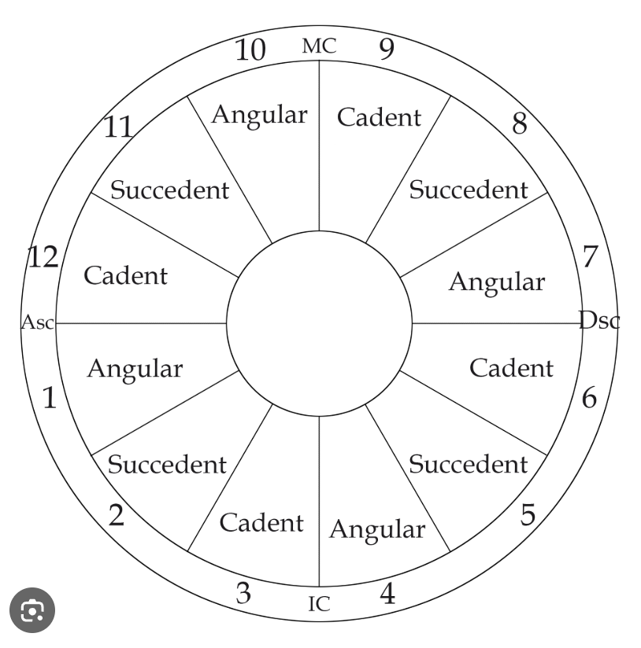

# Nhà góc, nhà kế, nhà cuối (Angular, Succedent, Cadent)

◼ NHÀ GÓC (ANGULAR HOUSE) – 1, 4, 7, 10
Các Nhà góc trong biểu đồ sinh của bạn nổi bật trong việc hướng đến hành động, vì chúng là Nhà chủ của các cung Tiên phong (Bạch Dương, Cự Giải, Thiên Bình và Ma Kết). Nếu nhiều hành tinh trong biểu đồ sinh của bạn rơi vào các Nhà này, bạn là người trội Nhà góc, được biết đến với khả năng khởi xướng, dẫn dắt và bắt đầu mọi việc.
◼ NHÀ KẾ (SUCCEDENT HOUSE) – 2, 5, 8, 11
Các Nhà kế trong biểu đồ sinh của bạn nổi bật với tính kiên định và vững vàng, vì chúng là Nhà chủ của các cung Kiên định (Kim Ngưu, Sư Tử, Bọ Cạp và Bảo Bình). Nếu nhiều hành tinh trong biểu đồ sinh của bạn rơi vào các Nhà này, bạn là người trội Nhà kế, được biết đến với tính cách ổn định, đáng tin cậy. Khi đã nhận trách nhiệm, bạn sẽ toàn tâm toàn ý với nó và luôn biết cách hoàn thành công việc.
◼ NHÀ CUỐI (CADENT HOUSE) – 3, 6, 9, 12
Các Nhà cuối trong biểu đồ sinh của bạn nổi bật với tính linh hoạt và dễ thích nghi, vì chúng là Nhà chủ của các cung Linh hoạt (Song Tử, Xử Nữ, Nhân Mã và Song Ngư). Nếu nhiều hành tinh trong biểu đồ sinh của bạn rơi vào các Nhà này, bạn là người trội Nhà cuối, được biết đến với khả năng thích nghi nhanh chóng, cởi mở với những thay đổi và luôn luôn trong trạng thái hoạt động.

Gần đúng, nhưng có ba chỗ nên chỉnh lại cho chính xác.

## 1. Angular không đồng nghĩa với "tốt"

Angular chỉ làm hành tinh biểu hiện **nhiều và rõ**. Tốt hay xấu vẫn do dignity và condition quyết định. Ví dụ:

| | Sun condition tốt (ví dụ ở Leo) | Sun condition xấu (ví dụ ở Libra, fall) |
|---|---|---|
| Angular | Tỏa sáng rõ, được công nhận ngay | Cái yếu cũng lộ rõ, khó giấu |
| Cadent | Vẫn tốt nhưng kín đáo, ít người thấy | Vấn đề có nhưng ít bộc lộ |

Nên cách nói chính xác là: angular là **khuếch đại** (cả mặt tốt lẫn mặt xấu), cadent là **thu nhỏ**.

## 2. Đừng gọi là "sức mạnh còn 20%"

Bài viết nói:
- Angular: khoảng 100%
- Succedent: khoảng 50–75%
- Cadent: khoảng 25–50%

Đây là hình ảnh ví von về "âm lượng" của tác giả bài, không phải số đo thật, và cadent là 25–50% chứ không phải 20%. Bạn đừng dùng con số này khi nói với khách. Chỉ nên nói "ít biểu hiện hơn, kín đáo hơn".

## 3. Nó đo "lượng biểu hiện", không phải "sức mạnh bên trong"

Bài phân biệt rõ:
- Dignity (sign, phase, aspect) quyết định **chất lượng**.
- Angularity (house) quyết định **số lượng**.

Sun ở cadent không phải bị "yếu đi bản chất", mà là nó ít có dịp thể hiện ra bên ngoài. Giống một người giỏi nhưng ngồi ở góc phòng họp: năng lực vẫn còn, chỉ là ít được nghe thấy.

## Câu tóm gọn để bạn ghi vào note

Hành tinh ở angular thì hoạt động nhiều, rõ, dễ thấy nhất (khuếch đại cả tốt lẫn xấu). Ở succedent thì mức vừa. Ở cadent thì kín đáo, ít biểu hiện. Chất lượng tốt/xấu vẫn do dignity quyết định.

Bạn muốn mình gom lại thành `note_7.md` luôn không?