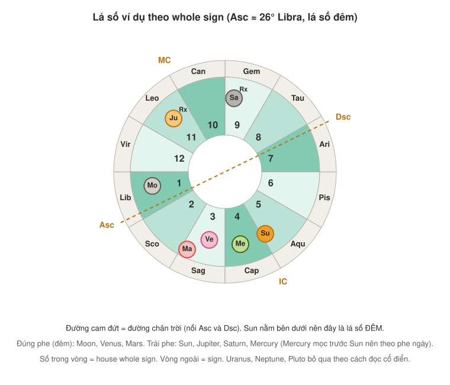
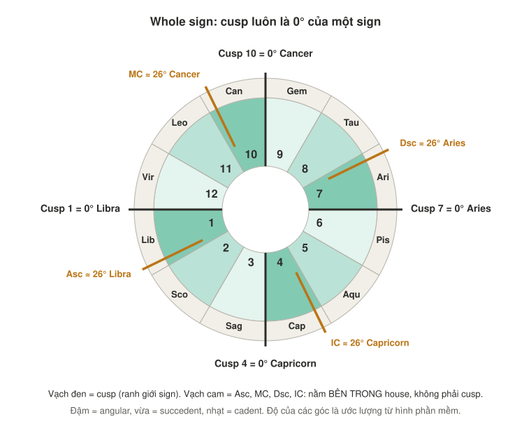
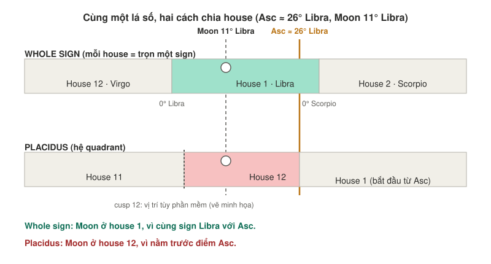
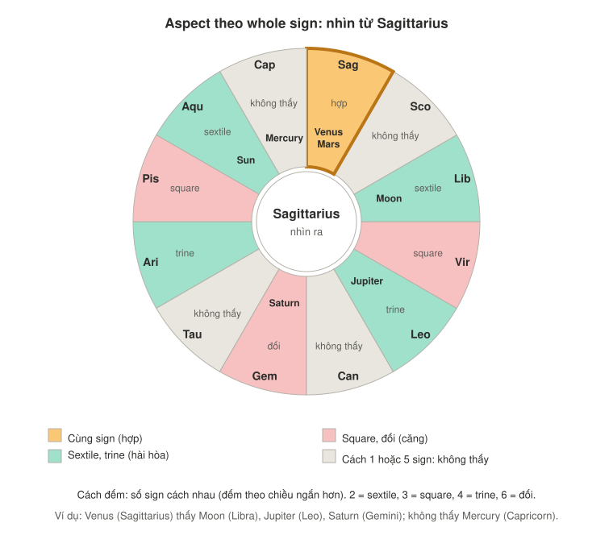
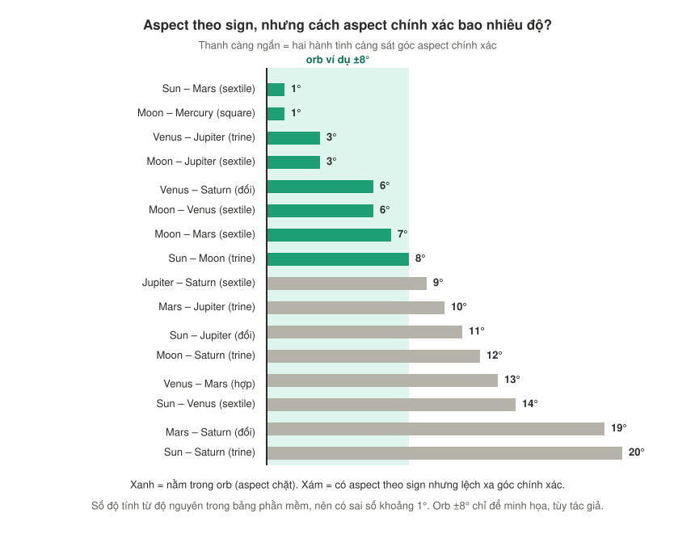

# Note 8: House system (whole sign vs Placidus) và Aspect

> **[Sách]** = có trong các trang sách đã đọc. **[Bổ sung]** = kiến thức traditional astrology nói chung, nên đối chiếu khi sách dạy tới.
> Các hình nằm trong thư mục `images/`. Độ của Asc, MC, Dsc, IC trong hình là **ước lượng từ ảnh phần mềm**, không phải số chính xác.

---

## Tóm tắt nhanh

1. **Cusp** = điểm bắt đầu của một house. Whole sign: cusp luôn là 0° của một sign. Placidus: cusp nằm ở những độ lẻ.
2. Cùng một lá số, hai hệ cho **house khác nhau**, nên chủ đề đọc ra khác nhau.
3. **Aspect giữa hai hành tinh không phụ thuộc hệ house.** Nhưng có hai cách tính aspe◊◊ct: theo sign và theo độ (orb).
4. Mặc định trong các note này: **whole sign**, vì sách của Demetra George dùng whole sign.

---

## 1. Lá số ví dụ (viết lại theo whole sign)

Asc ≈ 26° Libra, nên **Libra là house 1**. Chart ruler là Venus. Sun nằm dưới đường chân trời nên đây là **lá số đêm**.

| Hành tinh | Sign và độ | House (phần mềm, Placidus) | House (whole sign) | Phe |
|---|---|---|---|---|
| Sun | 3° Aquarius | 4 | **5** | Trái phe |
| Moon | 11° Libra | 12 | **1** | Đúng phe |
| Mercury | 12° Capricorn | 3 | **4** | Trái phe (mọc trước Sun 21° nên theo phe ngày) |
| Venus | 17° Sagittarius | 2 | **3** | Đúng phe |
| Mars | 4° Sagittarius | 2 | **3** | Đúng phe |
| Jupiter (Rx) | 14° Leo | 10 | **11** | Trái phe |
| Saturn (Rx) | 23° Gemini | 8 | **9** | Trái phe |

Uranus, Neptune, Pluto bỏ qua theo cách đọc cổ điển.

---

## 2. Cusp là gì

Cusp nghĩa đen là "đỉnh, mũi nhọn", ở đây là **điểm bắt đầu của một house**.

| | Placidus (và các hệ quadrant) | Whole sign |
|---|---|---|
| Cusp nằm ở đâu | Một độ cụ thể tính từ giờ và nơi sinh (ví dụ 17° Gemini) | Luôn là **0° của một sign** |
| Độ lớn mỗi house | Không đều nhau | Đúng 30° |
| Cusp của house 1 | Chính là độ của Asc | **Không phải Asc**, mà là 0° của sign chứa Asc |

**Điều dễ nhầm:** trong whole sign, Asc, MC, Dsc, IC vẫn có độ riêng, nhưng chúng **nằm bên trong house**, không phải cusp. Ví dụ Asc ≈ 26° Libra nằm trong house 1 (cusp của house 1 là 0° Libra).

Khi gửi bảng cho người khác đọc, bạn không cần cột cusp kiểu Placidus. Chỉ cần **cung của Asc** (và độ của các góc nếu muốn xếp hành tinh angular nhất).

---

## 3. Whole sign và Placidus cho kết quả khác nhau

Moon ở 11° Libra nằm trước điểm Asc khoảng 15°:
- Whole sign: cùng sign Libra với Asc, nên **house 1**.
- Placidus: nằm trước Asc, nên **house 12**.

### Chủ đề đọc ra khác hẳn

Chủ đề house lấy theo danh sách trong sách:

| Hành tinh | Placidus | Whole sign |
|---|---|---|
| Moon | House 12 (khó khăn, ẩn giấu) | House 1 (bản thân, sinh lực) |
| Sun | House 4 (cha mẹ, gốc gác) | House 5 (con cái, vui chơi) |
| Venus, Mars | House 2 (tiền bạc) | House 3 (anh chị em, đi lại) |
| Saturn | House 8 (cái chết, tài sản chung) | House 9 (tôn giáo, du hành xa) |
| Jupiter | House 10 (sự nghiệp) | House 11 (bạn bè, hy vọng) |

### Hệ nào đúng?

Không có thực nghiệm phân định. Hai hệ đi kèm hai cách đọc khác nhau:
- **Whole sign**: theo mình biết là hệ cổ nhất, gắn với chiêm tinh Hellenistic. Khớp với toàn bộ kỹ thuật cổ điển (ruler theo sign, aspect theo sign, joy). Ví dụ Maria von Trapp trong sách chỉ khớp với whole sign.
- **Placidus**: xuất hiện muộn hơn, phổ biến trong chiêm tinh hiện đại và nhiều phần mềm mặc định.
- Phần lịch sử này mình không chắc chi tiết, bạn nên kiểm tra thêm.

### Nếu làm nội dung thương mại
- Chọn một hệ làm hệ chính và **nói rõ** (ví dụ "mình dùng whole sign houses").
- Đừng trộn hai hệ trong cùng một lá số.
- Với hành tinh nằm gần ranh giới (như Moon ở trên), ghi chú rằng hệ khác có thể cho kết quả khác.

---

## 4. Aspect theo whole sign: "nhìn thấy nhau"

Theo whole sign, hai hành tinh có aspect hay không chỉ phụ thuộc vào **số sign cách nhau** (đếm theo chiều ngắn hơn):

| Cách nhau | Quan hệ | Nhìn thấy nhau? |
|---|---|---|
| 0 sign (cùng sign) | Hợp (conjunction) | Có |
| 1 sign (ngay cạnh) | Không có aspect | **Không** |
| 2 sign | Sextile (60°) | Có, hài hòa |
| 3 sign | Square (90°) | Có, căng |
| 4 sign | Trine (120°) | Có, hài hòa |
| 5 sign | Không có aspect | **Không** |
| 6 sign | Đối (opposition, 180°) | Có, căng |

**Điều dễ gây hiểu nhầm:** sign ngay cạnh nhau lại **không nhìn thấy nhau**. Truyền thống gọi các sign này là "quay mặt" (averse). Trong chiêm tinh hiện đại hai kiểu này vẫn có tên (semi-sextile 30°, quincunx 150°), nhưng theo cách nói truyền thống mà mình biết thì chúng không phải aspect. Mình chưa chắc sách của Demetra George trình bày ra sao, bạn nên đối chiếu khi đọc tới.

### Aspect đầy đủ của lá số ví dụ (theo sign) [Bổ sung]

| Hành tinh | Hợp | Sextile | Square | Trine | Đối | Không thấy |
|---|---|---|---|---|---|---|
| Sun | | Venus, Mars | | Moon, Saturn | Jupiter | Mercury |
| Moon | | Venus, Mars, Jupiter | Mercury | Sun, Saturn | | |
| Mercury | | | Moon | | | Sun, Venus, Mars, Jupiter, Saturn |
| Venus | Mars | Sun, Moon | | Jupiter | Saturn | Mercury |
| Mars | Venus | Sun, Moon | | Jupiter | Saturn | Mercury |
| Jupiter | | Moon, Saturn | | Venus, Mars | Sun | Mercury |
| Saturn | | Jupiter | | Sun, Moon | Venus, Mars | Mercury |

**Nhận xét nhanh:** Mercury gần như cô lập, chỉ thấy Moon (square). Moon nhận nhiều aspect nhất. Cụm Venus–Mars bị Saturn đối nhưng được Jupiter trine.

---

## 5. Aspect có đổi theo hệ house không?

**Không.** Aspect chỉ phụ thuộc vị trí hai hành tinh trên vòng hoàng đạo.

| Không đổi theo hệ house | Đổi theo hệ house |
|---|---|
| Aspect giữa hai hành tinh | Hành tinh ở house nào |
| Dignity, retrograde, khoảng cách tới Sun | Chủ house nào, house nào trống |
| Lá số ngày hay đêm (thường không đổi) | Hành tinh angular, succedent hay cadent theo house |
| Độ của Asc và MC | Cusp của các house giữa |

### Nhưng có hai cách tính aspect (độc lập với hệ house)

- **Theo sign**: chỉ đếm số sign cách nhau, bỏ qua độ (cách ở mục 4).
- **Theo độ và orb**: tính hai hành tinh cách nhau bao nhiêu độ, xem có gần 60°, 90°, 120°, 180° trong một khoảng sai lệch (orb, thường khoảng 6 đến 10° tùy tác giả) hay không.

Cùng lá số, theo sign có 16 aspect. Theo độ với orb ±8° (chỉ để minh họa) chỉ còn 8 aspect chặt. Ví dụ:
- Venus – Saturn (đối): lệch 6°, nằm trong orb.
- Mars – Saturn (đối): lệch 19°, có aspect theo sign nhưng theo độ thì gần như không.
- Sun – Saturn (trine): lệch 20°, cũng vậy.

Aspect có ở **cả hai cách** là chắc nhất. Aspect chỉ có theo sign nên xem là yếu hơn, và nên ghi rõ đó là aspect theo sign. Mình chưa chắc sách của Demetra George có xét độ để phân mạnh yếu hay không, bạn hãy đối chiếu khi đọc tới.

---

## 6. Chủ house và "có nhìn thấy house của mình không" [Bổ sung]

Theo cách đọc truyền thống: chủ house đứng ở đâu thì câu chuyện của house đó "đi" về đó. Và chủ house **nhìn thấy** house của mình (có aspect) thì kết nối chặt hơn, **không nhìn thấy** thì kết nối yếu hơn.

| House | Sign (chủ) | Chủ đang ở sign, house | Aspect chủ → house |
|---|---|---|---|
| 1 | Libra (Venus) | Sagittarius, 3 | Sextile, **thấy** |
| 2 | Scorpio (Mars) | Sagittarius, 3 | Cách 1 sign, **không thấy** |
| 3 | Sagittarius (Jupiter) | Leo, 11 | Trine, **thấy** |
| 4 | Capricorn (Saturn) | Gemini, 9 | Cách 5 sign, **không thấy** |
| 5 | Aquarius (Saturn) | Gemini, 9 | Trine, **thấy** |
| 6 | Pisces (Jupiter) | Leo, 11 | Cách 5 sign, **không thấy** |
| 7 | Aries (Mars) | Sagittarius, 3 | Trine, **thấy** |
| 8 | Taurus (Venus) | Sagittarius, 3 | Cách 5 sign, **không thấy** |
| 9 | Gemini (Mercury) | Capricorn, 4 | Cách 5 sign, **không thấy** |
| 10 | Cancer (Moon) | Libra, 1 | Square, **thấy** |
| 11 | Leo (Sun) | Aquarius, 5 | Đối, **thấy** |
| 12 | Virgo (Mercury) | Capricorn, 4 | Trine, **thấy** |

"Thấy" chỉ nói có kết nối, chưa nói tốt hay xấu. Trine và sextile hài hòa, square và đối căng. Tốt hay xấu còn phụ thuộc condition của chủ house (đúng phe hay trái phe, dignity, phase...).

### Những điều cần sửa so với các lượt đọc trước
- **Sun sextile Venus và Mars** trước đây bị thiếu, nay đã có trong bảng ở mục 4.
- **Tiền bạc (house 2)**: Mars là chủ house 2 nhưng không nhìn thấy house 2, nên kết nối yếu hơn mình từng nói "khá thuận".
- **Saturn và Mercury "ở nhà của nhau"**: Capricorn và Gemini cách nhau 5 sign nên không nhìn thấy nhau. Sự "đỡ nhau" chỉ ở mức trên danh nghĩa.

---

## 7. Checklist khi đọc một lá số theo whole sign

1. Lấy **cung của Asc**, đặt sign đó là house 1, đếm tiếp từng sign một.
2. Xác định **lá số ngày hay đêm** (Sun trên hay dưới chân trời).
3. Với mỗi hành tinh: sign, dignity, phe, retrograde, khoảng cách tới Sun.
4. Tính **aspect theo sign** (đếm sign) và ghi chú độ lệch thực tế nếu có.
5. Tìm **chủ house** của các house quan tâm, xem chủ đứng ở house nào, có nhìn thấy house của mình không.
6. Xếp **hành tinh angular nhất** theo khoảng cách (độ) tới 4 góc.
7. Tổng hợp theo nguyên tắc cộng dồn: yếu tố hỗ trợ so với yếu tố cản trở.

---

## 8. Điều cần kiểm chứng
- Độ của Asc (≈ 26° Libra), MC (≈ 26° Cancer), Dsc, IC là **ước lượng từ hình**. Nếu có số chính xác, hãy thay vào.
- Phần mềm ghi hầu hết hành tinh là "peregrine", nhiều khả năng chỉ tính domicile và exaltation. Đối chiếu bảng triplicity, bound, decan trong sách.
- Cách sách của Demetra George xử lý aspect theo sign và angularity theo house hay theo độ.
- Phần lịch sử các hệ house và quy tắc "chủ house nhìn thấy house" là kiến thức chung mình biết, chưa kiểm chứng với nguồn.
- Tất cả chỉ là **xu hướng** theo cách đọc truyền thống, không phải dự đoán sự kiện.
