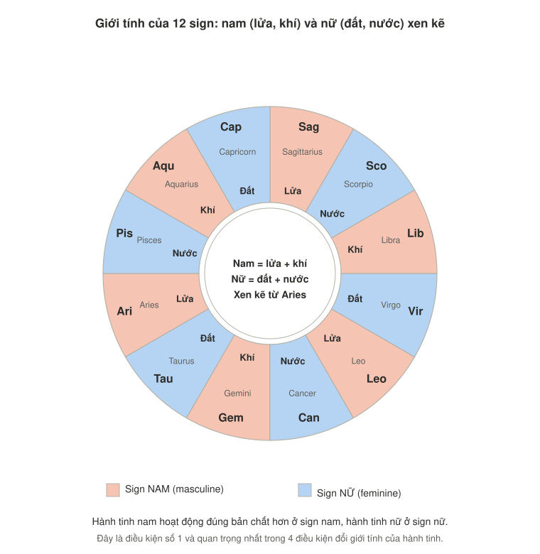
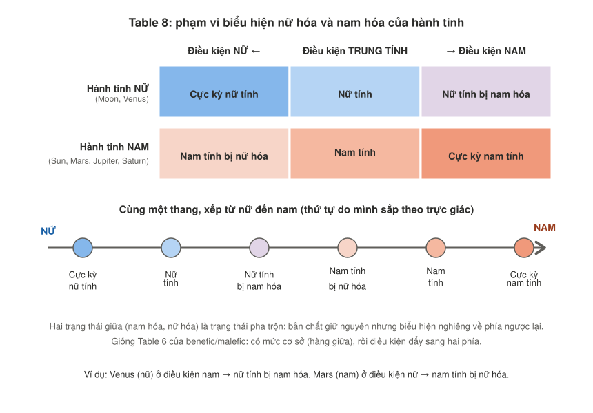

# Giới tính của các hành tinh, Phần 1: Khái niệm, giới tính của sign và thang biểu hiện
*(Demetra George, Ancient Astrology in Theory and Practice, Vol. I, Chương 5 "Gender of the Planets", Table 7 và Table 8)*

> **[Sách]** = dịch và giải nghĩa từ các trang bạn chụp. **[Bổ sung]** = phần mình diễn giải thêm hoặc ghép từ các note trước, nên đối chiếu khi đọc tiếp.
> Các hình nằm trong thư mục `images/`. Phần 2 (`gender-of-planets-part-2-phase-quadrant-latitude.md`) nói về ba điều kiện còn lại: solar phase, góc phần tư và vĩ độ thiên thể.
> Mình không có công cụ tra cứu. Các tên được nhắc tới (Plato, Ptolemy, Rhetorius, Paulus, Alan White) là những gì sách ghi. Hãy kiểm tra lại trước khi trích dẫn.

---

## Tóm tắt nhanh

1. Chiêm tinh cổ đại chia hành tinh thành **nam** (Sun, Mercury, Mars, Jupiter, Saturn) và **nữ** (Moon, Venus). Mercury cũng được ghi là **common**.
2. "Nam/nữ" ở đây là **hai loại năng lượng**, không chỉ là đàn ông hay phụ nữ: nam = **khởi xướng**, nhanh, đón thay đổi; nữ = **tiếp nhận**, chậm, kháng cự thay đổi.
3. Có **4 điều kiện** làm hành tinh nghiêng nam hơn hoặc nữ hơn: **sign, solar phase, góc phần tư, vĩ độ thiên thể**. Sign là điều kiện đầu tiên và quan trọng nhất.
4. Hành tinh hoạt động **đúng bản chất** hơn khi điều kiện cùng giới với nó. Điều kiện khác giới thì nó bị **chậm lại** (nếu là nam) hoặc bị **thúc ép** (nếu là nữ).
5. **Table 8** là một thang 6 mức, giống Table 6 của benefic/malefic: có mức cơ sở rồi điều kiện đẩy sang hai phía.
6. Sách cảnh báo: nhiều cách diễn giải cổ (như của Rhetorius) phản ánh **định kiến của thời đó**, đừng áp dụng nguyên văn.

---

## 1. Mở đầu chương 5

### Bản dịch

> **Chiêm tinh cổ đại phân loại các hành tinh theo giới tính nam và nữ.** Sun, Mercury, Mars, Jupiter và Saturn thuộc giới nam; Moon và Venus thuộc giới nữ; Mercury là common (chung). Đây là một trong số ít trường hợp rõ ràng mà giới tính của hành tinh dường như **tương ứng trực tiếp với giới của vị thần cùng tên** (tức thần nam hoặc nữ thần). Tuy nhiên, tồn tại một số điều kiện chiêm tinh khiến một hành tinh, dù giới tính cốt yếu là gì, **dịch chuyển về phía biểu hiện nam tính hoặc nữ tính hơn**.
>
> Trong ngữ cảnh này, nam và nữ **không chỉ nói về đàn ông và phụ nữ**, mà nói về **hai loại năng lượng cơ bản**. Các triết gia cổ đại như **Plato** định nghĩa năng lượng nam là **khởi xướng hành động** và năng lượng nữ là **tiếp nhận hành động**. **Ptolemy** giải thích việc gán giới tính cho hành tinh bằng các tính chất, trong đó **độ ẩm chủ yếu gắn với nữ và độ khô gắn với nam**. Trong chiêm tinh hiện đại, bạn có thể đã nghe sự phân biệt giới tính được gọi là các cực dương và âm, hoặc yang và yin.
>
> Lý do là: nếu một hành tinh ở trong **điều kiện nam**, nó sẽ có xu hướng **khởi xướng** hành động. Nếu ở **điều kiện nữ**, nó sẽ có xu hướng là **bên tiếp nhận** hành động. Năng lượng nam đặc trưng bởi **chuyển động nhanh hơn** và chào đón thay đổi, nên các sự kiện của hành tinh trong điều kiện nam **xảy ra sớm hơn**. Năng lượng nữ chuyển động **chậm hơn**, kháng cự thay đổi, nên kết quả của hành tinh trong điều kiện nữ **đến muộn hơn**. Phần lớn, hành tinh nam hành động đúng bản chất cơ bản hơn khi ở điều kiện nam, và hành tinh nữ cũng vậy khi ở điều kiện nữ.

### Phân tích

**a) Giới tính cơ bản của 7 hành tinh** [Sách]:

| Giới | Hành tinh |
|---|---|
| Nam (masculine) | Sun, Mars, Jupiter, Saturn, và Mercury (xếp vào nhóm nam ở Table 7) |
| Nữ (feminine) | Moon, Venus |

**Cập nhật quan trọng về Mercury** [Bổ sung]: ở Table 5 (note trước), Mercury được ghi là "androgynous" (lưỡng tính) và không nằm trong nhóm nam. Ở chương 5, Table 7 xếp Mercury vào **nhóm nam**, còn câu văn ghi "Mercury là common". Cách hợp lý nhất để hiểu hai nơi: Mercury **mặc định xếp nam nhưng linh hoạt**, dễ nghiêng về hai phía hơn các hành tinh khác. Mình đã cập nhật hai note cũ cho khớp.

**b) Giới tính khớp với thần cùng tên** [Sách, thêm chi tiết từ Table 3]:

| Hành tinh | Thần | Giới của thần |
|---|---|---|
| Sun | Hēlios, Apollō | Nam |
| Moon | Selēnē, Artemis, Hekatē | Nữ |
| Mercury | Hermēs | Nam |
| Venus | Aphroditē | Nữ |
| Mars | Arēs | Nam |
| Jupiter | Zeus | Nam |
| Saturn | Kronos | Nam |

Sách nói đây là "một trong số ít trường hợp rõ ràng": hầu hết các phân loại khác (benefic/malefic, sect, nóng/lạnh) không khớp trực tiếp với thần thoại như vậy.

**c) "Giới tính" ở đây là loại năng lượng, không phải giới của con người** [Sách, giải nghĩa thêm]. Ba cách nói cùng một ý:

| Nguồn | Nam | Nữ |
|---|---|---|
| Plato | Khởi xướng hành động | Tiếp nhận hành động |
| Ptolemy (qua tính chất) | Khô | Ẩm |
| Chiêm tinh hiện đại | Dương (yang), cực dương | Âm (yin), cực âm |

Cho nên một hành tinh "nữ" không có nghĩa là liên quan đến phụ nữ, và hành tinh "nam" không chỉ liên quan đến đàn ông.

**d) Cơ chế: nhanh hay chậm, sớm hay muộn** [Sách]:

| | Điều kiện nam | Điều kiện nữ |
|---|---|---|
| Vai trò | Khởi xướng | Tiếp nhận |
| Nhịp độ | Nhanh hơn | Chậm hơn |
| Với thay đổi | Chào đón | Kháng cự |
| Sự kiện | Xảy ra **sớm** hơn | Đến **muộn** hơn |

**e) Quy tắc ẩm và khô của Ptolemy có một ngoại lệ: Jupiter** [Bổ sung, mình ghép từ Table 5]:

| Hành tinh | Ẩm hay khô (Table 5) | Theo quy tắc "ẩm = nữ, khô = nam" | Giới thực tế |
|---|---|---|---|
| Moon | Ẩm | Nữ | Nữ (khớp) |
| Venus | Ẩm | Nữ | Nữ (khớp) |
| Sun | Khô | Nam | Nam (khớp) |
| Mars | Khô | Nam | Nam (khớp) |
| Saturn | Khô | Nam | Nam (khớp) |
| **Jupiter** | **Ẩm** | **Nữ** | **Nam (ngoại lệ)** |
| Mercury | Thay đổi | Thay đổi | Nam (thay đổi) |

Jupiter vừa ấm vừa ẩm nhưng lại là hành tinh nam. Sách chưa giải thích trong các trang này. Cách mình đọc (suy đoán): giới tính ở đây không chỉ dựa vào tính chất mà còn khớp với thần cùng tên (Zeus là nam) và phe ngày.

**f) Giới tính và phe không trùng nhau** [Bổ sung, nhắc lại note trước]:

| | Phe ngày | Phe đêm |
|---|---|---|
| Nam | Sun, Jupiter, Saturn | **Mars** |
| Nữ | (không có) | Moon, Venus |

Mars là hành tinh nam duy nhất thuộc phe đêm.

**g) Một chỗ có vẻ mâu thuẫn: Saturn nam nhưng chậm nhất** [Bổ sung]. Sách mô tả năng lượng nam là nhanh và chào đón thay đổi, trong khi Saturn là hành tinh nam nhưng mô tả của nó (note trước) lại gắn với trì hoãn, giới hạn, kéo dài. Điều này cho thấy "nhanh, chậm" ở đây là **phong cách năng lượng** (chủ động khởi xướng hay đợi tiếp nhận), không phải tốc độ quỹ đạo thật. Sách không bàn thẳng chỗ này trong các trang đã gửi.

**h) Gợi ý dùng để đoán thời điểm** [Bổ sung, mở rộng từ đoạn "sớm hơn, muộn hơn"]: sách nói sự kiện của hành tinh trong điều kiện nam xảy ra sớm hơn, điều kiện nữ muộn hơn. Có thể dùng để **ước lượng nhịp độ**: chủ đề do hành tinh nam hóa cai quản thì "tiến nhanh", chủ đề do hành tinh nữ hóa cai quản thì "chín muộn". Sách chưa dạy cách dùng này cụ thể, nên coi đây là hướng gợi ý, chưa phải kỹ thuật chính thức.

---

## 2. Bốn điều kiện đổi giới tính (Table 7)

### Bản dịch
> Các hành tinh được điều chỉnh để trở nên **nam hơn** hoặc **nữ hơn** bởi các điều kiện sau: (1) **Sign hoàng đạo**, (2) **Solar phase**, (3) **Vĩ độ thiên thể**, (4) **Vị trí góc phần tư**.

### Table 7: Giới tính của hành tinh

| | **Nam hóa** (masculinizing) | **Nữ hóa** (feminizing) |
|---|---|---|
| Hành tinh gốc | **Nam:** Sun, Mercury, Mars, Jupiter, Saturn | **Nữ:** Moon, Venus |
| **1. Sign** | Aries, Gemini, Leo, Libra, Sagittarius, Aquarius | Taurus, Cancer, Virgo, Scorpio, Capricorn, Pisces |
| **2. Phase** | Buổi sáng, đi trước Sun | Buổi chiều, đi sau Sun |
| **3. Quadrant** | Asc đến MC; Dsc đến IC | MC đến Dsc; IC đến Asc |
| **4. Latitude** | Bắc | Nam |

### Phân tích
- **Thứ tự**: danh sách đánh số của sách là sign, phase, latitude, quadrant, nhưng bảng xếp sign, phase, quadrant, latitude. Phần văn bản ở chương cũng bàn theo thứ tự sign, phase, quadrant, latitude. Phần 2 đi theo thứ tự này.
- **Bốn điều kiện không bằng nhau**: sách nói giới tính của sign là yếu tố **đầu tiên và quan trọng nhất**.
- **Cách nhớ** [Bổ sung]: hướng "nam hóa" gắn với những gì **chủ động, đang lên, buổi sáng, phía bắc**; hướng "nữ hóa" gắn với những gì **tiếp nhận, đang xuống, buổi chiều, phía nam**. Phần 2 giải thích vì sao.

---

## 3. Giới tính của sign (điều kiện số 1)

### Bản dịch

> **Giới tính của sign hoàng đạo** mà hành tinh đang đứng là yếu tố **đầu tiên và quan trọng nhất** trong việc đánh giá này. Các sign nam là Aries, Gemini, Leo, Libra, Sagittarius và Aquarius, tương ứng với nguyên tố **lửa và khí**. Các sign nữ là Taurus, Cancer, Virgo, Scorpio, Capricorn và Pisces, thuộc nguyên tố **đất và nước**. Hành tinh nam hành động đúng với bản chất cốt yếu của nó hơn khi ở sign nam, còn hành tinh nữ hành động đúng với bản chất cơ bản hơn khi ở sign nữ.
>
> Cũng như việc làm chính mình và làm tốt nhất sẽ dễ hơn khi ta ở trong một môi trường nâng đỡ và củng cố bản chất của mình, các hành tinh cũng hoạt động tốt hơn trong các sign có **nhịp độ giống nhịp độ của chúng**. Khi một hành tinh nam ở sign nữ, khả năng hành động của nó **bị chậm lại**, có thể là nguồn của sự bực bội hoặc chán nản. Nếu một hành tinh nữ ở sign nam, nó có thể cảm thấy **bị thúc ép phải hành động trước khi sẵn sàng**, và vì thế trở thành nguồn căng thẳng. Alan White quá cố từng minh họa nguyên lý này bằng ví dụ một cặp đôi tuổi teen ở rạp chiếu phim ngoài trời, một bên muốn mọi thứ nhanh lên trong khi bên kia muốn chậm lại.
>
> Nói chung, condition của hành tinh được cải thiện khi nó ở sign cùng giới, nhưng **đây không phải quy tắc tuyệt đối**. Không có phán xét giá trị giữa nhanh và kéo dài, giữa nở sớm và nở muộn; bối cảnh của từng tình huống quyết định loại năng lượng nào có lợi hơn. Và đôi khi điều tốt nhất là để cái nhanh chậm lại, như tốc độ viêm của một căn bệnh.

### Hình: 12 sign nam và nữ xen kẽ

### Phân tích

**a) Bảng tóm tắt hành tinh và sign** [Sách]:

| | Ở sign nam (lửa, khí) | Ở sign nữ (đất, nước) |
|---|---|---|
| **Hành tinh nam** | Hợp nhịp, hành động đúng bản chất | **Bị chậm lại**, dễ bực bội hoặc chán |
| **Hành tinh nữ** | **Bị thúc ép**, phải hành động trước khi sẵn sàng, căng thẳng | Hợp nhịp, hành động đúng bản chất |

**b) Sign nam và nữ xen kẽ**: bắt đầu từ Aries (nam), Taurus (nữ), Gemini (nam), Cancer (nữ)... Cứ cách một sign đổi giới. Nên dễ nhớ: số thứ tự lẻ (Aries là 1, Gemini là 3, Leo là 5...) là nam, số chẵn là nữ.

**c) Giới tính sign gắn với nguyên tố** [Sách]: lửa và khí là nam, đất và nước là nữ. Liên hệ với bài tính chất nguyên tố [Bổ sung]: lửa (nóng-khô) và khí (nóng-ẩm) đều **có phần nóng**, đất (lạnh-khô) và nước (lạnh-ẩm) đều **có phần lạnh**. Vì vậy sign nam là sign nóng hơn, sign nữ là sign lạnh hơn. Đây là liên hệ của mình, sách chưa nêu trong các trang này.

**d) Mỗi hành tinh có ít nhất một domicile cùng giới** [Bổ sung, ghép Figure 3 rulerships với Table 7]:

| Hành tinh | Giới | Domicile 1 | Domicile 2 |
|---|---|---|---|
| Sun | Nam | Leo (nam, hợp) | |
| Moon | Nữ | Cancer (nữ, hợp) | |
| Mercury | Nam | Gemini (nam, hợp) | Virgo (nữ, **lệch**) |
| Venus | Nữ | Taurus (nữ, hợp) | Libra (nam, **lệch**) |
| Mars | Nam | Aries (nam, hợp) | Scorpio (nữ, **lệch**) |
| Jupiter | Nam | Sagittarius (nam, hợp) | Pisces (nữ, **lệch**) |
| Saturn | Nam | Aquarius (nam, hợp) | Capricorn (nữ, **lệch**) |

Ý nghĩa: ở domicile, hành tinh có dignity nhưng **giới tính của sign có thể lệch** với giới của hành tinh. Ví dụ Saturn ở Capricorn (domicile) vẫn đang ở sign nữ (đất), nên "được ở nhà" nhưng nhịp độ bị chậm lại. Dignity và giới tính là **hai lớp đánh giá độc lập**.

**e) "Không phải quy tắc tuyệt đối"** [Sách]: sách nhấn mạnh **không có phán xét giá trị** giữa nhanh và chậm. Ví dụ y học: với một cơn viêm, điều tốt nhất là để tiến trình nhanh chậm lại. Nên hành tinh nam ở sign nữ không nhất thiết là xấu: tùy bối cảnh, "chậm lại" có thể có lợi.

**f) Hai cảm giác khác nhau** [Sách, tóm lại]:
- Hành tinh nam ở sign nữ → **bực bội, chán** (muốn đi mà bị kéo lại).
- Hành tinh nữ ở sign nam → **căng thẳng, vội** (chưa sẵn sàng mà bị đẩy).

---

## 4. Thang biểu hiện nữ hóa và nam hóa (Table 8)

### Bản dịch

> Tương tự bản chất benefic hay malefic cơ bản của hành tinh, **giới tính nam hay nữ của hành tinh cũng có thể được điều chỉnh** theo nhiều cách ảnh hưởng đến biểu hiện của nó.

**Table 8: Phạm vi biểu hiện nữ hóa và nam hóa của hành tinh**

| | ← Điều kiện nữ | Điều kiện trung tính | Điều kiện nam → |
|---|---|---|---|
| **Hành tinh nữ** | Cực kỳ nữ tính | Nữ tính | Nữ tính bị nam hóa |
| **Hành tinh nam** | Nam tính bị nữ hóa | Nam tính | Cực kỳ nam tính |

> **Rhetorius**, bị định hình bởi các chuẩn mực văn hóa thời ông, kết luận rằng các hành tinh nam trong điều kiện nam khiến đàn ông bướng bỉnh và táo bạo, nhưng khiến phụ nữ ngỗ ngược và vô liêm sỉ. Tương tự, các hành tinh nữ trong điều kiện nữ khiến đàn ông mềm yếu và hèn nhát, còn phụ nữ khiêm tốn, đoan trang và ngoan ngoãn. Tuy nhiên, hãy nhớ rằng **nhiều cách diễn giải biểu tượng không tránh khỏi phản ánh phong tục và giá trị của thời đó**. Trong thế giới đương đại, các điều chỉnh giới của hành tinh có thể đem lại những cái nhìn quý giá về cách biểu hiện của sự linh hoạt giới tính (gender fluidity), ví dụ trong cộng đồng LGBTQIA.

### Hình: Table 8 vẽ lại và đặt trên một thang

### Phân tích

**a) Cách đọc bảng**: hàng là hành tinh (nữ hay nam), cột là điều kiện (nữ, trung tính, nam). Ô ở giữa là mức cơ sở. Đi sang cùng phía với giới của hành tinh thì **cực đoan hơn**. Đi sang phía ngược lại thì **pha trộn**.

**b) Tên gọi cho thấy hành tinh vẫn giữ giới gốc** [Bổ sung]: "nữ tính bị nam hóa" vẫn là hành tinh **nữ** (chỉ nghiêng nam), "nam tính bị nữ hóa" vẫn là hành tinh **nam** (chỉ nghiêng nữ). Giống Table 6 ở note trước: điều kiện dịch chuyển biểu hiện nhưng không đổi hẳn loại.

**c) So sánh Table 6 và Table 8** [Bổ sung]:

| | Table 6 (benefic/malefic) | Table 8 (nam/nữ) |
|---|---|---|
| Mức cơ sở | Benefic = tốt, malefic = xấu | Hành tinh nam = nam tính, nữ = nữ tính |
| Yếu tố điều chỉnh | Sect, dignity, phase, aspect, house | Sign, phase, quadrant, latitude |
| Số bậc | 5 | 3 cột cho mỗi hàng |
| Có đổi hẳn loại không? | Không | Không |

Câu mở đầu của sách ("tương tự bản chất benefic/malefic") cho thấy cùng một **mô hình tư duy**: hành tinh có bản chất gốc, và nhiều điều kiện khiến biểu hiện của nó đi lên hay xuống.

**d) Về phần Rhetorius**: các kết luận của ông gắn với **vai trò giới truyền thống** (đàn ông phải táo bạo, phụ nữ phải đoan trang, ngoan ngoãn). Chính tác giả nói đây là sản phẩm của chuẩn mực thời đó. Cách dùng phù hợp ngày nay:
- Dịch lại thành **phong cách năng lượng**, không gắn với giới tính của người đó: nam hóa là **chủ động, nhanh, khởi xướng**; nữ hóa là **thong thả, tiếp nhận, chín muộn**.
- Cách sách gợi ý: các điều chỉnh này có thể giúp hiểu **sự linh hoạt giới tính (gender fluidity)** của một người. Đây là hướng mở của tác giả, bạn chỉ nên dùng khi người đối diện chủ động chia sẻ, đừng tự suy ra.

---

## 5. Áp dụng sơ bộ: giới tính của sign trong lá số mẫu [Bổ sung]

(Các điều kiện còn lại tính ở Phần 2.)

| Hành tinh | Giới gốc | Sign | Giới của sign | Kết quả theo sách |
|---|---|---|---|---|
| Sun | Nam | Aquarius | Nam | Hợp nhịp |
| Moon | Nữ | Libra | Nam | **Bị thúc ép** |
| Mercury | Nam | Capricorn | Nữ | **Bị chậm lại** |
| Venus | Nữ | Sagittarius | Nam | **Bị thúc ép** |
| Mars | Nam | Sagittarius | Nam | Hợp nhịp |
| Jupiter | Nam | Leo | Nam | Hợp nhịp |
| Saturn | Nam | Gemini | Nam | Hợp nhịp |

**Nhận xét:** bốn hành tinh nam trong sign nam đều hợp nhịp. Hai hành tinh nữ (Moon, Venus) đều ở sign nam, nên bị nam hóa. Mercury là hành tinh duy nhất bị làm chậm lại.

---

## 6. Khi xem lá số cho người khác [Bổ sung]

- Dùng ngôn ngữ **năng lượng** thay vì giới tính của con người: "chủ động, đẩy nhanh" hay "thong thả, chờ chín", không nói "kiểu đàn ông" hoặc "kiểu phụ nữ".
- **Đừng dùng nguyên văn các kết luận của Rhetorius** (ví dụ về đàn ông mềm yếu, phụ nữ ngỗ ngược). Sách đã cảnh báo đây là định kiến của thời đó.
- **Đừng giả định giới của người đối diện** từ lá số. Hành tinh nam hay nữ không nói người đó là nam hay nữ, hay họ nên hành xử thế nào.
- Với hành tinh nữ ở sign nam: có thể nói "bạn có thể thấy mình bị thúc phải quyết nhanh trước khi sẵn sàng". Với hành tinh nam ở sign nữ: "bạn có thể thấy khó chịu vì mọi việc diễn ra chậm hơn mong muốn".
- Nhớ tinh thần note_5: lá số mô tả **hoàn cảnh và xu hướng**, không áp đặt cách sống của một người.

---

## 7. Tự kiểm tra

| Câu hỏi | Đáp án |
|---|---|
| Hành tinh nữ là những hành tinh nào? | Moon, Venus |
| "Nam/nữ" ở đây chủ yếu chỉ điều gì? | Hai loại năng lượng: khởi xướng và tiếp nhận |
| Ptolemy gắn ẩm và khô với giới nào? | Ẩm với nữ, khô với nam |
| Sign nam gồm những sign nào? | Aries, Gemini, Leo, Libra, Sagittarius, Aquarius (lửa và khí) |
| Hành tinh nam ở sign nữ thì thế nào? | Bị chậm lại, dễ bực bội hoặc chán |
| Hành tinh nữ ở sign nam thì thế nào? | Bị thúc ép, căng thẳng |
| Điều kiện nào quan trọng nhất trong bốn điều kiện? | Giới tính của sign |
| "Nữ tính bị nam hóa" là hành tinh gì? | Hành tinh nữ ở điều kiện nam (vẫn là hành tinh nữ) |
| Vì sao sách cảnh báo về Rhetorius? | Cách diễn giải phản ánh chuẩn mực văn hóa thời ông |

---

## 8. Từ vựng khó

| Tiếng Anh | Tiếng Việt |
|---|---|
| Masculine / feminine | Nam / nữ (loại năng lượng) |
| Androgynous | Lưỡng tính |
| Initiate / receive (action) | Khởi xướng / tiếp nhận (hành động) |
| Polarity | Cực (dương, âm) |
| Masculinize / feminize | Nam hóa / nữ hóa |
| Willful | Bướng bỉnh, ngang ngạnh |
| Insubordinate | Không phục tùng, ngỗ ngược |
| Shameless | Vô liêm sỉ |
| Gender fluidity | Sự linh hoạt giới tính |
| Pace | Nhịp độ |

---

## 9. Điều cần kiểm chứng
- Bản dịch dựa trên các trang bạn chụp. Phần ví dụ của Alan White mình diễn đạt lại ngắn gọn, trung tính.
- Mercury: Table 5 ghi "androgynous", Table 7 xếp vào nhóm nam, văn bản ghi "common". Mình hiểu là "mặc định nam nhưng linh hoạt", sách chưa giải thích trực tiếp.
- Các mục e, g, h của phần 1, mục c, d của phần 3, và phần 5 là cách mình đọc thêm, không phải lập luận tác giả nêu rõ.
- Ngoại lệ Jupiter (ẩm nhưng là nam) và việc Saturn là hành tinh nam dù chậm nhất: sách chưa giải thích trong các trang này.
