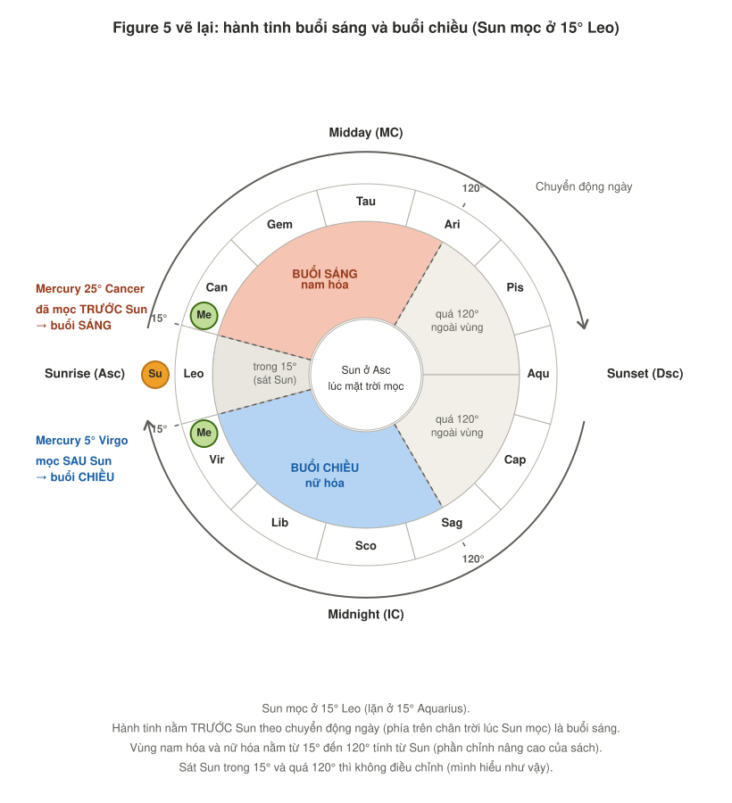
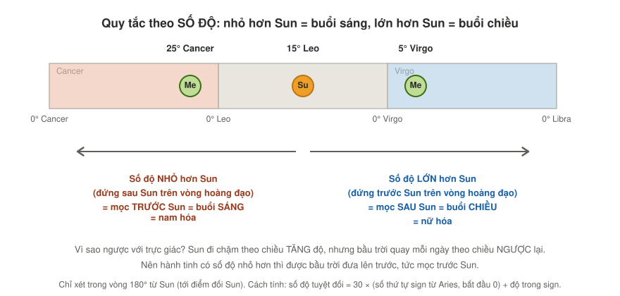
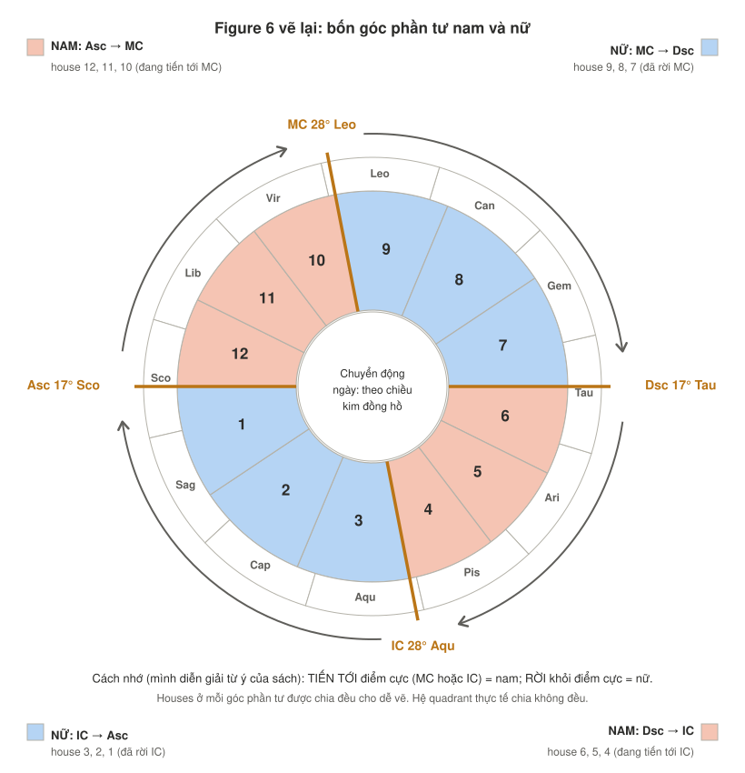
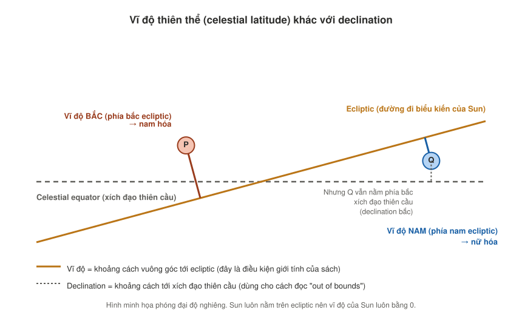

# Giới tính của các hành tinh, Phần 2: Solar phase, góc phần tư và vĩ độ thiên thể
*(Demetra George, Ancient Astrology in Theory and Practice, Vol. I, Chương 5, Figure 5, Figure 6)*

> **[Sách]** = dịch và giải nghĩa từ các trang bạn chụp. **[Bổ sung]** = phần mình diễn giải thêm hoặc tính thêm, nên đối chiếu khi đọc tiếp.
> Phần này đi cùng `gender-of-planets-part-1-concepts-signs-and-range.md` (khái niệm, giới tính của sign, Table 7 và Table 8). Các hình nằm trong thư mục `images/`.
> Mình không có công cụ tra cứu. Tên Paulus và các nhận định lịch sử là những gì sách ghi, hãy kiểm tra lại trước khi trích dẫn.

---

## Tóm tắt nhanh

1. **Solar phase**: hành tinh mọc **trước** Sun (buổi sáng) thì **nam hóa**, mọc **sau** Sun (buổi chiều) thì **nữ hóa**.
2. Cách tính bằng số: hành tinh có **số độ nhỏ hơn Sun** (trong 180°) là buổi sáng, **lớn hơn** là buổi chiều.
3. Phần chỉnh nâng cao: vùng điều chỉnh chỉ nằm từ **15° đến 120°** tính từ Sun.
4. **Góc phần tư**: Asc đến MC và Dsc đến IC là **nam**; MC đến Dsc và IC đến Asc là **nữ**.
5. **Vĩ độ thiên thể**: phía **bắc** ecliptic nam hóa, phía **nam** nữ hóa. Đừng nhầm với declination.
6. Sách chưa rõ quadrant tính theo **whole sign** hay theo **độ chính xác của các góc**. Trong lá số mẫu, hai cách cho kết quả khác nhau với Moon và Mercury.

---

## 1. Solar phase (điều kiện số 2)

### Bản dịch

> **Solar phase** của hành tinh là điều kiện thứ hai để đánh giá việc điều chỉnh giới tính. Một hành tinh trở nên **nam hóa** hơn khi nó được thấy trên **bầu trời buổi sáng, mọc trước (đi trước) Sun**, và **nữ hóa** hơn khi nó xuất hiện trên **bầu trời buổi chiều, sau (theo sau) Sun đã lặn**. Chúng ta có thể hình dung rằng phần lớn mọi người tràn đầy năng lượng và sẵn sàng hoạt động vào buổi sáng, và có xu hướng nghỉ ngơi, thư giãn vào buổi chiều.
>
> Để xác định một hành tinh thuộc pha buổi sáng hay buổi chiều, hãy **xoay lá số sao cho Sun nằm ở vị trí Ascendant**, tức điểm mặt trời mọc. Nhớ rằng các hành tinh chuyển động theo chuyển động ngày, nên lúc bình minh chúng leo lên qua Ascendant và đi **theo chiều kim đồng hồ**, trong đó Midheaven là giữa trưa, Descendant là hoàng hôn, và Nadir là nửa đêm. Nếu hành tinh đang xét thuộc **buổi sáng**, nó đã mọc trước Sun và **đi trước Sun** (tới độ đối của Sun), nhưng có **kinh độ hoàng đạo nhỏ hơn Sun**. (Sun ở 15° Leo, Mercury ở 25° Cancer.) Nếu hành tinh thuộc **buổi chiều**, nó mọc sau Sun và **đi sau Sun** (tới độ đối của Sun), nhưng có **kinh độ hoàng đạo lớn hơn Sun**. (Sun ở 15° Leo, Mercury ở 5° Virgo.) Sun có thể nằm bất cứ đâu trong lá số; yếu tố quyết định đơn giản là hành tinh đang xét **đi trước hay đi sau Sun theo chuyển động ngày**. Chúng ta sẽ giải thích sao/hành tinh buổi sáng và buổi chiều đầy đủ hơn ở Phần Ba.

**Chú thích Figure 5:** *Sun mọc ở 15° Leo (lặn ở 15° Aquarius). Mercury ở 25° Cancer mọc vào buổi sáng, trước lúc bình minh; Mercury ở 5° Virgo có thể được thấy xuất hiện trên bầu trời buổi chiều sau hoàng hôn.*

### Phần chỉnh nâng cao (bản dịch)

> Học viên nâng cao có thể tinh chỉnh đánh giá này bằng cách lưu ý rằng: **khu vực nam hóa** của chu kỳ solar phase kéo dài **về phía trước từ độ thứ 15 phía trước Sun tới độ thứ 120 tính từ Sun**, hoặc ngay trước trạm nghịch hành (retrograde station). **Khu vực nữ hóa** của chu kỳ solar phase kéo dài **về phía sau từ độ thứ 15 phía sau Sun tới độ thứ 120 tính từ Sun**, hoặc ngay sau trạm thuận hành (direct station).

### Hình 1: Figure 5 vẽ lại, có thêm các vùng 15° và 120°

**Cách đọc hình:**
- Bánh xe đã **xoay sao cho Sun nằm ở Asc** (bên trái, giờ mặt trời mọc).
- Các hành tinh đi **theo chiều kim đồng hồ**: lên qua đỉnh (Midday, MC), xuống ở bên phải (Sunset, Dsc), rồi qua đáy (Midnight, IC).
- **Phía trên** đường chân trời lúc Sun mọc là các hành tinh **đã mọc trước Sun** (buổi sáng, màu cam, nam hóa).
- **Phía dưới** là các hành tinh **chưa mọc, sẽ mọc sau Sun** (buổi chiều, màu xanh, nữ hóa).
- Mercury 25° Cancer nằm trên đường chân trời nên là buổi sáng. Mercury 5° Virgo nằm dưới nên là buổi chiều.

### Hình 2: Quy tắc theo số độ

### Phân tích

**a) Vì sao "đi trước Sun" lại là "số độ nhỏ hơn"?** [Bổ sung, giải thích chỗ dễ gây rối]

Có hai chiều chuyển động khác nhau:
- Trong một năm, Sun đi **chậm theo chiều tăng độ** (Cancer → Leo → Virgo).
- Trong một ngày, **bầu trời quay theo chiều ngược lại** (mọc ở phía đông, lặn ở phía tây).

Vì bầu trời quay như vậy, vật nào đứng ở **phía "sau" Sun trên vòng hoàng đạo** (số độ nhỏ hơn) sẽ được bầu trời đưa lên **trước**. Nên "đi trước Sun theo chuyển động ngày" và "số độ nhỏ hơn" là **cùng một thứ**, chỉ nhìn từ hai chiều khác nhau.

**b) Cách tính bằng số** [Bổ sung]:

1. Đổi mỗi vị trí ra số độ tuyệt đối: 30 × (số thứ tự sign, Aries là 0) + độ trong sign. Ví dụ 15° Leo = 30×4 + 15 = **135°**.
2. Tính chênh lệch **d = (độ hành tinh − độ Sun)**, cộng 360 nếu âm.
3. Nếu **d lớn hơn 180**: hành tinh nằm "sau" Sun trên vòng hoàng đạo, là **buổi sáng**, khoảng cách tới Sun là **360 − d**.
4. Nếu **d nhỏ hơn 180**: là **buổi chiều**, khoảng cách tới Sun là **d**.

Ví dụ theo sách (Sun 15° Leo = 135°):
- Mercury 25° Cancer = 115°. d = 115 − 135 = −20 → 340. Lớn hơn 180 nên **buổi sáng**, cách Sun 20°.
- Mercury 5° Virgo = 155°. d = 20. Nhỏ hơn 180 nên **buổi chiều**, cách Sun 20°.

**c) Phần chỉnh nâng cao: vùng 15° đến 120°** [Bổ sung, cách mình hiểu]

| Khoảng cách tới Sun | Điều chỉnh giới tính |
|---|---|
| Trong 15° | Không điều chỉnh (hành tinh sát Sun, bị lu mờ) |
| 15° đến 120° | **Có điều chỉnh**: phía trước = nam hóa, phía sau = nữ hóa |
| Quá 120° | Không điều chỉnh (gần trạm nghịch hành hoặc thuận hành) |

Sách nói vùng điều chỉnh kéo dài "tới độ 120 hoặc ngay trước/sau trạm". Mình hiểu hai đầu (trong 15° và quá 120°) là **không còn điều chỉnh**, nhưng sách không nói thẳng điều này trong các trang đã gửi.

**d) Mercury và Venus không bao giờ chạm mốc 120°** [Bổ sung, kiến thức chung]: Mercury luôn ở rất gần Sun (cách tối đa khoảng 28°), Venus khoảng 47°. Nên với hai hành tinh này, vùng điều chỉnh chạy từ 15° tới khoảng cách tối đa của chúng. Chỉ các hành tinh ngoài (Mars, Jupiter, Saturn) mới có thể vượt 120°.

**e) Hai liên hệ thú vị**

- **Venus buổi sáng và buổi chiều** [Bổ sung]: ở Table 3 bạn đã đọc Ishtar là **nữ thần chiến tranh khi là sao Mai** và **nữ thần tình yêu khi là sao Hôm**. Quy tắc này khớp: sao Mai (buổi sáng) thì **nam hóa** (chủ động, tranh đấu), sao Hôm (buổi chiều) thì **nữ hóa** (êm dịu, tình yêu). Cũng khớp với ghi chú trong `venus.md` rằng Venus mọc trước Sun thường được coi là chủ động hơn.
- **Moon theo pha trăng** [Bổ sung, suy ra từ quy tắc]: trăng **đang tròn dần** (đi trước Sun trên vòng hoàng đạo, hiện ra buổi chiều) thì thuộc **buổi chiều** (nữ hóa). Trăng **đang khuyết dần** (đi sau Sun, mọc trước Sun) thì thuộc **buổi sáng** (nam hóa). Sách có thể xử lý riêng Moon ở Phần Ba, nên đây chỉ là suy luận từ quy tắc chung.

**f) Điều kiện này khớp với note trước:** "oriental" (mọc trước Sun) và "occidental" (mọc sau Sun) mình đã dùng ở note về sect và các file hành tinh chính là **buổi sáng** và **buổi chiều** ở đây.

---

## 2. Góc phần tư (điều kiện số 3)

### Bản dịch

> **Vị trí góc phần tư** của hành tinh cũng ảnh hưởng đến việc điều chỉnh giới tính. Các house trong góc phần tư **từ Ascendant đến Midheaven là nam**; từ **Midheaven đến Descendant là nữ**; các house từ **Descendant đến IC là nam**, và từ **IC đến Ascendant là nữ**. Một hành tinh trở nên nam hơn khi ở các góc phần tư nam, có lẽ vì chuyển động của Sun đang **đi lên hướng tới các điểm culminating hoặc anti-culminating** (đỉnh hoặc đáy). Hành tinh trở nên nữ hơn khi ở các góc phần tư nữ, có lẽ do **hướng đi xuống (declining) của Sun**. Các văn bản **không hoàn toàn rõ** liệu các góc phần tư này được phân định theo whole sign hay theo độ chính xác của các góc, dù **Paulus có nêu độ chính xác** trong phần bàn về chủ đề này.

**Chú thích Figure 6:** *Theo chuyển động ngày, các góc phần tư nam kéo dài từ ASC đến MC, và từ DSC đến IC. Các góc phần tư nữ kéo dài từ MC đến DSC, và từ IC đến ASC.*

### Hình 3: Figure 6 vẽ lại, có house và hướng chuyển động

(Lá số của sách: Asc 17° Scorpio, MC 28° Leo, Dsc 17° Taurus, IC 28° Aquarius. Hình chia mỗi góc phần tư thành 3 house đều nhau cho dễ nhìn.)

### Phân tích

**a) Bảng góc phần tư** [Sách, thêm cột house và hướng đi]:

| Góc phần tư (theo chuyển động ngày) | House | Giới | Sun đang làm gì (diễn giải của sách) |
|---|---|---|---|
| Asc → MC | 12, 11, 10 | **Nam** | Đang đi lên tới đỉnh (MC) |
| MC → Dsc | 9, 8, 7 | **Nữ** | Đang đi xuống từ đỉnh |
| Dsc → IC | 6, 5, 4 | **Nam** | Đang tiến tới đáy (IC) |
| IC → Asc | 3, 2, 1 | **Nữ** | Đang rời khỏi đáy |

**b) Cách nhớ** [Bổ sung, diễn giải theo câu "perhaps because..." của sách]: **tiến tới điểm cực (MC hoặc IC) = nam; rời khỏi điểm cực = nữ**. Giống như việc leo dốc (nam, đang tăng lực) so với xuống dốc (nữ, đang buông).

**c) Nối với angularity** [Bổ sung]: bài Angularity chia house thành succedent (tiến tới góc), angular (ở góc), cadent (rời góc). Quadrant ở đây là một cách chia khác, **chỉ dùng hai góc MC và IC** làm điểm cực. Hai cách chia này khác nhau, đừng nhầm lẫn.

**d) Cách xác định quadrant bằng số độ** [Bổ sung]:

Đi theo chiều tăng độ trên vòng hoàng đạo, bốn góc nằm theo thứ tự **MC → Asc → IC → Dsc → MC**. Các khoảng giữa:

| Khoảng (theo độ tăng) | Giới |
|---|---|
| Từ MC đến Asc | Nam (Asc → MC) |
| Từ Asc đến IC | Nữ (IC → Asc) |
| Từ IC đến Dsc | Nam (Dsc → IC) |
| Từ Dsc đến MC | Nữ (MC → Dsc) |

Kiểm tra với lá số của sách: MC 28° Leo (148°), Asc 17° Scorpio (227°). Khoảng 148° đến 227° gồm Leo (từ 28°), Virgo, Libra, Scorpio (đến 17°): đúng là cung nam ở góc trên bên trái của Figure 6.

**e) Whole sign hay độ chính xác?** Sách nói các văn bản không rõ. Hai cách xác định cho kết quả khác nhau, như ở lá số mẫu dưới đây (mục 4).

---

## 3. Vĩ độ thiên thể (điều kiện số 4)

### Bản dịch

> Điều chỉnh giới tính cuối cùng là **vĩ độ thiên thể (celestial latitude)** của hành tinh. Vĩ độ thiên thể là khoảng cách của hành tinh **về phía bắc hoặc phía nam của ecliptic**. Hành tinh ở **phía bắc ecliptic trở nên nam hơn**, còn hành tinh ở **phía nam ecliptic trở nên nữ hơn**. Nhiều phần mềm chiêm tinh có báo cáo về vĩ độ của hành tinh. Hãy chắc chắn phân biệt điều này với **declination** của hành tinh, tức khoảng cách về phía bắc hoặc phía nam của **xích đạo thiên cầu (celestial equator)**, và được dùng trong nhiều cách diễn giải "out of bounds".

### Hình 4: Vĩ độ khác declination như thế nào

### Phân tích

**a) Ecliptic là gì?** [Bổ sung, kiến thức chung] Ecliptic là **đường đi biểu kiến của Sun** trên bầu trời trong một năm, và là "đường chuẩn" của vòng hoàng đạo (12 sign nằm dọc theo nó). Xích đạo thiên cầu là đường xích đạo của Trái Đất chiếu lên bầu trời. Hai đường này **nghiêng nhau khoảng 23.4°**.

**b) Hai cách đo "lệch bắc hay nam"** [Sách, giải thích thêm]:

| | Đo so với | Dùng làm gì |
|---|---|---|
| **Vĩ độ thiên thể (latitude)** | Ecliptic | Điều kiện đổi giới tính (chương này) |
| **Declination** | Xích đạo thiên cầu | Cách đọc "out of bounds" |

Như trong hình, một hành tinh có thể nằm **phía nam ecliptic** (vĩ độ nam, nữ hóa) nhưng vẫn **phía bắc xích đạo thiên cầu** (declination bắc). Hai con số này **không trùng nhau**, nên phải lấy đúng cột trong phần mềm.

**c) Sun luôn có vĩ độ 0** [Bổ sung]: vì ecliptic được định nghĩa là đường Sun đi, Sun luôn nằm ngay trên đó. Nên vĩ độ **không điều chỉnh** giới tính của Sun.

**d) Moon và các hành tinh khác** [Bổ sung, kiến thức chung]: Moon lệch bắc nam đáng kể (khoảng vài độ, và đổi hướng trong khoảng nửa tháng), nên điều kiện vĩ độ của Moon thay đổi nhanh. Các hành tinh khác thường lệch ít hơn, và thay đổi chậm.

**e) Lưu ý về dữ liệu**: bảng lá số mẫu bạn gửi **không có cột vĩ độ thiên thể**, nên mình chưa tính được điều kiện này. Gợi ý: thêm cột "Latitude" (thường ký hiệu Lat, Br, hoặc β trong phần mềm) vào bảng, và nhớ **không nhầm với Declination**.

**f) Cách nhớ** [Bổ sung]: bắc là "phía trên" (nam hóa), nam là "phía dưới" (nữ hóa). Nếu phần mềm hiển thị số **dương** cho phía bắc và **âm** cho phía nam thì dương là nam hóa, âm là nữ hóa.

---

## 4. Áp dụng vào lá số mẫu [Bổ sung]

Lá số mẫu: whole sign, Asc ≈ 26° Libra, lá số đêm. Các độ của góc (Asc ≈ 26° Libra, MC ≈ 26° Cancer, Dsc ≈ 26° Aries, IC ≈ 26° Capricorn) là **ước lượng từ hình phần mềm**.

### Bước 1: solar phase (tính bằng số)

Sun = 3° Aquarius = 303°.

| Hành tinh | Độ | d = độ − 303 (cộng 360 nếu âm) | Pha | Cách Sun | Trong vùng 15° đến 120°? | Điều chỉnh |
|---|---|---|---|---|---|---|
| Moon | 191° | 248 | Sáng (đang khuyết) | 112° | Có | Nam hóa |
| Mercury | 282° | 339 | Sáng | 21° | Có | Nam hóa |
| Venus | 257° | 314 | Sáng (sao Mai) | 46° | Có | Nam hóa |
| Mars | 244° | 301 | Sáng | 59° | Có | Nam hóa |
| Jupiter ℞ | 134° | 191 | Sáng | 169° | **Không (quá 120°)** | Không |
| Saturn ℞ | 83° | 140 | Chiều | 140° | **Không (quá 120°)** | Không |

### Bước 2: góc phần tư (hai cách)

Các khoảng theo độ (ước lượng): MC→Asc là 116° đến 206° (nam), Asc→IC là 206° đến 296° (nữ), IC→Dsc là 296° đến 386° (nam), Dsc→MC là 26° đến 116° (nữ).

| Hành tinh | House (whole sign) | Quadrant theo house | Độ | Quadrant theo độ |
|---|---|---|---|---|
| Sun | 5 | Nam (6, 5, 4) | 303° | Nam |
| Moon | 1 | **Nữ** (3, 2, 1) | 191° | **Nam** |
| Mercury | 4 | **Nam** (6, 5, 4) | 282° | **Nữ** |
| Venus | 3 | Nữ | 257° | Nữ |
| Mars | 3 | Nữ | 244° | Nữ |
| Jupiter | 11 | Nam (12, 11, 10) | 134° | Nam |
| Saturn | 9 | Nữ (9, 8, 7) | 83° | Nữ |

**Hai hành tinh cho kết quả khác nhau theo cách đo: Moon và Mercury.** Đây chính là chỗ sách nói "các văn bản không rõ". Moon ở 11° Libra nằm cùng sign với Asc nên là house 1 (whole sign), nhưng về độ nó đã **nằm trên đường chân trời, mọc trước điểm Asc** khoảng 15°. Mercury ở 12° Capricorn thuộc house 4, nhưng về độ nó đã **đi qua IC** khoảng 14°.

### Bước 3: vĩ độ thiên thể
Chưa có dữ liệu. Sun luôn bằng 0 (không điều chỉnh).

### Bước 4: tổng hợp sơ bộ

| Hành tinh | Giới gốc | Sign | Phase | Quadrant | Xu hướng sơ bộ (chưa tính latitude) |
|---|---|---|---|---|---|
| Sun | Nam | Nam (hợp) | Không áp dụng | Nam | Nam tính, nghiêng **cực kỳ nam tính** |
| Moon | Nữ | Nam | Nam hóa | Nữ (house) hoặc nam (độ) | **Nữ tính bị nam hóa** (nếu quadrant theo độ thì cả 3 điều kiện đều nam hóa) |
| Mercury | Nam (linh hoạt) | Nữ | Nam hóa | Nam (house) hoặc nữ (độ) | **Chưa rõ**, phụ thuộc cách đo quadrant |
| Venus | Nữ | Nam | Nam hóa | Nữ | **Nữ tính bị nam hóa** (2 trên 3 điều kiện nam hóa) |
| Mars | Nam | Nam (hợp) | Nam hóa | Nữ | **Nam tính**, nghiêng cực kỳ nam tính (2 trên 3) |
| Jupiter | Nam | Nam (hợp) | Không điều chỉnh | Nam | **Nam tính**, nghiêng cực kỳ nam tính |
| Saturn | Nam | Nam (hợp) | Không điều chỉnh | Nữ | **Nam tính** (1 điều kiện nam hóa, 1 nữ hóa) |

**Cách tính chỉ là kiểm đếm sơ bộ** của mình: sách chỉ nói sign quan trọng nhất, chưa dạy cách cân các điều kiện, nên đây là bài tập tư duy.

### Nhận xét từ kết quả

1. **Hai hành tinh nữ (Moon, Venus) đều bị nam hóa**: cả hai ở sign nam, cùng buổi sáng. Theo mô hình của sách, năng lượng của chúng "chủ động và nhanh hơn" mức thường của hành tinh nữ. Với Venus (chart ruler) và Moon (ánh sáng chủ của lá số đêm), điều đó có thể nghĩa là tình cảm, cảm xúc và thân thể có xu hướng **biểu hiện sớm, chủ động** hơn là chờ đợi. Đây chỉ là diễn giải theo logic của sách.
2. **Mars, Jupiter, Sun gần như hoàn toàn nam**: nhiều điều kiện cùng hướng.
3. **Mercury là hành tinh nên để ý nhất**: là hành tinh linh hoạt, bị chậm lại ở sign nữ, nhưng vừa buổi sáng. Kết quả đổi tùy cách đo quadrant.
4. **Liên hệ với việc đoán thời điểm** (mục 1h của Phần 1) [Bổ sung, mở rộng của mình]: các chủ đề của hành tinh nam hóa (Mars chủ house 2 và 7, Jupiter chủ house 3 và 6) có thể "tiến nhanh", còn các chủ đề của hành tinh ít nam hóa hơn (Saturn chủ house 4 và 5, Mercury chủ house 9 và 12) có thể "chín muộn" hơn. Sách chưa dạy cách dùng này, hãy coi như hướng gợi ý.

---

## 5. Tổng hợp bốn điều kiện

| Điều kiện | Nam hóa | Nữ hóa | Cần dữ liệu gì | Độ khó |
|---|---|---|---|---|
| **1. Sign** (quan trọng nhất) | Aries, Gemini, Leo, Libra, Sagittarius, Aquarius | Taurus, Cancer, Virgo, Scorpio, Capricorn, Pisces | Sign của hành tinh | Dễ |
| **2. Solar phase** | Buổi sáng (số độ nhỏ hơn Sun) | Buổi chiều (số độ lớn hơn Sun) | Độ của hành tinh và Sun | Vừa |
| **3. Quadrant** | Asc → MC; Dsc → IC | MC → Dsc; IC → Asc | House hoặc độ của các góc | Vừa (có hai cách) |
| **4. Latitude** | Bắc | Nam | Cột vĩ độ trong phần mềm | Cần thêm dữ liệu |

**Cách dùng thực tế** [Bổ sung, gợi ý của mình]:
1. Bắt đầu bằng **giới gốc** của hành tinh.
2. Xét **sign** trước (yếu tố quan trọng nhất).
3. Thêm **phase**, **quadrant**, **latitude**.
4. Đặt kết quả lên **thang Table 8** (xem Phần 1): nhiều điều kiện cùng hướng với giới gốc thì "cực kỳ", điều kiện ngược hướng thì "pha trộn".
5. Ghi chú **cách đo quadrant** bạn đã dùng (theo house hay theo độ).

---

## 6. Khi xem lá số cho người khác [Bổ sung]

- Dùng **ngôn ngữ năng lượng** (chủ động và nhanh so với thong thả và chín muộn), không gắn với giới tính của người đó.
- Với solar phase: "hành tinh này mọc trước Sun nên có xu hướng chủ động, hành động sớm" hoặc "mọc sau Sun nên có xu hướng chờ, chín muộn". Câu so sánh buổi sáng và buổi chiều của sách (con người tràn năng lượng buổi sáng, thư giãn buổi chiều) là hình ảnh dễ dùng.
- Nói rõ nếu **hai cách đo quadrant** cho kết quả khác nhau.
- Nếu người đối diện chia sẻ về bản dạng giới của mình, sách gợi ý các điều chỉnh này có thể giúp hiểu sự linh hoạt giới. Nhưng bạn đừng tự suy ra từ lá số.
- Không nói theo kiểu định kiến giới (xem lưu ý về Rhetorius ở Phần 1).

---

## 7. Tự kiểm tra

| Câu hỏi | Đáp án |
|---|---|
| Hành tinh nào nam hóa theo solar phase? | Hành tinh mọc trước Sun (buổi sáng), số độ nhỏ hơn Sun |
| Sun ở 15° Leo, Mercury ở 5° Virgo thì pha nào? | Buổi chiều (số độ lớn hơn Sun), nữ hóa |
| Vùng điều chỉnh solar phase nằm từ đâu đến đâu? | Từ 15° đến 120° tính từ Sun |
| Quadrant nào nam, quadrant nào nữ? | Asc → MC và Dsc → IC là nam; MC → Dsc và IC → Asc là nữ |
| Gợi ý cách nhớ quadrant? | Tiến tới điểm cực (MC hoặc IC) là nam, rời khỏi là nữ |
| Vĩ độ bắc thì sao? | Nam hóa |
| Vĩ độ khác declination thế nào? | Vĩ độ đo so với ecliptic, declination đo so với xích đạo thiên cầu |
| Sun có vĩ độ bao nhiêu? | 0 (luôn nằm trên ecliptic) |
| Sách chưa rõ điều gì về quadrant? | Phân định theo whole sign hay theo độ chính xác của các góc |

---

## 8. Từ vựng khó

| Tiếng Anh | Tiếng Việt |
|---|---|
| Solar phase | Pha so với Sun |
| Morning / evening phase | Pha buổi sáng / buổi chiều |
| Diurnal motion | Chuyển động ngày (bầu trời quay mỗi ngày) |
| Zodiacal longitude | Kinh độ hoàng đạo (số độ trên vòng hoàng đạo) |
| Opposition degree | Độ đối của Sun (cách Sun 180°) |
| Retrograde / direct station | Trạm nghịch hành / thuận hành (lúc hành tinh đổi hướng) |
| Quadrant | Góc phần tư |
| Culminating / anti-culminating | Điểm culminating (đỉnh) / anti-culminating (đáy) |
| Nadir | Đáy bầu trời (IC) |
| Ecliptic | Hoàng đạo (đường đi biểu kiến của Sun) |
| Celestial equator | Xích đạo thiên cầu |
| Celestial latitude | Vĩ độ thiên thể |
| Declination | Độ xích vĩ (lệch so với xích đạo thiên cầu) |
| Out of bounds | Vượt biên (declination vượt giới hạn) |

---

## 9. Điều cần kiểm chứng
- Bản dịch dựa trên các trang bạn chụp. Sách hẹn giải thích đầy đủ hơn về sao buổi sáng và buổi chiều ở Phần Ba, nên có thể có thêm quy tắc.
- Cách mình hiểu vùng điều chỉnh solar phase (trong 15° và quá 120° là không điều chỉnh) là suy luận từ câu của sách, chưa được nêu thẳng.
- Các độ của Asc, MC, Dsc, IC trong lá số mẫu là ước lượng. Kết quả quadrant theo độ của Moon (cách Asc khoảng 15°) và Mercury (cách IC khoảng 14°) khá nhạy với ước lượng này.
- Bảng lá số mẫu chưa có vĩ độ thiên thể, nên phần tổng hợp chưa đầy đủ.
- Suy luận về Moon theo pha trăng, về Venus sao Mai và sao Hôm, và việc dùng giới tính để đoán nhịp độ chủ đề house là cách mình đọc thêm, không phải lập luận tác giả nêu rõ.
- Các số liệu thiên văn (độ nghiêng 23.4°, khoảng cách tối đa của Mercury và Venus) là kiến thức chung của mình, chưa kiểm chứng với nguồn.
