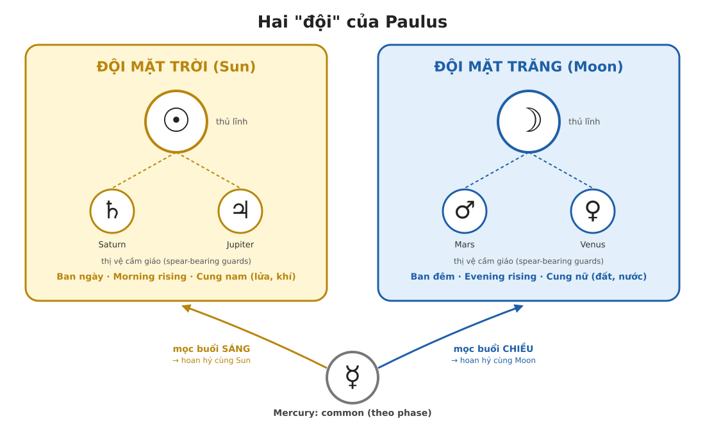
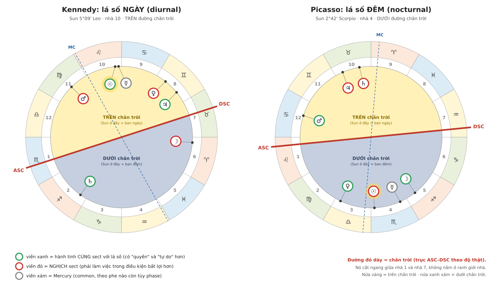
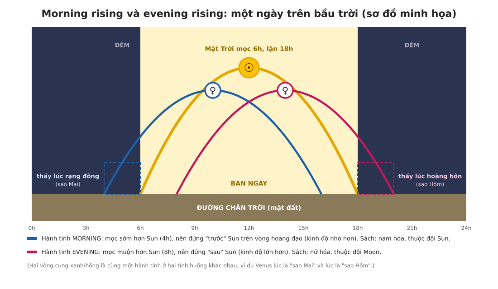

# Sect: phe ngày và phe đêm
*(Demetra George, Ancient Astrology in Theory and Practice Vol. I: "The Third Classification of Planets is According to Sect", "Diurnal and Nocturnal Sect", Figure 9, Example Charts; kèm đoạn trích Paulus)*

Quy ước: **[Sách]** = nội dung có trong trang sách. **[Bổ sung]** = mình tự diễn giải hoặc ghép từ các note trước. Phần [Bổ sung] không phải lời tác giả.

---

## 0. Tóm tắt nhanh

- **Sect** = "phe/đội". Mỗi lá số thuộc một phe: **ngày (diurnal)** nếu Sun ở trên đường chân trời, **đêm (nocturnal)** nếu Sun ở dưới.
- Mỗi hành tinh cũng thuộc một phe. **Đội Sun**: Sun, Jupiter, Saturn. **Đội Moon**: Moon, Venus, Mars. **Mercury** là common (theo phase).
- Hành tinh **cùng phe** với lá số có nhiều "quyền hạn và tự do" hơn để mang ra ý nghĩa tích cực. Hành tinh **nghịch phe** thì khó hơn.
- Sect là **một trong những điều đầu tiên** cần xem khi phân tích condition của hành tinh, và là điểm xuất phát của nhiều kỹ thuật khác (tuổi thọ, mức độ nổi bật, công thức Part of Fortune...).

---

## 1. Đoạn trích Paulus

**[Sách] Bản dịch ý**

> Vì toàn thể được Mặt Trời và Mặt Trăng cai quản, và không có gì trong vũ trụ ra đời mà thiếu sự cai quản của hai tinh tú này, nên cần giải thích sect của Mặt Trời và Mặt Trăng: mỗi bên được phân cho điều gì, và mọi thứ hội tụ lại qua hai bên như thế nào.
>
> - **Mặt Trời** được phân cho **ban ngày**, **sự mọc buổi sáng** (morning rising) và **các cung nam**. Đội thị vệ cầm giáo của nó là **Saturn và Jupiter**.
> - **Mặt Trăng** được phân cho **ban đêm**, **sự mọc buổi chiều** (evening rising) và **các cung nữ**. Thị vệ cầm giáo của nó là **Mars và Venus**.
> - **Mercury** được coi là mang bản chất **chung** (common). Khi mọc buổi sáng, nó "hoan hỷ" (rejoice) cùng Mặt Trời. Khi mọc buổi chiều, nó hoan hỷ cùng Mặt Trăng.
>
> — Paulus

**Giải thích:**
- Paulus gom mỗi bên thành một **bộ ba**: *ngày + morning + cung nam* (đội Sun) và *đêm + evening + cung nữ* (đội Moon).
- "Thị vệ cầm giáo" nghĩa là các hành tinh còn lại làm đội hộ vệ cho hai luminary (Sun, Moon).
- Đây là cơ sở của quy ước **morning = phe ngày, evening = phe đêm**.
- **[Bổ sung]** Bộ ba này trùng với hai điều kiện đầu của Chương 5 (giới tính của cung và solar phase). Vì thế một hành tinh có thể bị lệch ở điều kiện này nhưng không lệch ở điều kiện kia.

### Hình 2: Hai "đội" của Paulus

---

## 2. Phân loại thứ ba: theo sect

**[Sách] Bản dịch ý**
- *Sect* bắt nguồn từ tiếng Hy Lạp **hairesis**, nghĩa là phe phái, liên minh, trường phái tư tưởng, thậm chí đảng chính trị hay đội.
- Nhiều học thuyết chiêm tinh cổ dựa trên tập quán xã hội của thế giới cổ đại. Sect phản ánh hệ thống **đồng minh và kẻ thù**, việc xác định bạn thù dựa trên liên minh, và **cán cân quyền lực**: phe nào đang giữ đặc quyền và thống trị.
- Sect của lá số và tình trạng sect của một hành tinh là **một trong những cân nhắc đầu tiên** khi phân tích condition của hành tinh.

---

## 3. Sect ngày và sect đêm

**[Sách] Bản dịch ý**
- Chiêm tinh cổ có hai sect: **diurnal** (ngày) và **nocturnal** (đêm). Sinh ban ngày thì lá số là diurnal, sinh ban đêm thì nocturnal.
- **Sect của một hành tinh** quyết định nó có bao nhiêu **quyền hạn và tự do** để mang ra ý nghĩa tích cực cho đương số. Sect cũng cho biết hành tinh đó **nên dựa vào hành tinh nào** để hỗ trợ cho mục tiêu của mình.
- Việc đánh giá hành tinh tốt hay xấu theo sect là đặc điểm chính của chiêm tinh cổ, và phần lớn đã mất trong chiêm tinh hiện đại.
- Sect của lá số còn là **điểm xuất phát** của nhiều kỹ thuật: tính tuổi thọ, đánh giá mức độ nổi bật của đời người, **công thức của nhiều lot** (Arabic Parts), và chọn hành tinh đại diện cho các chủ đề như cha mẹ.
- **Figure 9:** lá số ngày thì Sun ở trên trục ASC–DSC, lá số đêm thì Sun ở dưới trục ASC–DSC.

---

## 4. Cách xác định ngày/đêm

**[Sách] Bản dịch ý**
- Trục cần nhìn là **trục ASC–DSC theo độ chính xác**, đi qua nhà 1 và nhà 7. Đó **không phải** đường ngang ở đầu nhà 1 như trong các hệ quadrant (Placidus...).
- Trục này đánh dấu **đường chân trời** (nơi trời gặp đất). Sách nói hầu hết bản in từ máy tính theo whole sign **không vẽ nó chính xác về mặt hình ảnh**.
- Sun **trên** đường chân trời thì là lá số ngày. Sun **dưới** đường chân trời thì là lá số đêm. Có thể kiểm tra bằng giờ sinh (ban ngày hay ban đêm).

**[Bổ sung]** "Ngày/đêm" ở đây nghĩa là Sun ở trên hay dưới đường chân trời, không phải số giờ trên đồng hồ. Nếu sinh sát lúc mặt trời mọc hoặc lặn, hoặc vào mùa có ngày rất dài/ngắn, nên kiểm theo độ của Sun và trục ASC/DSC.

### Hình 1: Ngày/đêm trên hai lá số thật

- Đường đỏ dày = chân trời (ASC–DSC theo độ thật). Nửa vàng = trên chân trời, nửa xanh xám = dưới chân trời.
- Viền xanh = cùng sect với lá số, viền đỏ = nghịch sect, viền xám = Mercury.
- Chân trời cắt ngang giữa nhà 1 và nhà 7 chứ không nằm ở ranh giới nhà.

---

## 5. Hai lá số ví dụ

**[Sách]**
- **Chart I (Kennedy) là diurnal.** Trục ASC/DSC đi từ 17°58' Scorpio đến 17°58' Taurus. Sun ở 5° Leo **trên** chân trời. Giờ sinh 2:30 pm.
- **Chart II (Picasso) là nocturnal.** Trục đi từ 5°38' Leo đến 5°38' Aquarius, Sun ở 2° Scorpio **dưới** chân trời. Giờ sinh 11:15 pm.

**[Bổ sung] Sect status của từng hành tinh**

| | Cùng sect (in sect) | Nghịch sect (out of sect) | Common |
|---|---|---|---|
| **Kennedy (ngày)** | Sun, Jupiter, Saturn | Moon, Venus, Mars | Mercury |
| **Picasso (đêm)** | Moon, Venus, Mars | Sun, Jupiter, Saturn | Mercury |

---

## 6. Morning rising và evening rising

Hình dưới minh họa lại ý của Paulus bằng một ngày trên bầu trời.

- **Morning**: hành tinh có kinh độ **nhỏ hơn** Sun (tối đa 180°). Nó mọc **trước** Sun nên thấy lúc rạng đông (như "sao Mai"). Thuộc đội Sun, **nam hóa**.
- **Evening**: hành tinh có kinh độ **lớn hơn** Sun. Nó mọc **sau** Sun nên thấy lúc hoàng hôn (như "sao Hôm"). Thuộc đội Moon, **nữ hóa**.
- Hình chỉ là sơ đồ minh họa, không phải giờ mọc thật của hành tinh nào.

---

## 7. Liên hệ với hai lá số đã phân tích

1. **Hình vẽ whole sign của mình đúng ý sách:** đường ASC nằm bên trong nhà 1 và hơi nghiêng, chính là đường chân trời theo độ.
2. **Part of Fortune** mình tính theo sect khớp sách: Kennedy (ngày) dùng Asc + Moon − Sun, Picasso (đêm) dùng Asc + Sun − Moon.
3. **Mercury (common)** theo Paulus:
   - Kennedy: Mercury ở morning phase trong lá số ngày, nên "hoan hỷ cùng Sun".
   - Picasso: Mercury ở evening phase trong lá số đêm, nên "hoan hỷ cùng Moon".
   - [Bổ sung] Cách áp dụng này là của mình.
4. **[Bổ sung] Phase và sect có thể không cùng chiều.** Ví dụ Moon của Kennedy ở morning phase (thuộc đội Sun) nhưng trong lá số ngày thì Moon nghịch sect. Mình chưa tìm thấy sách nói gì về trường hợp này, nên chỉ ghi nhận như một nhận xét.

---

## 8. Từ vựng

| Anh | Việt gợi ý |
|---|---|
| Sect | Phe, đội (từ Hy Lạp *hairesis*) |
| Diurnal / Nocturnal | Ngày / Đêm |
| In sect / Out of sect | Cùng sect / Nghịch sect |
| Horizon | Đường chân trời (trục ASC–DSC) |
| Spear-bearing guards | Thị vệ cầm giáo |
| Common | Chung (không thuộc hẳn phe nào) |
| Morning rising / Evening rising | Mọc buổi sáng / Mọc buổi chiều |
| Rejoice | Hoan hỷ (vui vẻ, hợp phe) |
| Lot (Arabic Part) | Điểm Lot (Part of Fortune...) |

---

## 9. Tự kiểm tra

1. Lá số ngày hay đêm được xác định bằng gì? Có phải bằng đồng hồ không?
2. Hành tinh nào thuộc đội Sun, đội Moon? Mercury thì sao?
3. Vì sao sách dặn dùng trục ASC–DSC theo độ thật, không dùng đường ngang đầu nhà 1?
4. Trong lá số ngày, Mars có cùng sect không?

Đáp án gợi ý

1. Bằng việc Sun ở trên hay dưới đường chân trời (trục ASC–DSC theo độ). Giờ sinh chỉ để kiểm tra lại.
2. Đội Sun: Sun, Jupiter, Saturn. Đội Moon: Moon, Venus, Mars. Mercury là common, theo phase (morning theo Sun, evening theo Moon).
3. Vì đường chân trời thật đi qua giữa nhà 1 và nhà 7 theo độ chính xác của Asc/Dsc, còn đường ngang đầu nhà 1 chỉ là cách vẽ của các hệ quadrant.
4. Không. Mars thuộc đội Moon nên trong lá số ngày nó nghịch sect (như trong lá số Kennedy).

---

## 10. Những điểm nên kiểm tra lại

- **[Bổ sung]** Việc gắn Mercury "hoan hỷ" với phase của Kennedy và Picasso là cách áp dụng của mình, bạn nên đối chiếu thêm với nguồn khác.
- **[Bổ sung]** Điểm 4 ở mục 7 (phase và sect không cùng chiều) mình chưa kiểm chứng trong sách.
- Hình 3 chỉ là sơ đồ minh họa, số giờ trên hình (4h, 6h, 8h, 16h, 18h, 20h) là giá trị giả định.
- Note `note_7` trước đây ghi "morning = phe ngày" như một quy ước của mình. Đoạn Paulus này xác nhận quy ước đó, nên có thể sửa note cũ cho khớp.
