# Hệ phân tán và hệ một máy (Distributed vs Single-Node)

Ghi chú tổng hợp từ DDIA (bản 2), Chương 1, hai mục "Distributed Versus Single-Node Systems" và "Problems with Distributed Systems", kèm phân tích, ví dụ và phần hỏi đáp liên quan.

---

## 1. Định nghĩa

- **Hệ phân tán:** nhiều máy giao tiếp với nhau qua mạng.
- **Node:** mỗi *tiến trình* tham gia hệ phân tán. Không nhất thiết là một máy: ba container FastAPI trên cùng một host ECS vẫn là ba node.

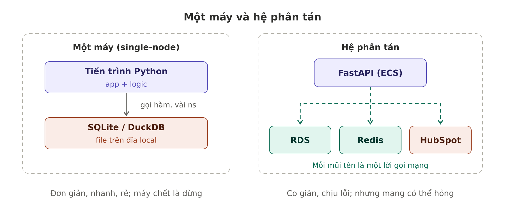

### Phân tán xét theo cái gì?

Định nghĩa xét theo **cấu trúc chạy**: có bao nhiêu tiến trình và chúng có nói chuyện qua mạng không. Không xét app làm nghiệp vụ gì.

Cùng một app quản lý chi phí:
- Một file Python + SQLite trên laptop → **không** phân tán.
- FastAPI + Postgres cùng một máy → hai tiến trình, nhưng gần như không gặp vấn đề mạng.
- FastAPI trên ECS, Postgres trên RDS, cache trên ElastiCache → **phân tán**.

Có trường hợp app phân tán **từ bản chất** (chat, Google Docs, game nhiều người chơi) hoặc **bị luật ép** (dữ liệu phải nằm trong nước).

Dù bắt nguồn từ hạ tầng, phân tán **lan vào code**: phải có timeout, retry, idempotency, xử lý dữ liệu tạm lệch nhau. Nên đây là quyết định kiến trúc, không chỉ là chuyện deploy.

### Gọi một API khác là đã phân tán

Chỉ cần code gửi request qua mạng tới một tiến trình khác rồi chờ response (ví dụ gọi HubSpot API) là hệ thống đã phân tán, kể cả khi app bên kia không phải của bạn. Vì vậy gần như mọi backend dùng RDS, Redis, S3, SQS đều là hệ phân tán. Câu hỏi thực tế không còn là "có phân tán không" mà là:
1. Phần nào AWS lo hộ, phần nào mình phải lo?
2. Phân tán tới mức nào là đủ?

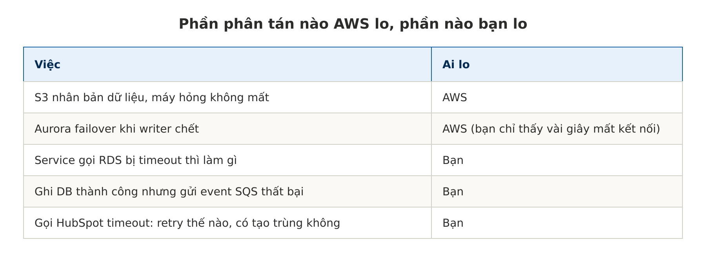

Managed service giấu đi phần phân tán *bên trong* nó; phần *giữa các thành phần* vẫn là của bạn.

---

## 2. Chín lý do dùng hệ phân tán

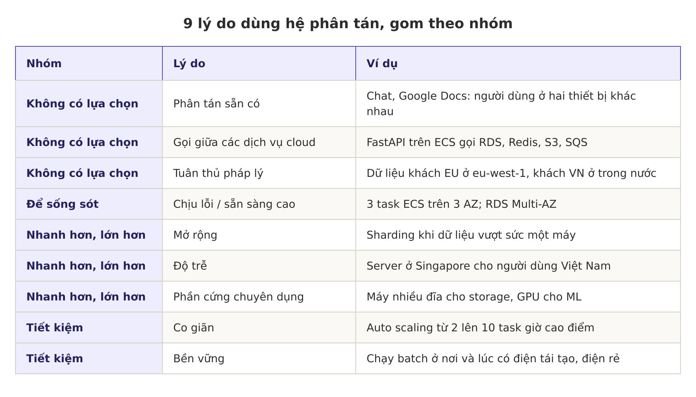

Ghi chú thêm cho từng lý do:

- **Phân tán sẵn có:** nhiều người dùng trên nhiều thiết bị thì bắt buộc đi qua mạng.
- **Gọi giữa các dịch vụ cloud:** hệ quả trực tiếp của việc tách storage và compute. Đã tách là đã phân tán.
- **Chịu lỗi:** máy, mạng, thậm chí cả data center có thể sập; nhiều máy dự phòng cho nhau.
- **Mở rộng:** dữ liệu hoặc khối lượng tính toán vượt sức một máy thì chia ra.
- **Độ trễ:** TP.HCM ↔ Virginia khoảng 230 ms một vòng, TP.HCM ↔ Singapore khoảng 35 ms.
- **Co giãn:** một máy phải mua đủ cho lúc cao điểm, cloud thì trả theo lúc dùng.
- **Phần cứng chuyên dụng:** dòng `d`/`i` cho storage, `r` cho cache/DB, `c` cho tính toán, `p`/`g` cho ML. Đây cũng là một lợi ích của việc tách storage và compute.
- **Tuân thủ pháp lý:** GDPR, Nghị định 13 của Việt Nam... Liên hệ mô hình multi-tenant **silo**: có tenant bị tách riêng vì luật chứ không vì kỹ thuật.
- **Bền vững:** dời job batch sang nơi và lúc có nhiều điện tái tạo, điện rẻ.

Các lý do này áp dụng cho cả code tự viết lẫn phần mềm có sẵn như database.

**Các lý do có thể mâu thuẫn nhau:** luật muốn dữ liệu ở một chỗ cố định, độ trễ muốn dữ liệu ở gần người dùng, bền vững muốn job chạy ở nơi điện sạch.

---

## 3. Availability Zone (AZ) là gì

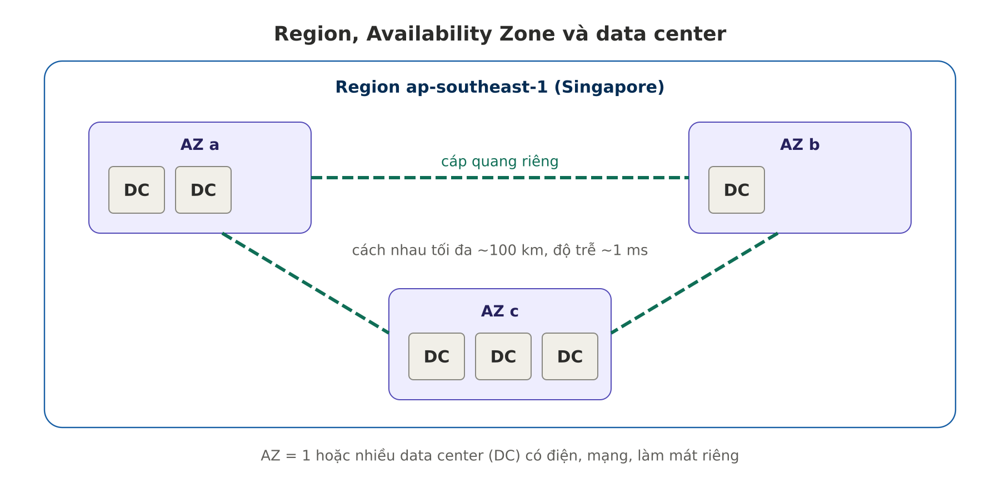

- **Region** (ví dụ `ap-southeast-1`) gồm nhiều AZ.
- **AZ** là một hoặc nhiều **data center vật lý** có điện, mạng, kết nối riêng và có dự phòng.
- Các AZ cách nhau một khoảng đủ xa (tối đa khoảng 100 km) để một sự cố không kéo sập nhiều AZ.
- Nối với nhau bằng **cáp quang metro riêng của AWS, có dự phòng hoàn toàn**; đủ gần để nhân bản đồng bộ với độ trễ vài mili giây.
- Tên `ap-southeast-1a` ở mỗi account có thể trỏ tới AZ vật lý khác nhau; muốn chính xác thì xem **AZ ID** (dạng `apse1-az1`).

Liên hệ:
- "3 task ECS trên 3 AZ" = đặt ở ba tòa nhà khác nhau.
- Aurora ghi 6 bản qua 3 AZ đi qua chính các sợi cáp này.
- AWS tính phí truyền dữ liệu giữa các AZ (thường khoảng $0,01/GB mỗi chiều), nên gọi DB khác AZ liên tục với lượng dữ liệu lớn có thể làm hóa đơn tăng.

---

## 4. Năm vấn đề của hệ phân tán

### 4.1. Mọi lời gọi mạng đều có thể thất bại

Mạng có thể đứt, service bên kia quá tải hoặc sập, nên request có thể timeout mà không có response. Khi đó **không biết** bên kia đã nhận hay chưa, và retry đơn giản có thể không an toàn (Chương 9).

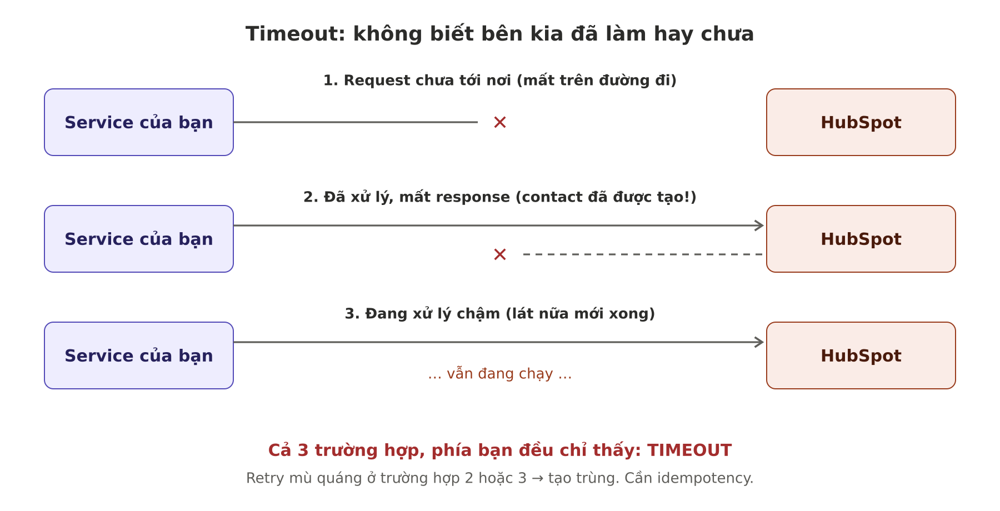

Ví dụ nguy hiểm: API thanh toán timeout, retry, khách bị trừ tiền hai lần. Vì vậy các API thanh toán như Stripe dùng `Idempotency-Key`.

Code gọi API nên có:

```python
import asyncio, httpx

async def create_contact(email: str, props: dict):
    async with httpx.AsyncClient(timeout=httpx.Timeout(10.0)) as client:  # 1. Luôn đặt timeout
        for attempt in range(3):                                          # 2. Retry có giới hạn
            try:
                # 3. Upsert theo email thay vì create -> gọi lại vẫn chỉ ra 1 contact
                resp = await client.post(UPSERT_URL, json={"email": email, **props})
                if resp.status_code == 429:                               # 4. Rate limit
                    await asyncio.sleep(2 ** attempt)
                    continue
                resp.raise_for_status()
                return resp.json()
            except httpx.TimeoutException:
                await asyncio.sleep(2 ** attempt)                         # 5. Backoff tăng dần
    raise RuntimeError("HubSpot không phản hồi sau 3 lần thử")
```

### 4.2. Gọi qua mạng chậm hơn gọi hàm rất nhiều

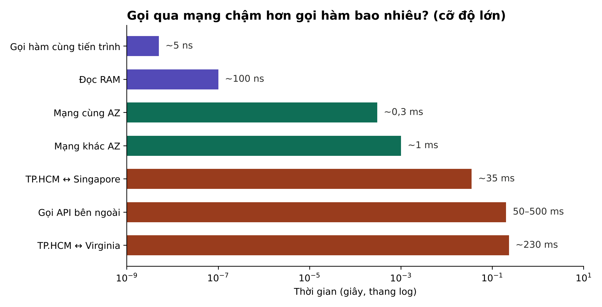

Từ vài nano giây (gọi hàm) lên nửa mili giây (mạng cùng AZ) là chênh khoảng **100.000 lần**. Nếu gọi hàm mất 1 giây thì gọi service cùng AZ tương đương hơn một ngày.

Hệ quả hay gặp nhất là **lỗi N+1 qua mạng**:

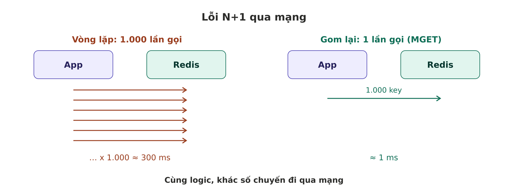

```python
# Chậm: 1.000 lần gọi Redis
for cid in contact_ids:
    data = await redis.get(f"contact:{cid}")

# Nhanh: 1 lần gọi
data = await redis.mget([f"contact:{cid}" for cid in contact_ids])
```

Thói quen tốt: thấy lời gọi DB, Redis, API nằm trong vòng lặp thì dừng lại hỏi "gom được không?" (batch API, `MGET`, pipeline, `IN (...)`).

### 4.3. Mang tính toán tới dữ liệu; nhiều node chưa chắc đã nhanh hơn

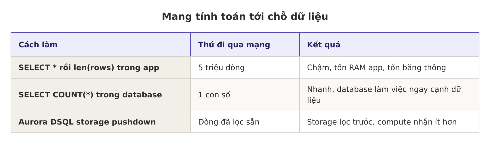

```sql
-- Tốt: database tự đếm, chỉ trả về 1 con số
SELECT COUNT(*) FROM events WHERE tenant_id = 'acme';
```

Thêm node không phải lúc nào cũng nhanh hơn. Bài *"Scalability! But at what COST?"* (Frank McSherry và cộng sự) cho thấy một số hệ phân tán chạy trên hàng trăm core vẫn thua một chương trình đơn luồng trên laptop, vì thời gian bị tiêu cho việc chia việc, gửi dữ liệu và đồng bộ giữa các node.

### 4.4. Debug khó, cần observability

Ba trụ cột:
- **Metric:** con số tổng hợp (latency p99, số lỗi/phút).
- **Log:** từng sự kiện chi tiết.
- **Trace:** đường đi của một request qua nhiều thành phần.

**Tracing theo dõi gì?** Từ ngoài nhìn vào, request chỉ là client → server → client. Nhưng bên trong server còn rất nhiều lời gọi mạng (DB, cache, API ngoài, service khác). Mỗi lời gọi là một **span**; các span của cùng request gộp thành một **trace**.

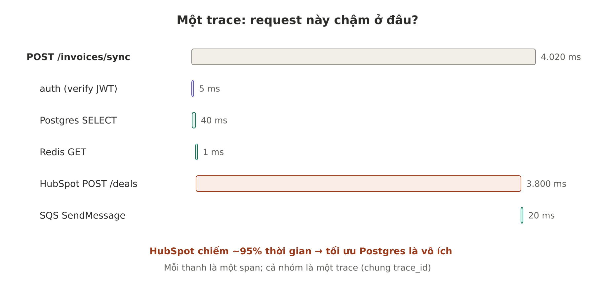

"Service" trong tracing là **bất kỳ thành phần nào được gọi qua mạng** (database, cache, queue, API ngoài, service khác), không phải module hay function trong codebase. Vẫn có thể tạo span thủ công cho đoạn code nặng nếu muốn đo:

```python
with tracer.start_as_current_span("build_invoice_pdf"):
    pdf = render_pdf(invoice)
```

Trace đi xuyên nhiều service nhờ truyền `trace_id` qua header chuẩn W3C `traceparent` (hoặc metadata của message trong queue):

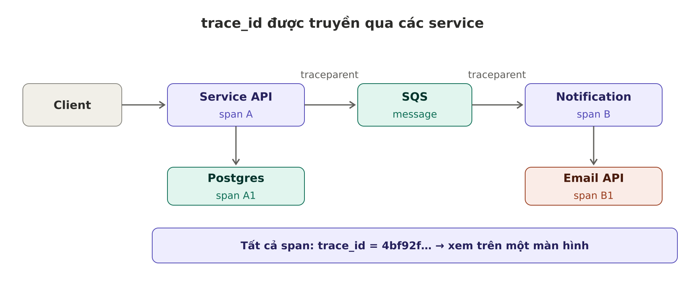

**Hệ thống nhỏ có cần OpenTelemetry không?** Một service FastAPI + Postgres + Redis + vài API ngoài thì chưa cần dựng cả bộ tracing. Request ID + log JSON trên CloudWatch thường là đủ:

```python
import time, uuid, logging
from fastapi import Request

@app.middleware("http")
async def add_request_id(request: Request, call_next):
    rid = request.headers.get("x-request-id", str(uuid.uuid4()))
    request.state.rid = rid
    start = time.perf_counter()
    resp = await call_next(request)
    logging.info({"rid": rid, "path": request.url.path,
                  "ms": round((time.perf_counter() - start) * 1000)})
    resp.headers["x-request-id"] = rid
    return resp
```

Nên thêm tracing khi: có từ 3 service trở lên gọi qua lại, log không trả lời nổi "chậm ở đâu", hoặc có xử lý bất đồng bộ qua queue. Cách nhẹ: auto-instrumentation OpenTelemetry cho FastAPI, httpx, asyncpg, redis, đẩy sang AWS X-Ray hoặc Grafana Tempo.

### 4.5. Giữ dữ liệu nhất quán giữa các service thành việc của bạn

Database có cơ chế nhất quán riêng (Chương 6, 8). Nhưng khi mỗi service có database riêng, giữ dữ liệu khớp nhau là việc của ứng dụng. Distributed transaction hiếm được dùng trong microservices vì đi ngược mục tiêu độc lập, và nhiều database không hỗ trợ.

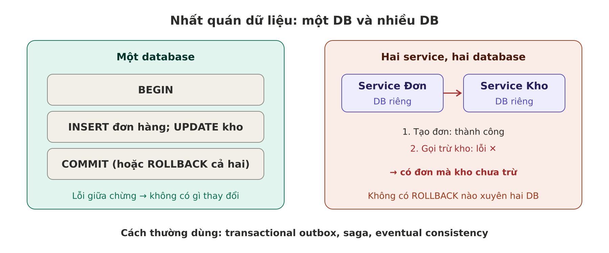

Cách thường dùng thay thế:
- **Transactional outbox:** ghi dữ liệu và event vào cùng một DB trong một transaction, worker gửi event sau.
- **Saga:** chia thành nhiều bước, bước nào lỗi thì chạy bước bù trừ (huỷ đơn, hoàn tiền).
- Chấp nhận **eventual consistency**: lệch vài giây rồi sẽ khớp.

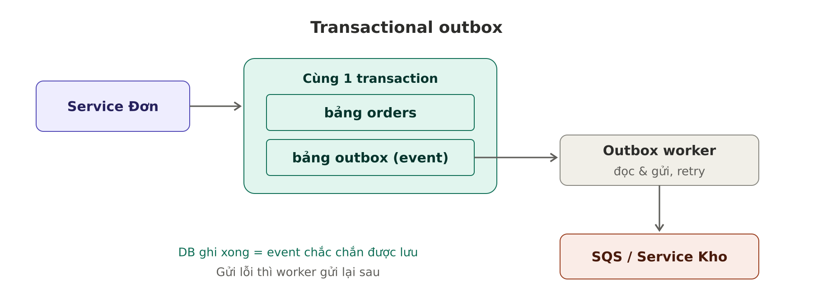

---

## 5. Kết luận của sách: một máy thường đơn giản và rẻ hơn

CPU, RAM, đĩa ngày càng lớn, nhanh, tin cậy. Kết hợp với database một node như **DuckDB, SQLite, KùzuDB**, rất nhiều workload chạy gọn trên một máy (Chương 4).

```python
import duckdb
duckdb.sql("""
    SELECT tenant_id, COUNT(*) AS events
    FROM 's3://bucket/logs/*.parquet'
    GROUP BY tenant_id ORDER BY events DESC
""").show()
```

Phân tích 20 GB log trên một máy, một tiến trình, không cần cluster.

---

## 6. Insight

1. **Đọc hai mục chung với nhau:** 9 lý do *nên* phân tán và 5 cái giá phải trả. Phân tán khi lợi ích lớn hơn cái giá.
2. **Gốc của hầu hết vấn đề hiệu năng** là gọi qua mạng quá nhiều lần, không phải CPU yếu.
3. **Mọi thứ nối với nhau:** tách storage–compute cho co giãn nhưng biến I/O thành lời gọi mạng; microservices cho độc lập nhưng mất transaction.
4. **Mỗi service thêm vào là thêm một chỗ có thể đứt.** Đừng tách nhỏ chỉ vì "microservices nghe xịn".
5. **"Đủ dùng" thường là một máy.** Trước khi thêm service hay cluster, hỏi: một máy lớn hơn hoặc một Postgres tốt hơn có giải quyết được không?

---

## 7. Tài liệu tham khảo

- AWS, *Availability Zones – AWS Fault Isolation Boundaries*: https://docs.aws.amazon.com/whitepapers/latest/aws-fault-isolation-boundaries/availability-zones.html
- AWS, *Regions and Availability Zones*: https://aws.amazon.com/about-aws/global-infrastructure/regions_az/
- Frank McSherry, Michael Isard, Derek G. Murray, *Scalability! But at what COST?* (HotOS 2015)
- OpenTelemetry cho Python: https://opentelemetry.io/docs/languages/python/
- W3C Trace Context (`traceparent`): https://www.w3.org/TR/trace-context/
