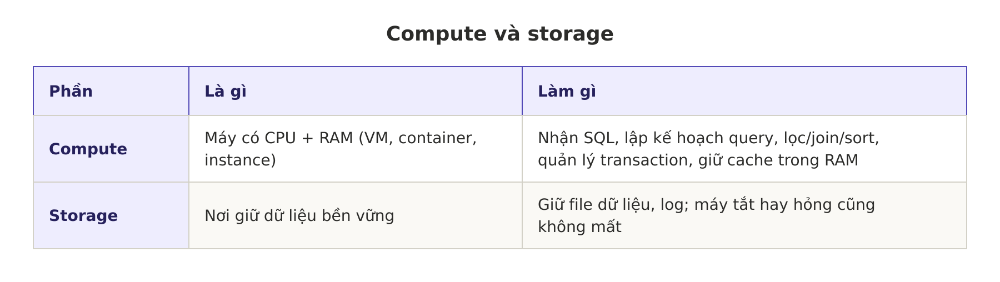
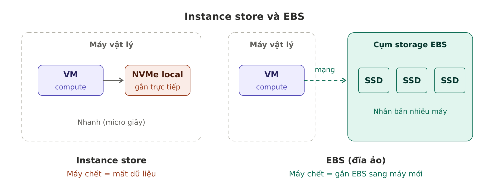
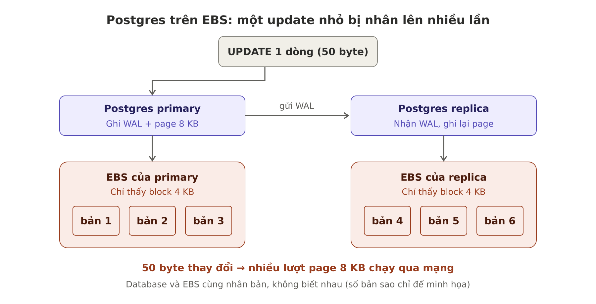
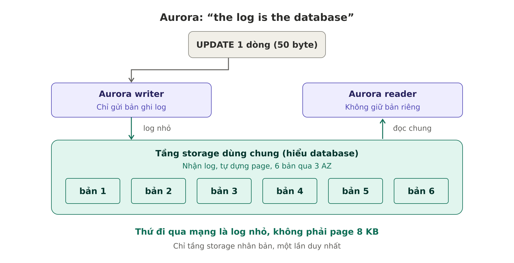
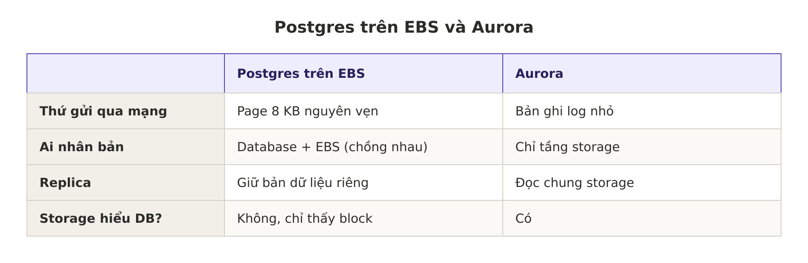
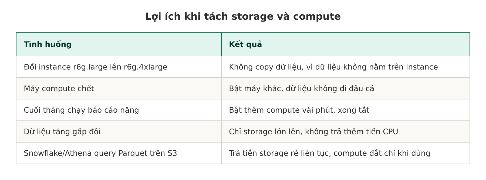
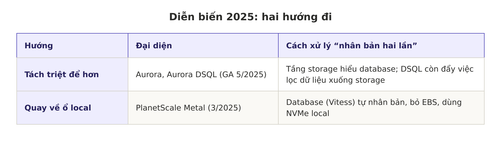

# Tách storage và compute trong cloud

Ghi chú tổng hợp từ DDIA (bản 2), Chương 1, mục "Separation of storage and compute" (tr.13–16), kèm phân tích, ví dụ và tài liệu mới.

---

## 1. Compute và storage là gì?

**So sánh dễ nhớ (thư viện):**
- Storage = kho sách: to, rẻ, ít thay đổi.
- Compute = người đọc ngồi ở bàn: tốn chi phí, số lượng lên xuống theo giờ.
- Kiến trúc truyền thống: mỗi người đọc tự mang theo nguyên kho sách.
- Kiến trúc tách rời: một kho chung, đông người thì kê thêm bàn, vắng thì cất bàn.

**Liên hệ thực tế:** service FastAPI trên ECS là compute thuần; Redis, RDS, S3 là nơi giữ state. Đó là lý do container nên stateless.

---

## 2. Ba cách lưu dữ liệu trên cloud

### 2.1. Instance store (đĩa local thật)
- SSD/NVMe gắn trực tiếp vào máy vật lý đang chạy VM.
- Rất nhanh (độ trễ cỡ micro giây), không đi qua mạng.
- VM bị stop, hỏng, hoặc dời sang máy khác → **mất dữ liệu**.
- Cloud native coi nó như **cache tạm**, không phải nơi lưu lâu dài.
- Trên AWS: chỉ một số loại instance có (ví dụ dòng có chữ `d`: `m5d`, `i3`, `i4i`).

### 2.2. Đĩa ảo (EBS, Azure managed disk, GCP persistent disk)
- Là **một cụm máy chủ lưu trữ riêng**, nằm ở chỗ khác trong data center. Bên trong vẫn là SSD vật lý.
- VM "thấy" nó như một ổ đĩa (`/dev/nvme1n1`), format và mount bình thường.
- Thực chất mỗi lần đọc/ghi một block (thường 4 KiB) là **một request qua mạng**.
- Mỗi block được nhân bản sang nhiều máy trong cùng Availability Zone.
- Tháo ra được, gắn sang VM khác được → dữ liệu sống độc lập với máy tính toán.
- Lưu ý: phần lớn EC2 hiện nay **mặc định đã dùng EBS làm ổ gốc**.

**Tương tự on-premise:** VMware thường để VM trên SAN/vSAN (lưu trữ dùng chung), nhờ vậy mới làm được vMotion. EBS là phiên bản "dịch vụ thuê" của ý tưởng này.

### 2.3. Dịch vụ lưu trữ chuyên dụng (cách cloud native chọn)
- Object storage (S3, Azure Blob, Cloudflare R2): phù hợp file lớn (vài trăm KB đến vài GB).
- Database cloud native: quản lý giá trị nhỏ ở một dịch vụ riêng, gom nhiều giá trị thành block lớn để lưu trên object store.
- Hoặc tầng storage riêng được thiết kế cho chính database đó (Aurora storage).

---

## 3. Nhược điểm của đĩa ảo

### 3.1. Độ trễ
- NVMe local: vài chục đến ~100 micro giây.
- EBS: dưới 1 ms đến ~1 ms → chậm hơn từ khoảng 10 lần trở lên mỗi thao tác.
- App web thường không cảm nhận được; database làm hàng nghìn I/O nhỏ mỗi giây thì cộng dồn rất nhanh.

### 3.2. Phụ thuộc mạng
- Ổ local: chạy hoặc hỏng hẳn.
- EBS: có thêm trạng thái lưng chừng — mạng nghẽn làm I/O **treo** vài giây.
- Ví dụ: Postgres commit transaction phải chờ WAL ghi xong; mạng tới EBS nghẽn 3 giây → mọi transaction đứng chờ, API timeout, dù CPU/RAM của EC2 vẫn rảnh.

### 3.3. Overhead của việc "giả làm ổ đĩa"
EBS không biết bên trên là database, nó chỉ thấy block. Hệ quả:

- **Ghi cả page dù chỉ đổi vài byte:** update 1 dòng 50 byte → Postgres ghi nguyên page 8 KB (≈ 160 lần), tương đương 2 block EBS gửi qua mạng.
- **Nhân bản hai lần:** database tự có replica, EBS bên dưới lại nhân bản từng block thêm lần nữa.
- **Giới hạn IOPS/throughput theo volume:** vượt trần là bị bóp, dù máy còn khỏe.
- **Gắn với 1 AZ:** không gắn được sang EC2 ở AZ khác.

**Ví dụ đời thường:** sửa một chữ trong tài liệu Word 100 trang, nhưng phải gửi lại nguyên trang chứa chữ đó, rồi cả bạn lẫn dịch vụ lưu trữ đều tự photo thêm vài bản.

---

## 4. Aurora giải quyết thế nào: "the log is the database"

- Instance chỉ gửi **bản ghi log mô tả thay đổi** (kiểu "dòng X đổi từ A thành B") xuống tầng storage.
- Tầng storage **hiểu database**, tự dựng lại page từ log.
- Dữ liệu được giữ 6 bản qua 3 AZ, chỉ ở tầng storage (nhân bản một lần).
- Reader dùng chung storage với writer, không giữ bản dữ liệu riêng.
- Theo paper gốc: chỉ ghi redo log xuống storage giúp giảm số I/O mỗi transaction khoảng 8 lần (7,4 → 0,95 so với MySQL mirrored).

**Ví dụ đời thường:** thay vì gửi lại nguyên trang, chỉ gửi một dòng "trang 37, dòng 5, đổi chữ A thành B"; bên lưu trữ tự sửa vào bản gốc.

---

## 5. Lợi ích khi tách storage và compute

**Cái giá phải trả:** mọi thứ thành lời gọi mạng → latency và độ ổn định mạng quyết định hiệu năng.

---

## 6. Diễn biến 2025: hai hướng đi

Số liệu từ PlanetScale: một workload ~1 triệu QPS có độ trễ I/O ~1 ms trên ổ mạng, xuống mức micro giây trên NVMe local. Depot chuyển từ 8 CPU + EBS xuống 4 CPU + NVMe vì hết thời gian chờ I/O.

**Điểm chung:** cả hai đều tránh EBS đứng giữa như một "ổ đĩa giả" không hiểu database.

---

## 7. Bài học thiết kế

1. Container/service nên **stateless**; đừng ghi state quan trọng vào đĩa local của container.
2. Đẩy state ra dịch vụ chuyên dụng: Redis/ElastiCache, RDS/Aurora, S3.
3. Redis chạy trong task ECS ghi vào đĩa local → task bị reschedule là mất dữ liệu.
4. Khi debug latency database trên EBS, xem cả metric của volume (IOPS, throughput, queue length), không chỉ CPU/RAM.
5. "Postgres chạy trên EC2/RDS" là phần mềm truyền thống đem lên cloud; "Aurora" mới là cloud native thật sự.

---

## 8. Tài liệu đọc thêm

**Kinh điển**
- Amazon Aurora paper (SIGMOD 2017): https://pdos.csail.mit.edu/6.824/papers/aurora.pdf
  → Đọc Section 1, 3.1–3.2; xem Figure 2 và Figure 3.
- Tóm tắt của The Morning Paper: https://blog.acolyer.org/2019/03/25/amazon-aurora-design-considerations-for-high-throughput-cloud-native-relational-databases/

**Mới (2025)**
- Xiangyao Yu, *Disaggregation: A New Architecture for Cloud Databases* (VLDB 2025, 4 trang): https://vldb.org/pvldb/vol18/p5527-xiangyao.pdf
- Tóm tắt của Murat Demirbas: https://muratbuffalo.blogspot.com/2025/09/disaggregation-new-architecture-for.html
- PlanetScale Metal: https://planetscale.com/blog/planetscale-metal-theres-no-replacement-for-displacement
- Case study Depot: https://depot.dev/blog/faster-database-with-planetscale-metal
- Marc Brooker về Aurora DSQL: https://brooker.co.za/blog/2024/12/04/inside-dsql/
- Loạt bài DeNA về DSQL: https://engineering.dena.com/blog/2025/07/aurora-dsql_01_aurora_en/
- AWS 10 năm Aurora: https://aws.amazon.com/blogs/aws/celebrating-10-years-of-amazon-aurora-innovation

**Thứ tự đọc gợi ý:** blog Murat (15 phút) → PlanetScale Metal (thấy mặt trái của EBS bằng số liệu) → Aurora paper → Marc Brooker về DSQL.
