# Case study timeline kiểu Twitter: polling, fan-out và load parameters

Ghi chú tổng hợp từ DDIA (bản 2), mở đầu Chương 2 ("Representing Users, Posts, and Follows" và "Materializing and Updating Timelines"), kèm phân tích, ví dụ và phần hỏi đáp liên quan.

---

## 1. Bối cảnh: ba bảng trong database quan hệ

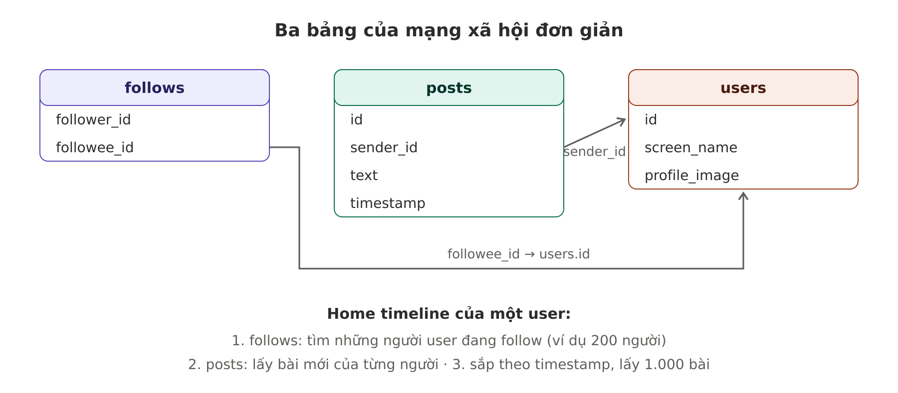

| Bảng | Cột | Ý nghĩa |
|---|---|---|
| `users` | `id`, `screen_name`, `profile_image` | Thông tin người dùng |
| `posts` | `id`, `sender_id`, `text`, `timestamp` | Ai đăng gì, lúc nào |
| `follows` | `follower_id`, `followee_id` | Ai follow ai |

**Chốt từ ngữ:**
- **Followee** = người *mình* follow. Bạn follow 200 người → bạn có 200 followee.
- **Follower** = người follow *mình*.

Thao tác đọc chính là **home timeline**: bài mới nhất của những người mình đang follow.

```sql
SELECT posts.*, users.* FROM posts
  JOIN follows ON posts.sender_id = follows.followee_id
  JOIN users   ON posts.sender_id = users.id
  WHERE follows.follower_id = current_user
  ORDER BY posts.timestamp DESC
  LIMIT 1000
```

---

## 2. Cách 1: polling, và vì sao nó quá đắt

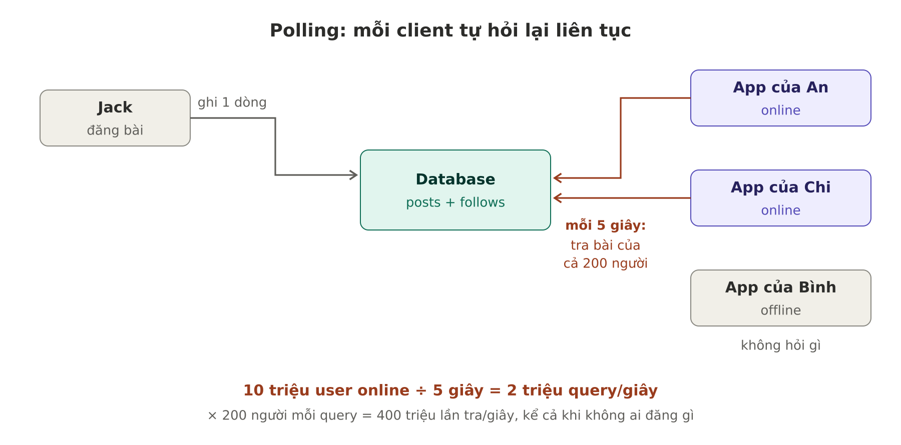

- Muốn follower thấy bài mới trong vòng **5 giây**.
- **Polling:** client của mỗi user đang online chạy lại query mỗi 5 giây.
- 10 triệu user online ÷ 5 giây = **2 triệu query/giây**.
- Mỗi query tra bài của khoảng 200 người: 2 triệu × 200 = **400 triệu lần tra/giây**.
- Có user follow hàng chục nghìn tài khoản, query của họ còn đắt hơn nhiều.

**Phần lãng phí:** trong 5 giây có thể chỉ 1 trong 200 người đăng bài, nhưng query vẫn tra cả 200 người và trả về 1.000 bài, gần như toàn bộ giống lần trước. Lặp mãi, kể cả khi không ai đăng gì.

**Hình dung:** cứ 5 giây bạn chạy qua nhà 200 người bạn gõ cửa hỏi "có thư mới cho tôi không?".

---

## 3. Cách 2: tính sẵn timeline (materialize) bằng fan-out

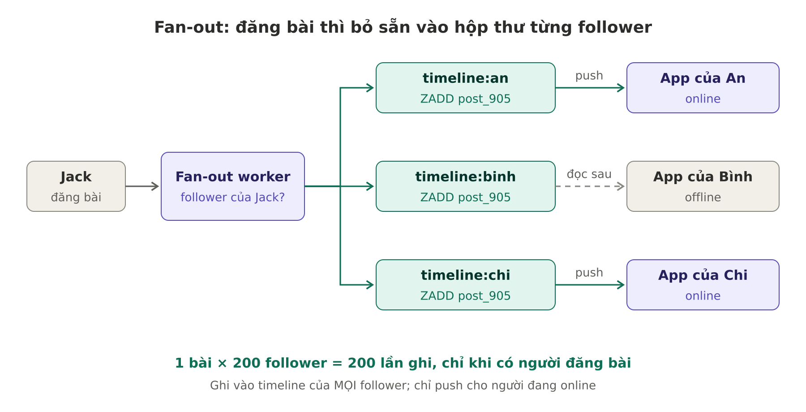

Hai thay đổi:
1. **Push thay vì poll:** server chủ động đẩy bài mới tới follower đang online.
2. **Tính trước kết quả query:** mỗi user có sẵn một timeline, xem timeline là đọc từ cache.

Khi có người đăng bài: tìm toàn bộ follower của người đó, **chèn bài vào timeline của từng follower**, giống bưu tá bỏ thư vào hộp thư từng nhà.

**Hai việc khác nhau, dễ nhầm:**

| Việc | Áp dụng cho ai | Mục đích |
|---|---|---|
| Chèn bài vào timeline tính sẵn | **Mọi** follower, kể cả offline | Lúc nào mở app thì timeline cũng đã sẵn |
| Đẩy thông báo bài mới (push qua WebSocket / SSE) | Chỉ follower **đang online** | Thấy bài ngay, không cần tải lại |

*Thực tế:* ở quy mô hàng trăm triệu tài khoản, nhiều hệ thống chỉ giữ timeline tính sẵn cho người dùng hoạt động gần đây; người lâu không vào thì dựng lại timeline một lần khi họ quay lại.

### Cấu trúc dữ liệu

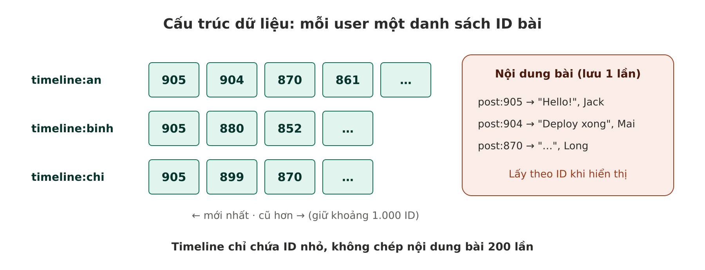

- Mỗi user một danh sách **ID bài**, xếp theo thời gian, giữ khoảng 1.000 bài mới nhất (ví dụ Redis sorted set, điểm số là timestamp).
- Nội dung bài lưu **một lần**, lấy theo ID khi hiển thị. Một bài gửi tới 200 người chỉ tốn 200 ID nhỏ.

### Ví dụ cài đặt (FastAPI + Redis + SQS)

```python
# Đăng bài: lưu bài, đẩy việc fan-out vào queue
async def create_post(sender_id: int, text: str):
    post_id, ts = await db.insert_post(sender_id, text)
    await sqs.send_message({"post_id": post_id, "sender_id": sender_id, "ts": ts})
    return post_id

# Worker: chèn bài vào timeline của từng follower
async def fan_out(post_id: int, sender_id: int, ts: float):
    follower_ids = await db.get_follower_ids(sender_id)
    pipe = redis.pipeline()                              # gom lệnh, 1 chuyến đi qua mạng
    for fid in follower_ids:
        pipe.zadd(f"timeline:{fid}", {post_id: ts})
        pipe.zremrangebyrank(f"timeline:{fid}", 0, -1001)  # chỉ giữ 1.000 bài mới nhất
    await pipe.execute()
    await notify_online_followers(follower_ids, post_id)   # push cho người đang online

# Xem timeline: đọc thẳng danh sách có sẵn, không JOIN
async def get_timeline(user_id: int):
    ids = await redis.zrevrange(f"timeline:{user_id}", 0, 999)
    return await load_posts_by_ids(ids)
```

### So sánh nhanh

| | Polling | Fan-out |
|---|---|---|
| Công việc xảy ra khi | User **đọc**, lặp lại mỗi 5 giây | Có người **đăng bài**, mỗi bài một lần |
| Không ai đăng gì | Vẫn tra liên tục | Không làm gì |
| Mở app | Chạy query JOIN nặng | Đọc một danh sách có sẵn |

---

## 4. Đọc và ghi: dồn việc nặng vào đâu

Mấu chốt: **việc nặng phải làm ở đâu đó, câu hỏi là làm lúc đăng bài hay lúc xem bài.**

Số liệu trong sách:
- **Ghi** (đăng bài): 5.800 lần/giây.
- **Đọc** (xem timeline): 2 triệu lần/giây, gấp khoảng 345 lần.
- **Hệ số fan-out:** trung bình mỗi bài tới 200 follower.

| | Polling (nặng lúc đọc) | Fan-out (nặng lúc ghi) |
|---|---|---|
| Mỗi lần đăng bài | 1 thao tác | 200 thao tác |
| × 5.800 lần đăng/giây | **5.800** | **1,16 triệu** |
| Mỗi lần xem timeline | 200 thao tác | 1 thao tác |
| × 2 triệu lần xem/giây | **400 triệu** | **2 triệu** |
| **Tổng** | **≈ 400 triệu** | **≈ 3,2 triệu** |

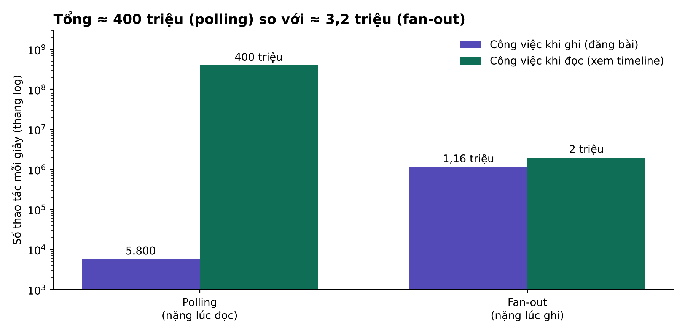

**Quy tắc:** phía nào bị nhân với con số lớn hơn thì làm cho phía đó nhẹ. Xem timeline nhân với 2 triệu, đăng bài chỉ nhân với 5.800, nên đẩy việc nặng sang lúc đăng bài.

**Hình dung quán phở:** quán đông khách thì nấu nước dùng sẵn từ sáng (nặng lúc chuẩn bị, mỗi tô múc ra nhanh). Một ngày chỉ có 2 khách mà nấu nồi 50 lít là phí. Tùy số khách.

**Fan-out** là hệ số nhân số request: một request ban đầu kéo theo bao nhiêu request phía sau.

---

## 5. Khi bài đăng tăng đột biến: dùng queue

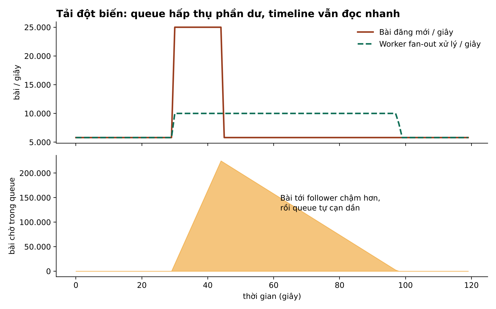

- Không cần phát bài vào timeline ngay lập tức; **xếp vào hàng đợi**, chấp nhận bài hiện ra chậm hơn một chút.
- Timeline **vẫn tải nhanh** vì vẫn đọc từ cache.
- Ví dụ: chung kết World Cup, bài đăng tăng vọt. Queue dài ra, bài tới follower chậm 30 giây thay vì 5 giây, nhưng không ai bị timeout khi mở app.

Đây là lợi ích kinh điển của queue: **tách lúc nhận việc khỏi lúc làm việc**, dàn mỏng đỉnh tải theo thời gian. Đổi lại là dữ liệu tạm thời chưa khớp (eventual consistency).

---

## 6. Dữ liệu dẫn xuất và materialized view

**Dữ liệu dẫn xuất (derived data):** dữ liệu được tính ra từ dữ liệu gốc (source of truth) để đọc nhanh hoặc tiện hơn.

**Phép thử:** xóa mất nó thì có dựng lại được từ dữ liệu khác không? Được thì là dữ liệu dẫn xuất.

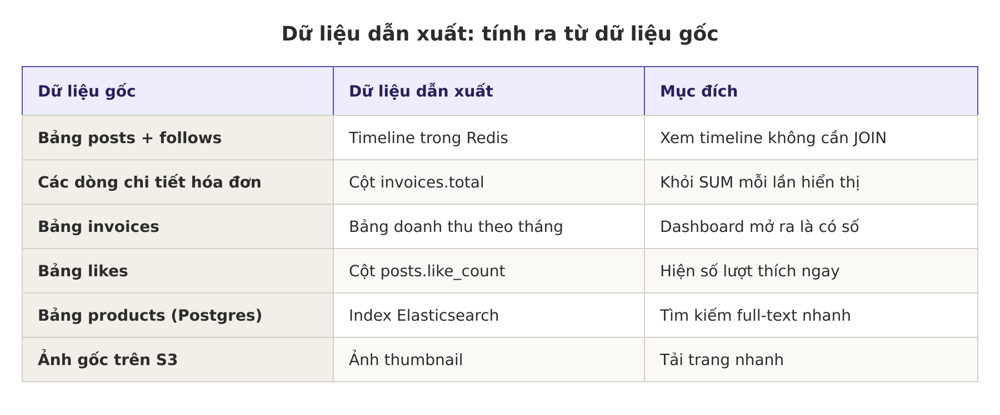

- **Materialization:** tính trước và cập nhật kết quả của một query.
- **Materialized view:** kết quả tính sẵn đó. Cache timeline là một ví dụ. Postgres có `CREATE MATERIALIZED VIEW` (phải tự `REFRESH`).
- **Cái giá chung:** dữ liệu gốc đổi thì bản dẫn xuất phải được cập nhật theo; quên hoặc chậm thì hai bên lệch nhau (bỏ like mà `like_count` chưa giảm, sửa giá mà ô tìm kiếm vẫn hiện giá cũ).

Câu hỏi luôn phải trả lời: **ai cập nhật bản tính sẵn, và chậm bao lâu thì chấp nhận được?**

---

## 7. Hai trường hợp cực đoan

### 7.1. User follow quá nhiều tài khoản
Timeline nhận lượng ghi rất lớn, nhưng người đó không đọc hết. **Bỏ bớt một số lần ghi**, chỉ hiện một mẫu bài là chấp nhận được.

### 7.2. Người nổi tiếng có hàng triệu follower
Không được bỏ bớt. Tính thử: 100 triệu follower, hệ thống ghi khoảng 1 triệu lần/giây → riêng một bài đã chiếm **~100 giây** công suất toàn hệ thống.

Cách giải: **xử lý bài của người nổi tiếng riêng**, lưu riêng và gộp vào timeline lúc đọc.

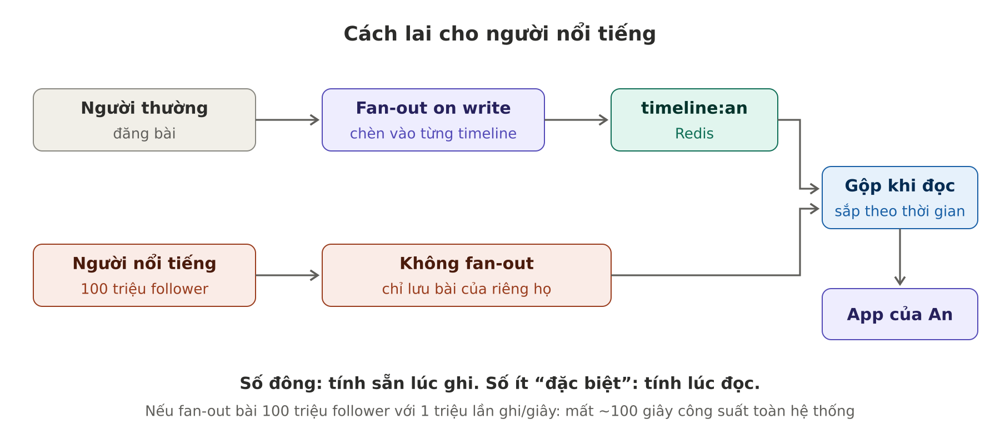

Tức là **fan-out on write cho số đông**, **fan-out on read cho số ít đặc biệt**.

---

## 8. Thiết kế xuất phát từ con số (load parameters)

Trước khi chọn cách làm, ước lượng tải của **từng tính năng**, rồi để con số quyết định. DDIA gọi đây là **load parameters**:

- Mỗi giây bao nhiêu lần đọc, bao nhiêu lần ghi? Tỉ lệ đọc/ghi?
- Hệ số fan-out?
- Dữ liệu lớn bao nhiêu, tăng nhanh cỡ nào?
- Cao điểm gấp mấy lần trung bình?
- Có trường hợp cực đoan (người nổi tiếng, sản phẩm flash sale) không?

Không cần chính xác; biết cỡ độ lớn (hàng chục, hàng nghìn hay hàng triệu mỗi giây) là đủ chọn hướng.

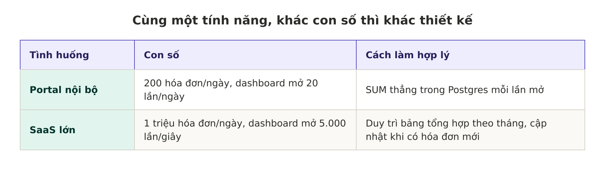

### Đọc nhiều hay ghi nhiều

Đây là một trong những câu hỏi đầu tiên khi thiết kế. Hỏi cho **từng tính năng**, không phải cả hệ thống.

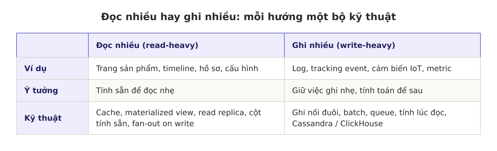

Các câu hỏi đi kèm:
- **Chấp nhận dữ liệu cũ bao lâu?** Timeline trễ 5 giây thì được, số dư ngân hàng thì không. Quyết định có dùng được cache và queue không.
- **Cần nhanh tới mức nào?** Người dùng chờ trực tiếp hay job chạy nền?
- **Có điểm nóng không?**
- **Dữ liệu lớn và tăng nhanh cỡ nào?**

---

## 9. Lấy con số load parameters bằng cách nào

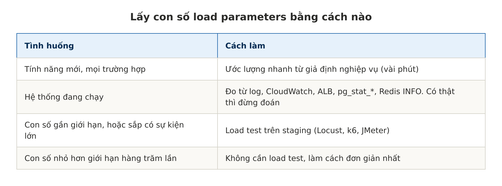

### 9.1. Ước lượng nhanh (hệ thống chưa có)

Hỏi nghiệp vụ: bao nhiêu người dùng, mỗi người làm thao tác đó mấy lần/ngày, có cao điểm không. Hai mẹo:
- 1 ngày ≈ 86.400 giây, làm tròn **≈ 100.000 giây**.
- Cao điểm thường gấp **2–10 lần** trung bình.

```
Ví dụ: tính năng nhập chi phí trong portal nội bộ
Ghi:  300 người × 20 khoản/ngày = 6.000/ngày ≈ 0,06/giây; cuối tháng ×10 ≈ 0,6/giây
Đọc:  300 người × 30 lần mở dashboard/ngày = 9.000/ngày ≈ 0,1/giây; cao điểm ≈ 1/giây
→ Chưa tới 1 request/giây: SUM thẳng trong Postgres, không cần cache hay bảng tổng hợp.
```

Research số liệu công khai (blog kỹ thuật, bài nói của các công ty) hữu ích để có số so sánh khi chưa có dữ liệu của mình.

### 9.2. Đo trực tiếp (hệ thống đang chạy)

**Request theo endpoint (CloudWatch Logs Insights):**
```
fields @timestamp, path, method
| filter ispresent(path)
| stats count(*) as requests by bin(1m), method, path
| sort requests desc
```
Xem theo từng phút để thấy đỉnh, đừng chỉ xem trung bình cả ngày. ALB có sẵn metric `RequestCount`.

**Đọc hay ghi nhiều, xem trong Postgres:**
```sql
SELECT relname,
       seq_scan + idx_scan               AS so_lan_doc,
       n_tup_ins + n_tup_upd + n_tup_del AS so_dong_ghi
FROM pg_stat_user_tables
ORDER BY so_lan_doc DESC;
```
Số tính từ lần reset gần nhất; chụp hai lần cách nhau một giờ rồi trừ đi.

**Query tốn nhất:** extension `pg_stat_statements`, hoặc RDS Performance Insights.

**Redis:** `INFO commandstats` cho biết mỗi lệnh chạy bao nhiêu lần.

**Fan-out và phân phối:** luôn xem **p99 và max**, không chỉ trung bình.
```sql
SELECT avg(cnt),
       percentile_cont(0.99) WITHIN GROUP (ORDER BY cnt),
       max(cnt)
FROM (SELECT followee_id, count(*) AS cnt FROM follows GROUP BY followee_id) t;
```

### 9.3. Load test (biết hệ thống chịu được tới đâu)

Ước lượng cho biết **tải sẽ là bao nhiêu**; load test cho biết **hệ thống chịu được bao nhiêu**.

1. Dựng bản chạy được trên staging, giống production nhất có thể.
2. Bơm dữ liệu giả quy mô thật (ví dụ `Faker` tạo 1 triệu hóa đơn).
3. Giả lập người dùng bằng Locust, k6 hoặc JMeter.
4. Tăng dần tải tới khi p99 latency vượt ngưỡng hoặc bắt đầu lỗi.

```python
# locustfile.py: tỉ lệ đọc/ghi lấy từ con số đã ước lượng
from locust import HttpUser, task, between

class PortalUser(HttpUser):
    wait_time = between(1, 3)

    @task(10)                      # đọc nhiều gấp 10 lần ghi
    def view_dashboard(self):
        self.client.get("/expenses/summary?month=2026-11")

    @task(1)
    def create_expense(self):
        self.client.post("/expenses", json={"amount": 150000, "category": "travel"})
```

Phần lớn trường hợp chỉ cần ước lượng là đủ biết không có gì phải lo. Load test dành cho lúc con số thật sự sát giới hạn.

---

## 10. Insight

1. **Không có thiết kế đúng cho mọi tải.** Query JOIN đơn giản hoàn hảo cho 1.000 user nhưng sụp ở 10 triệu user.
2. **Đổi việc đọc lấy việc ghi** là một trong những kỹ thuật quan trọng nhất. Hỏi trước: tính năng này đọc nhiều hay ghi nhiều?
3. **Trung bình chưa đủ, phải nhìn phân phối.** Trường hợp cực đoan mới làm sập hệ thống; đây là cầu nối sang phần percentile (p99) ngay sau trong sách.
4. **Case study gom gần hết Chương 1:** queue dàn tải, cache đọc nhanh, eventual consistency, batch/pipeline giảm lời gọi mạng, hệ phân tán gồm DB + Redis + queue + worker.
5. **Áp dụng ở quy mô nhỏ:** dashboard tổng hợp chậm hay danh sách thông báo từng user, cập nhật sẵn khi có sự kiện thay vì tính lại mỗi lần mở trang. Nhưng chỉ làm khi con số cho thấy cần.

---

## 11. Tài liệu tham khảo

- Martin Kleppmann, Chris Riccomini, *Designing Data-Intensive Applications*, 2nd edition, Chương 2.
- Raffi Krikorian, *Timelines at Scale* (QCon, Twitter, 2012–2013): https://www.infoq.com/presentations/Twitter-Timeline-Scalability/
- PostgreSQL, `pg_stat_statements`: https://www.postgresql.org/docs/current/pgstatstatements.html
- PostgreSQL, Materialized Views: https://www.postgresql.org/docs/current/rules-materializedviews.html
- Locust (load test bằng Python): https://locust.io
