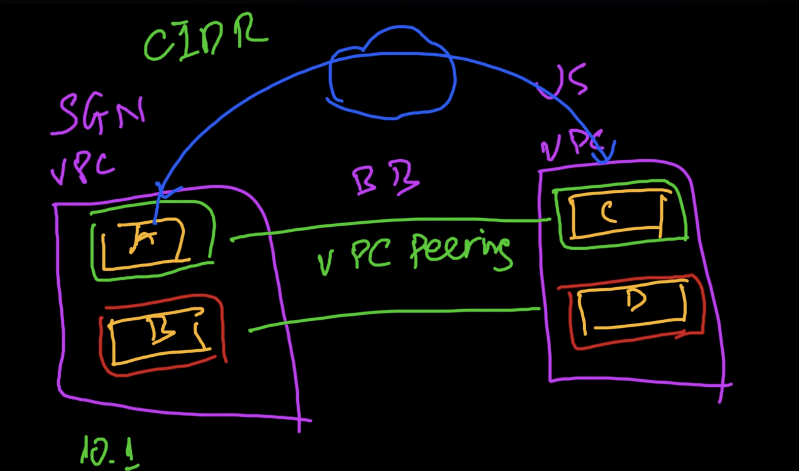
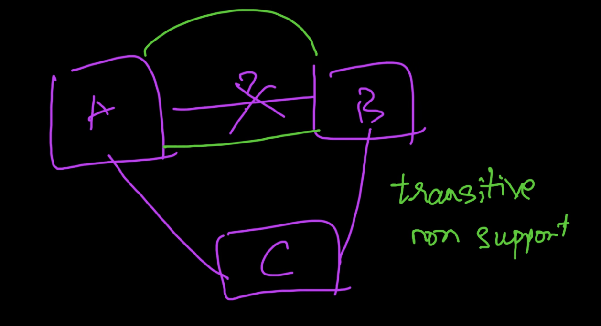

# vpc peerings
  
### new terms:
- AWS Back Bone: 

## context

- 2 VPC nằm ở 2 region khác nhau, trong VPC ở Singapore có server A (public subnet) + B (private subnet), VPC ở USA có server C (public subnet) + D (private subnet) thay vì traffic giữa các server này chạy thông qua public internet thì aws có hạ tầng riêng của nó, aws backbone
- để hai VPC 
=> VPC Peering

## prerequisite:
- hai dải CIDR ko được overlap nhau, vd VPC A có CIDR là 10.1.0.0/8 -> sẽ ko peering được với VPC B cũng có 10.1.0.0/8
- ko có tính chất bắc cầu =)
eg: 
- công thức tính số lượng peering dựa trên số lượng VPC: n*(n-1)/2

