# Performance: response time, throughput và percentile

Ghi chú tổng hợp từ DDIA (bản 2), Chương 2, các mục "Describing Performance", "Latency and Response Time", "Average, Median, and Percentiles" và "Use of Response Time Metrics", kèm phân tích và ví dụ.

---

## 1. Hai loại chỉ số hiệu năng

| Chỉ số | Là gì | Đơn vị |
|---|---|---|
| **Response time** | Từ lúc người dùng gửi request tới lúc nhận câu trả lời | giây, ms, µs |
| **Throughput** | Số request (hoặc lượng dữ liệu) hệ thống xử lý mỗi giây | "cái gì đó mỗi giây" |

Với một bộ phần cứng cố định, hệ thống có một **throughput tối đa**.

- Case study Twitter: số bài đăng/giây, số lần ghi timeline/giây là **throughput**; thời gian tải timeline, thời gian bài tới follower là **response time**.
- Service FastAPI: "xử lý 300 request/giây" là throughput; "`GET /invoices` trả về trong 80 ms" là response time.

**Response time** là thứ người dùng quan tâm nhất. **Throughput** quyết định cần bao nhiêu tài nguyên, tức là **chi phí**. Hệ thống **scalable** nếu throughput tối đa tăng đáng kể khi thêm tài nguyên. Scalable hay không phải xét ở **chỗ nghẽn**: thêm 10 task ECS cũng vô ích nếu mọi task cùng đè lên một Postgres đã chạy 95% CPU.

---

## 2. Càng gần giới hạn, response time càng tăng vọt

Khi tải thấp, response time gần bằng thời gian xử lý thuần. Khi tải tăng, request tới lúc CPU đang bận thì phải **xếp hàng**. Throughput càng gần mức tối đa, thời gian chờ càng tăng rất mạnh.

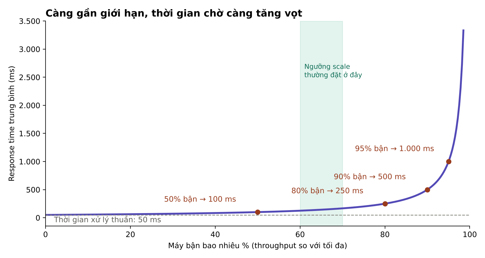

Theo mô hình xếp hàng đơn giản (một máy, request tới ngẫu nhiên): **response time trung bình ≈ thời gian xử lý ÷ (1 − mức độ bận)**. Với thời gian xử lý 50 ms:

| Máy bận | Response time trung bình |
|---|---|
| 50% | 100 ms |
| 80% | 250 ms |
| 90% | 500 ms |
| 95% | 1 giây |
| 99% | 5 giây |

Thời gian xử lý vẫn là 50 ms; phần tăng thêm hoàn toàn là **chờ tới lượt**.

**Hình dung:** quầy cà phê một nhân viên, mỗi ly 1 phút. Khách thưa thì tới là được pha ngay; khách gần một người mỗi phút thì tổng thời gian một khách mất khoảng 10 phút (chờ ~9 phút + pha 1 phút).

**Bài học:** đừng chạy sát 100%. Auto scaling của ECS thường đặt ngưỡng 60–70% CPU; phần dư đó giữ cho response time ổn định.

---

## 3. Khi hệ thống quá tải không tự hồi phục

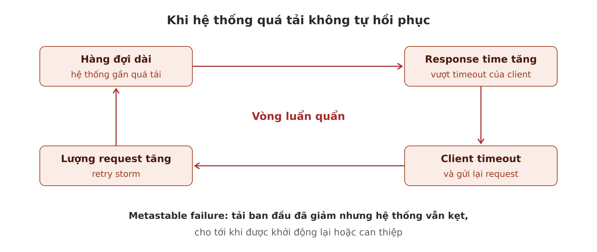

- **Retry storm:** hàng đợi dài → response time tăng → client timeout và gửi lại → lượng request còn tăng hơn.
- **Metastable failure:** kể cả khi tải đã giảm, hệ thống vẫn kẹt trong trạng thái quá tải cho tới khi khởi động lại.

**Ví dụ kinh điển:** Redis cache bị restart, mất sạch dữ liệu.
1. Mọi request cache miss, đổ thẳng xuống Postgres.
2. Postgres quá tải, query chậm từ 20 ms lên 5 giây.
3. App timeout sau 3 giây, kết quả không bao giờ kịp ghi vào cache.
4. Client retry, Postgres càng quá tải.
5. Cache mãi không đầy lại được, dù lượng người dùng không hề tăng.

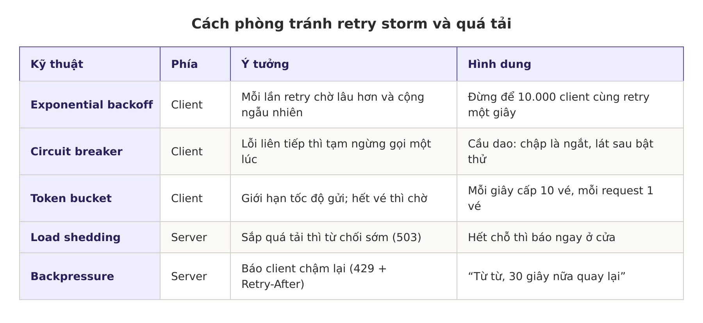

Thuật toán xếp hàng và cân bằng tải cũng tạo ra khác biệt. HubSpot trả `429 Too Many Requests` chính là backpressure từ phía họ.

**Backoff có ngẫu nhiên (jitter) với `tenacity`:**

```python
from tenacity import retry, stop_after_attempt, wait_random_exponential, retry_if_exception
import httpx

def _is_retryable(e: BaseException) -> bool:
    if isinstance(e, httpx.TimeoutException):
        return True
    return isinstance(e, httpx.HTTPStatusError) and (e.response.status_code == 429 or e.response.status_code >= 500)


@retry(
    wait=wait_random_exponential(multiplier=0.5, max=20),  # chờ tăng dần, có ngẫu nhiên, tối đa 20 s
    stop=stop_after_attempt(5),                            # tối đa 5 lần
    retry=retry_if_exception(_is_retryable),                # chỉ retry timeout / 429 / 5xx, không retry 4xx còn lại
)
async def call_hubspot(client: httpx.AsyncClient, payload: dict):
    resp = await client.post(HUBSPOT_URL, json=payload, timeout=10)
    resp.raise_for_status()
    return resp.json()
```

Phải đi cùng nhau: **có giới hạn số lần**, **chờ tăng dần**, **có ngẫu nhiên**, và thao tác **idempotent**.

**Load shedding đơn giản trong FastAPI:**

```python
import asyncio
from fastapi import Request
from fastapi.responses import JSONResponse

MAX_IN_FLIGHT = 100
sem = asyncio.Semaphore(MAX_IN_FLIGHT)

@app.middleware("http")
async def shed_load(request: Request, call_next):
    if sem.locked():                                   # đã đủ 100 request đang chạy
        return JSONResponse({"error": "overloaded"}, status_code=503,
                            headers={"Retry-After": "2"})
    async with sem:
        return await call_next(request)
```

Từ chối nhanh một request tốt hơn nhận vào rồi để nó chờ 30 giây, timeout, và bị gửi lại.

---

## 4. Latency, response time và các thuật ngữ liên quan

| Thuật ngữ | Nghĩa |
|---|---|
| **Response time** | Thứ **client nhìn thấy**, gồm mọi khoảng trễ ở mọi chỗ |
| **Service time** | Thời gian service **thực sự đang xử lý** request |
| **Queueing delay** | Thời gian **chờ**: chờ CPU rảnh, response chờ trong buffer vì card mạng bận... |
| **Latency** | Từ chung cho khoảng thời gian request **không được xử lý** (đang "nằm chờ") |
| **Network latency** | Thời gian request và response **đi trên mạng** |

```
Response time = network latency (đi) + queueing delay + service time + queueing delay + network latency (về)
```

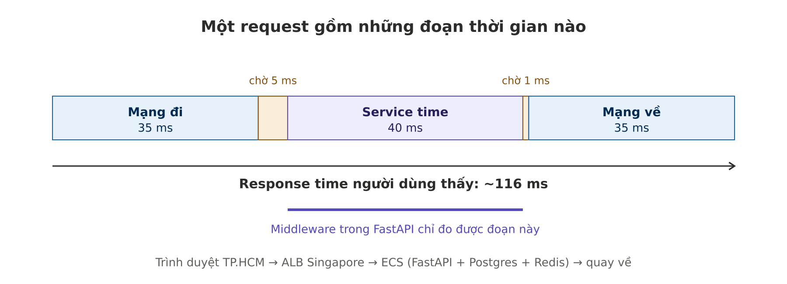

Sách dùng kiểu sơ đồ: thời gian chạy từ trái sang phải, mỗi node là một đường ngang, mỗi message là một mũi tên chéo. Kiểu này xuất hiện rất nhiều trong sách.

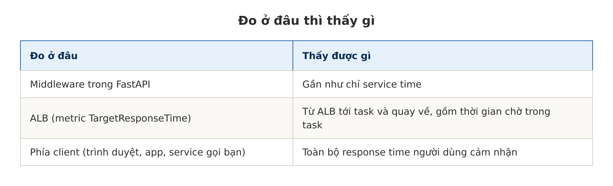

---

## 5. Cùng một request, mỗi lần một khác

Những thứ thêm độ trễ ngẫu nhiên:
- Hệ điều hành chuyển CPU sang tiến trình chạy nền (context switch).
- Mất gói tin và TCP gửi lại.
- Garbage collector tạm dừng chương trình.
- Page fault buộc đọc từ đĩa.
- Rung động cơ học trong rack server (có video nổi tiếng của Brendan Gregg hét vào dãy ổ cứng làm độ trễ đĩa vọt lên).

### Head-of-line blocking

Thời gian chờ thường chiếm phần lớn sự dao động của response time. Server chỉ xử lý song song được ít việc (giới hạn bởi số core), nên **vài request chậm đủ chặn các request phía sau**. Request sau dù xử lý nhanh, client vẫn thấy chậm. Thời gian chờ không nằm trong service time, nên **phải đo response time ở phía client**.

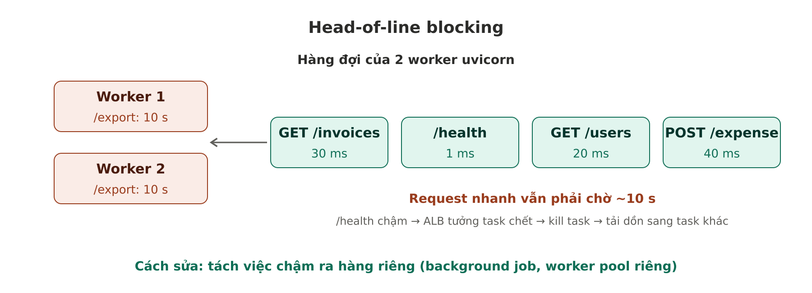

**Hình dung:** bạn mua một chai nước, người phía trước có ba xe đẩy đầy. Quầy "dưới 5 món" sinh ra để chữa chuyện này.

**Lỗi hay gặp: chặn event loop trong FastAPI async**

```python
@app.get("/report")
async def report():
    data = requests.get(SLOW_URL).json()   # thư viện đồng bộ: CHẶN cả event loop 3 giây
    return data
```

Một worker async chỉ có một event loop; lời gọi đồng bộ khiến **mọi request khác** vào worker đó phải chờ. Cách sửa:
- Dùng thư viện async (`httpx.AsyncClient`).
- Hoặc khai báo endpoint bằng `def` thường (FastAPI chạy trong threadpool), hoặc `run_in_threadpool`.
- Việc nặng (export, sync lớn) đẩy ra **background job** (SQS + worker riêng).

---

## 6. Trung bình, median và percentile

Response time là một **phân phối**, không phải một con số. Phần lớn request nhanh, thỉnh thoảng có **outlier** chậm hơn hẳn. Sự dao động của độ trễ mạng gọi là **jitter**.

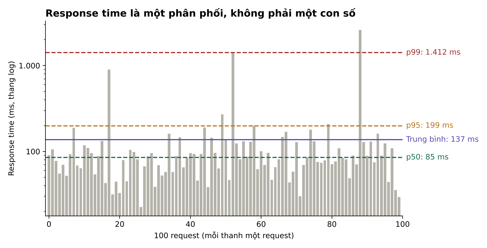

- **Trung bình (mean):** có ích để **ước lượng giới hạn throughput**, nhưng không cho biết response time "điển hình", vì không cho biết bao nhiêu người thật sự gặp độ trễ đó.
- **Median (p50):** một nửa request nhanh hơn, một nửa chậm hơn. Chỉ số tốt cho "người dùng thường chờ bao lâu".
- **p95, p99, p999:** cho biết outlier tệ cỡ nào. p95 = 1,5 s nghĩa là 5/100 request mất từ 1,5 s trở lên.

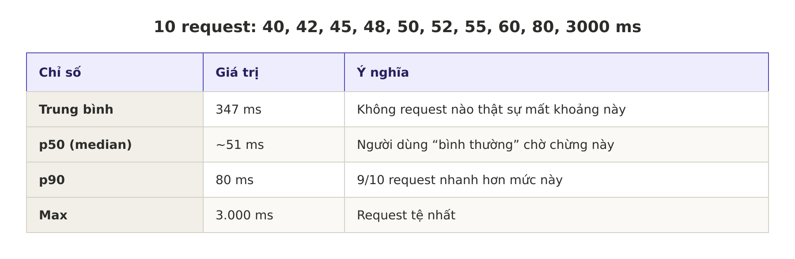

**Trung bình dùng để làm gì? Định luật Little:**

```
Số request đang xử lý cùng lúc = throughput × response time trung bình
```

200 request/giây × 0,1 giây = **20 request cùng lúc** → cần ít nhất ~20 worker hoặc connection DB, chưa tính phần dư.

**Cách xem percentile:**

```python
import numpy as np
print(np.percentile([40, 42, 45, 48, 50, 52, 55, 60, 80, 3000], [50, 95, 99]))
```

- CloudWatch metric: chọn statistic `p50`, `p95`, `p99` thay vì `Average` (ví dụ `TargetResponseTime` của ALB).
- CloudWatch Logs Insights: `stats pct(ms, 50) as p50, pct(ms, 95) as p95, pct(ms, 99) as p99 by bin(5m)`
- Prometheus: histogram + `histogram_quantile`.

### Tail latency và cách Amazon chọn p99.9

Percentile cao gọi là **tail latency**. Amazon đặt yêu cầu cho service nội bộ theo **p99.9**, vì khách có request chậm nhất thường là khách **có nhiều dữ liệu nhất**, tức mua nhiều nhất, **giá trị nhất**. Nhưng **p99.99** bị đánh giá là quá đắt: percentile rất cao dễ bị sự kiện ngẫu nhiên ảnh hưởng, lợi ích giảm dần.

**Ví dụ multi-tenant:** tenant nhỏ (500 hóa đơn) mở dashboard trong 50 ms; tenant lớn nhất (2 triệu hóa đơn) mất 8 giây. Tenant lớn có thể chỉ chiếm 0,5% request nên p50, p95 vẫn đẹp, nhưng đó lại là khách trả tiền nhiều nhất.

---

## 7. Response time ảnh hưởng người dùng thế nào

Rất khó có số liệu đáng tin; nhiều con số hay được trích dẫn không đáng tin.

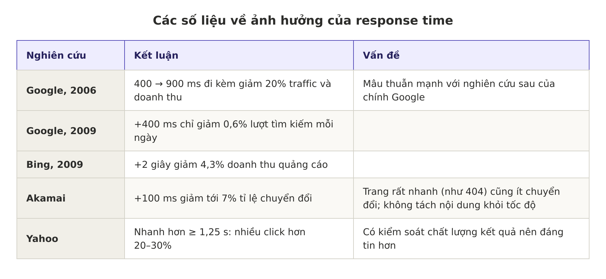

**Bài học từ Akamai: tương quan không phải nhân quả.** Trang nhanh ít chuyển đổi vì có yếu tố thứ ba (trang 404 vừa nhanh vừa chẳng ai mua). Yahoo đáng tin hơn vì đã kiểm soát chất lượng kết quả.

Thấy câu kiểu "cứ 100 ms chậm là mất 1% doanh thu" thì hỏi: số đó từ đâu, đo trên sản phẩm nào, có kiểm soát yếu tố khác không. Cách đáng tin nhất là **tự A/B test** trên sản phẩm của mình.

---

## 8. Tail latency amplification

Backend bị gọi nhiều lần trong một request người dùng: **kể cả gọi song song, vẫn phải chờ lời gọi chậm nhất**. Chỉ cần một lời gọi chậm là cả request chậm.

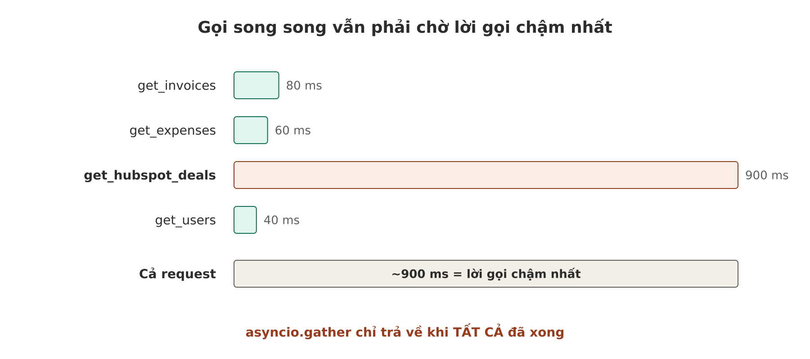

```python
async def build_dashboard(tenant_id: str):
    invoices, expenses, deals, users = await asyncio.gather(
        get_invoices(tenant_id),      #  80 ms
        get_expenses(tenant_id),      #  60 ms
        get_hubspot_deals(tenant_id), # 900 ms  <- lần này HubSpot chậm
        get_users(tenant_id),         #  40 ms
    )
    return render(invoices, expenses, deals, users)   # cả request: ~900 ms
```

Nếu mỗi backend có 1% lời gọi chậm, xác suất request người dùng bị chậm là `1 − 0,99^N`:

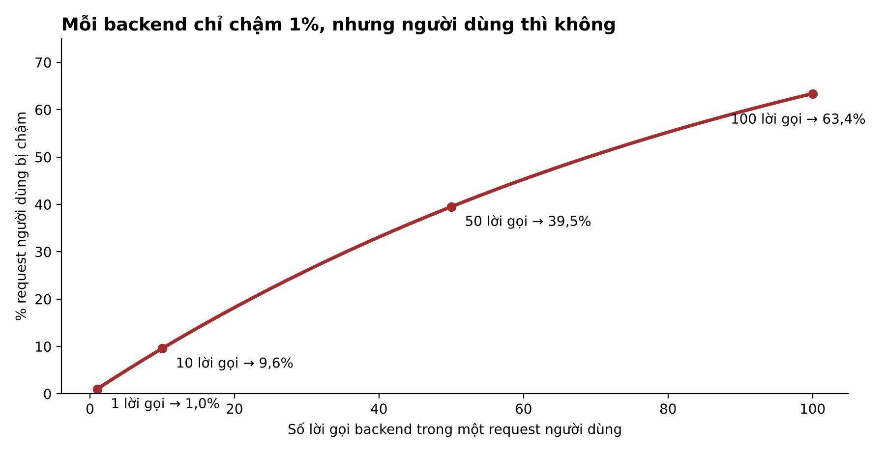

Với 100 lời gọi, gần 2/3 request người dùng bị chậm: **p99 của backend trở thành trải nghiệm của phần lớn request người dùng (~63% ở N=100)**.

**Cách giảm (tham khảo thêm):**
- Giảm số lời gọi: gom dữ liệu, cache, tránh fan-out không cần.
- Timeout và trả kết quả một phần (HubSpot quá 300 ms thì hiện dashboard thiếu phần deals, kèm "đang tải").
- **Hedged request:** chờ quá mức p95 thì gửi thêm request tới replica khác, lấy kết quả về trước (*The Tail at Scale*, Dean & Barroso, 2013).

---

## 9. SLO và SLA

Percentile thường dùng để định nghĩa SLO và SLA.

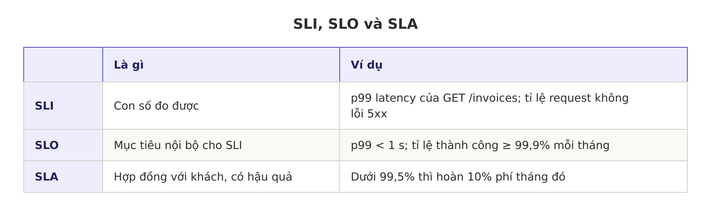

- Ví dụ SLO trong sách: median < 200 ms, p99 < 1 s, ít nhất 99,9% request hợp lệ không lỗi.
- SLA là **hợp đồng**: không đạt SLO thì có hậu quả (ví dụ hoàn tiền). SLA thường lỏng hơn SLO để có khoảng dư.
- AWS công bố SLA cho nhiều dịch vụ; vi phạm thì khách nhận **service credit**.

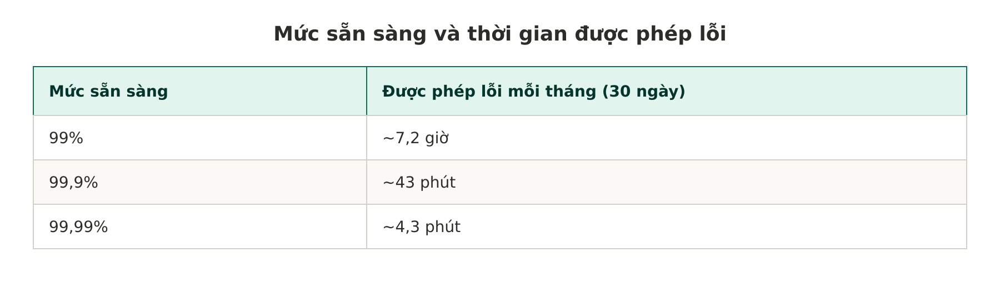

Khoảng được phép lỗi gọi là **error budget**: còn nhiều thì thoải mái deploy tính năng, sắp hết thì tập trung vào ổn định.

**Vì sao định nghĩa SLO không đơn giản:**
- Request "hợp lệ" là gì? Lỗi 400 do client gửi sai có tính không?
- Đo ở đâu: app, ALB hay phía người dùng?
- Trả 200 nhưng dữ liệu rỗng do lỗi bên trong thì sao?
- Chậm 30 giây nhưng không lỗi có tính là "không sẵn sàng" không?

---

## 10. Tính percentile thế nào

- Giữ **cửa sổ trượt** (ví dụ 10 phút gần nhất), mỗi phút tính median và percentile rồi vẽ lên biểu đồ.
- Cách đơn giản nhất: giữ mọi giá trị, mỗi phút sắp xếp lại. 1.000 request/giây × 10 phút = 600.000 giá trị mỗi lần sắp, nhân với nhiều endpoint và task thì nặng.
- Thuật toán **xấp xỉ** tốn rất ít CPU và RAM: **HdrHistogram, t-digest, OpenHistogram, DDSketch**.

**Ý tưởng histogram:** chỉ đếm số request rơi vào từng khoảng.

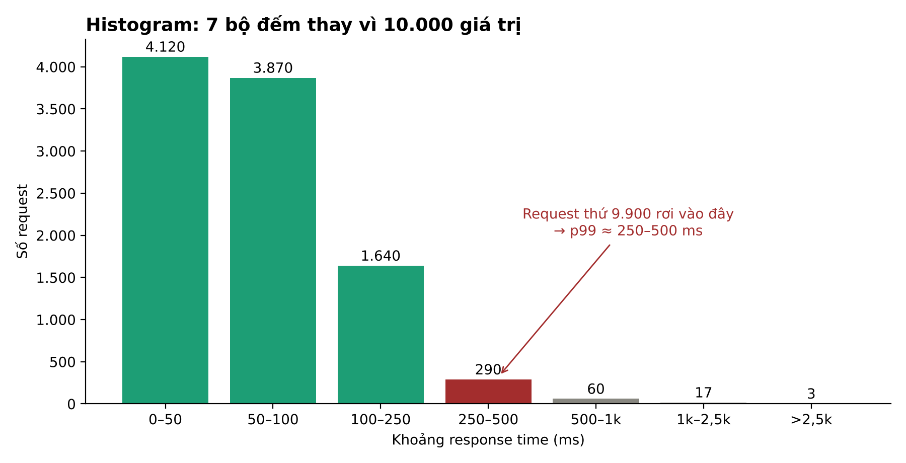

Trên thực tế hầu như không phải tự cài: Prometheus histogram, CloudWatch percentile, Datadog đã làm sẵn.

```python
from prometheus_client import Histogram

REQUEST_TIME = Histogram(
    "http_request_duration_seconds", "Thời gian xử lý request",
    ["path"],
    buckets=[0.05, 0.1, 0.25, 0.5, 1, 2.5],
)

with REQUEST_TIME.labels(path="/invoices").time():
    handle_request()
```

### Không được lấy trung bình các percentile

Lấy trung bình percentile (để giảm độ phân giải thời gian hay gộp nhiều máy) là **vô nghĩa về mặt toán học**. Cách đúng là **cộng các histogram**.

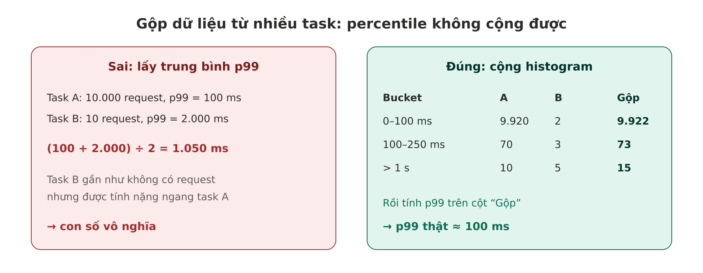

**Prometheus**, cộng histogram rồi mới tính percentile:

```promql
histogram_quantile(0.99,
  sum by (le) (rate(http_request_duration_seconds_bucket[5m])))
```

Tính p99 từng task rồi `avg` là mắc đúng lỗi sách cảnh báo.

**CloudWatch:** muốn p99 theo giờ thì chọn statistic `p99` với period 1 giờ; đừng tự lấy trung bình 60 giá trị p99 từng phút.

---

## 11. Insight

1. **Đo ở phía client.** Log trong server chỉ thấy service time; người dùng cảm nhận cả mạng lẫn thời gian chờ.
2. **Gần giới hạn là nguy hiểm.** Response time tăng vọt khi gần đầy; giữ khoảng dư công suất là điều kiện để ổn định.
3. **Retry vừa cứu vừa giết.** Không backoff, không giới hạn, không ngẫu nhiên là con đường ngắn nhất tới retry storm. Server cần tự vệ bằng load shedding và backpressure.
4. **Tách việc chậm khỏi việc nhanh** để tránh head-of-line blocking.
5. **Dashboard nên có p50, p95, p99**, không chỉ Average. p50 là người dùng điển hình, p99 là người dùng bất hạnh nhất, thường cũng là khách lớn nhất.
6. **Càng nhiều lời gọi, p99 càng quan trọng.** Mỗi lời gọi thêm vào tăng xác suất dính lời gọi chậm; thêm một lý do để không tách microservice khi chưa cần.
7. **SLO phải đủ cụ thể để đo:** đo cái gì, ở đâu, request nào được tính.
8. **Percentile không cộng được, histogram thì cộng được.**
9. **Biết dừng ở đâu** (Amazon chọn p99.9, không phải p99.99) và **hoài nghi số liệu được trích dẫn**.

---

## 12. Tài liệu tham khảo

- Martin Kleppmann, Chris Riccomini, *Designing Data-Intensive Applications*, 2nd edition, Chương 2.
- Jeffrey Dean, Luiz André Barroso, *The Tail at Scale*, Communications of the ACM, 2013.
- Nathan Bronson và cộng sự, *Metastable Failures in Distributed Systems*, HotOS 2021.
- Google SRE Book, chương *Service Level Objectives*: https://sre.google/sre-book/service-level-objectives/
- Prometheus, *Histograms and summaries*: https://prometheus.io/docs/practices/histograms/
- HdrHistogram: http://hdrhistogram.org
- Tenacity (retry cho Python): https://tenacity.readthedocs.io
